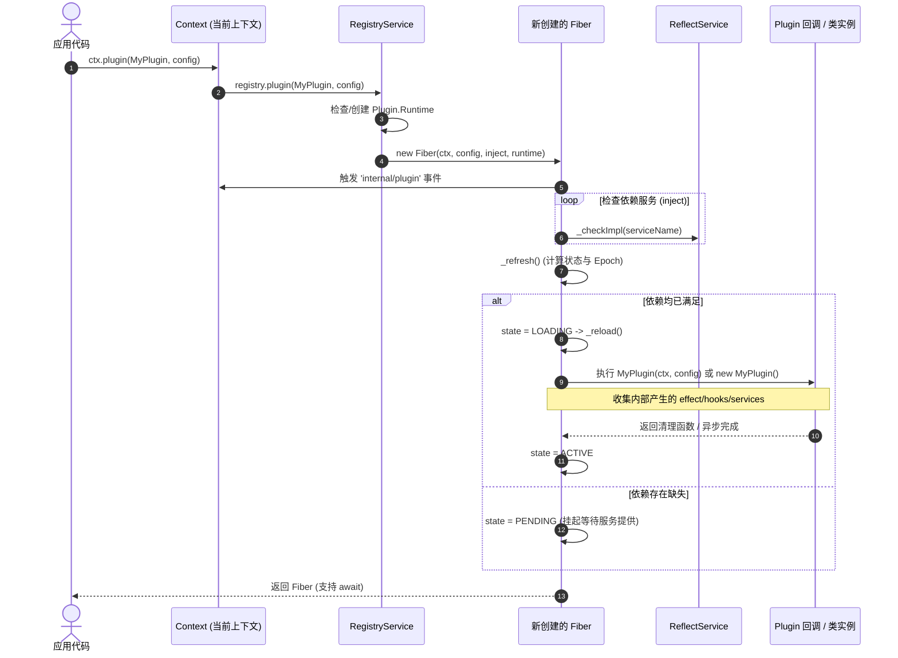
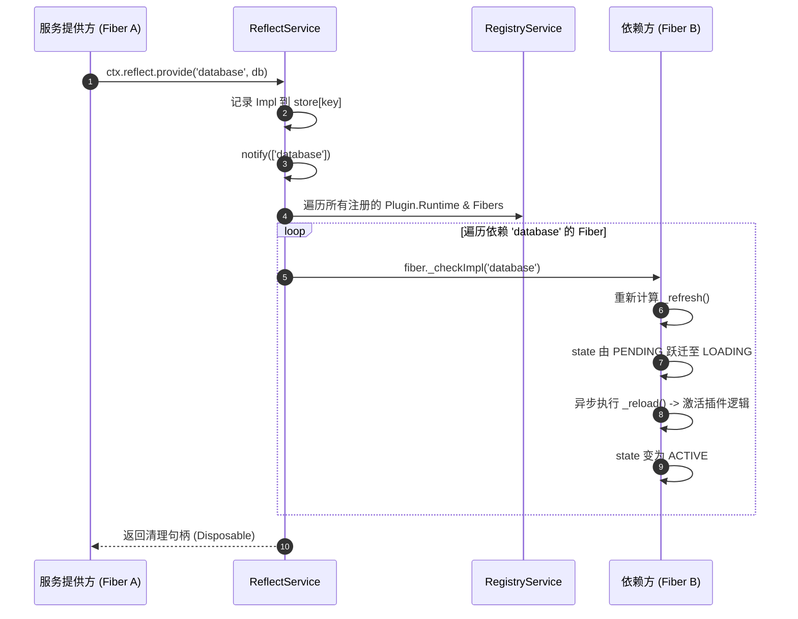
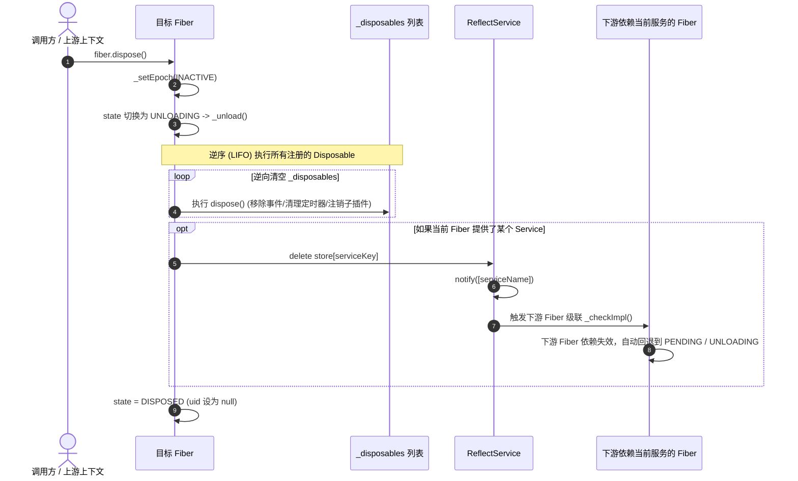

# 02. 架构设计与体系结构

## 1. Monorepo 模块分层结构

Cordis 采用 Monorepo 架构组织代码，将核心运行时、配置编排器、热重载引擎与生态插件解耦，形成清晰的分层体系：

```
                              ┌───────────────────────────────────┐
                              │            CLI & Tools            │
                              │        create-cordis (脚手架)      │
                              └─────────────────┬─────────────────┘
                                                │
                              ┌─────────────────▼─────────────────┐
                              │     Declarative Orchestration     │
                              │    @cordisjs/plugin-loader        │
                              │    @cordisjs/plugin-include       │
                              └─────────────────┬─────────────────┘
                                                │
                              ┌─────────────────▼─────────────────┐
                              │       Ecosystem & Services        │
                              │   plugin-timer  │ plugin-group    │
                              │   plugin-hmr    │ logger-console  │
                              └─────────────────┬─────────────────┘
                                                │
                              ┌─────────────────▼─────────────────┐
                              │           Core Runtime            │
                              │           cordis (核心)            │
                              │ Context • Fiber • Service • Events│
                              └───────────────────────────────────┘
```

### 各子包职责一览

| Package | 职责与定位 |
| :--- | :--- |
| **`cordis`** (`packages/core`) | **核心运行时**。提供 `Context`、`Fiber` 状态机、`Service` 抽象类、`Events` 事件服务、`Registry` 插件注册表、`Reflect` 属性代理、`Logger` 日志抽象与 `Effect` 副作用收集。 |
| **`@cordisjs/plugin-loader`** (`packages/loader`) | **声明式配置加载器**。管理插件的拓扑树（`EntryTree`）、项（`Entry`）与分组（`EntryGroup`），支持命名空间隔离（`Isolate`）与 Node.js 模块动态导入。 |
| **`@cordisjs/plugin-include`** (`packages/include`) | **配置文件集成**。支持读取 `cordis.yml` / `.json`，监听外部文件变更并自动回写，支持配置打补丁（Patches）。 |
| **`@cordisjs/plugin-hmr`** (`packages/hmr`) | **代码热重载服务**。基于 Node.js 内部 ESM 加载器劫持，分析模块依赖图，实现零停机的细粒度插件代码热更与原子回滚。 |
| **`@cordisjs/plugin-timer`** (`packages/timer`) | **生命周期绑定的定时器**。提供 `ctx.timeout`、`ctx.interval`、`ctx.throttle`、`ctx.debounce`，插件卸载时自动清理。 |
| **`@cordisjs/plugin-group`** (`packages/group`) | **插件容器分组**。将多个插件组合为一个逻辑单元，支持批量启停与作用域隔离。 |
| **`@cordisjs/plugin-logger-console`** (`packages/logger-console`) | **终端炫彩日志导出器**。提供多级别彩色格式化、毫秒级耗时差计算与多行自动缩进。 |
| **`@cordisjs/plugin-utils`** (`packages/utils`) | **上下文感知工具集合**。提供如 `List<T>` 等在上下文销毁时自动移除元素的工具类。 |
| **`create-cordis`** (`packages/create`) | **项目脚手架**。交互式创建 Cordis 项目，自动配置 Yarn Berry / npm 环境与初始模板。 |

---

## 2. 核心对象与类关系模型

Cordis 的核心是一个以 `Context` 为纽带，深度协作的对象图：

```mermaid
classDiagram
    direction TB

    class Context {
        +root: Context
        +baseUrl: string
        +events: EventsService
        +logger: LoggerService
        +reflect: ReflectService
        +registry: RegistryService
        +fiber: Fiber
        +extend(meta): Context
        +isolate(name, label): Context
        +intercept(name, config): Context
        +plugin(plugin, config): Fiber
        +inject(deps, callback): Fiber
        +provide(name, value): Function
        +on(event, listener): Function
        +emit(event, ...args): void
        +parallel(event, ...args): Promise
        +serial(event, ...args): Promise
        +bail(event, ...args): any
        +waterfall(event, ...args, next): any
    }

    class Fiber {
        +uid: number
        +ctx: Context
        +config: any
        +state: FiberState
        +inject: Dict
        +runtime: Plugin.Runtime
        +store: Dict~Impl~
        +dispose(): Promise~void~
        +restart(): Promise~void~
        +update(config): void
        +effect(execute, label): Disposable
        +await(): Promise~Fiber~
    }

    class PluginRuntime {
        +name: string
        +fibers: DisposableList~Fiber~
        +callback: Function
        +Config: StandardSchema
    }

    class Service {
        +name: string
        #ctx: Context
        +constructor(ctx, name)
        +[Service.init](): any
        +[Service.check](): boolean
        +[Service.invoke](): any
    }

    class ReflectService {
        +store: Dict~Impl~
        +props: Dict~Property~
        +get(name, strict): any
        +set(name, value): boolean
        +provide(name, value, check): Disposable
        +notify(names): Fiber[]
        +mixin(source, mixins): Disposable
        +accessor(name, options): Disposable
    }

    class EventsService {
        +_hooks: Record
        +on(name, listener, options): Disposable
        +once(name, listener, options): Disposable
        +emit(name, ...args): void
        +parallel(name, ...args): Promise
        +serial(name, ...args): Promise
        +bail(name, ...args): any
        +waterfall(name, ...args, next): any
    }

    class RegistryService {
        +size: number
        +plugin(plugin, config): Fiber
        +inject(deps, callback): Fiber
        +get(plugin): PluginRuntime
        +has(plugin): boolean
        +delete(plugin): PluginRuntime
    }

    Context "1" *-- "1" Fiber : 包含执行纤维
    Context "1" *-- "1" ReflectService : 属性代理与服务注册
    Context "1" *-- "1" EventsService : 事件分发中心
    Context "1" *-- "1" RegistryService : 插件注册管理器
    Context ..> Service : 承载与调用服务
    Fiber o-- PluginRuntime : 隶属于
    PluginRuntime "1" o-- "n" Fiber : 拥有多个实例
    ReflectService ..> Fiber : 依赖变更通知唤醒
```



---

## 3. 核心控制流与生命周期时序

### 1. 插件挂载与激活流（Plugin Loading Flow）

当开发者调用 `ctx.plugin(MyPlugin, config)` 时，Cordis 内部经历以下执行流：



---

### 2. 服务提供与级联唤醒流（Service Provision & Cascade Activation）

当某个服务通过 `ctx.provide('database', dbInstance)` 提供，或服务插件启动时：



---

### 3. 逆序副作用清理与卸载流（Dispose & Cascade Teardown）

当插件被显式销毁，或其依赖的服务下线时：



---

## 4. 架构设计的核心优势总结

1. **确定性与无竞态（Deterministic State Transition）**：基于单调递增的 `uid` 与 `epoch` 标识，配合 `inertia` Promise 链，确保任何高并发或异步重载下的最终状态完全一致。
2. **天然的树状隔离结构**：通过原型链继承与 Proxy 拦截，上下文的派生（`extend`）、隔离（`isolate`）和配置拦截（`intercept`）具有零额外空间开销。
3. **精准调用栈溯源（Long Stack Traces）**：内置 `composeError` 与 `buildOuterStack`，即使跨越复杂的异步调度和嵌套 Fiber，错误日志也能清晰还原触发源头。
