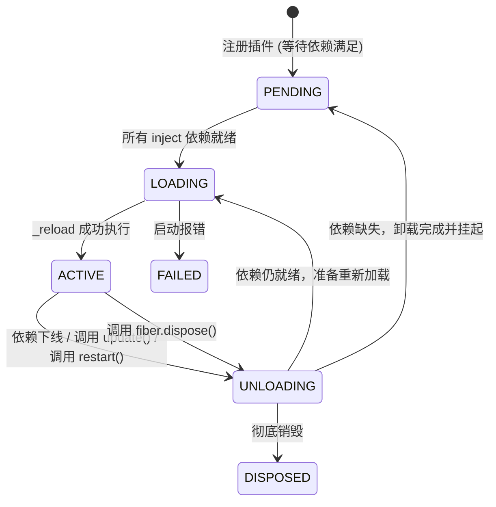

# 03. 核心机制剖析：Context、Fiber 与 Effect

Cordis 的核心运行机制建立在三大基石之上：**Context（上下文）**、**Fiber（执行纤维）** 与 **Effect（副作用管控）**。本章将深入源码级别剖析它们的设计思想与实现细节。

---

## 1. Context（上下文系统）

`Context` 是 Cordis 应用的运行环境载体。所有插件的注册、服务的访问、事件的监听和配置的读取都发生在某个具体的 `Context` 实例上。

### 1.1 原型链派生（Prototypal Context Tree）

不同于传统框架中沉重、庞大的 DI 容器，Cordis 的 Context 基于 JavaScript 原型链（`Object.create()`）实现轻量派生：

```typescript
// packages/core/src/context.ts
extend(meta = {}): this {
  const shadow = Reflect.getOwnPropertyDescriptor(this, symbols.shadow)?.value
  const self = Object.create(getTraceable(this, this))
  for (const prop of Reflect.ownKeys(meta)) {
    Object.defineProperty(self, prop, Reflect.getOwnPropertyDescriptor(meta, prop)!)
  }
  if (!shadow) return self
  return Object.assign(Object.create(self), { [symbols.shadow]: shadow })
}
```

- **极低内存开销**：派生子上下文只是创建一个以父上下文为原型的新对象，共享父上下文的所有能力。
- **向下继承与向上隔离**：子上下文可以访问父上下文中的服务和属性；子上下文进行的属性修改（如通过 `meta` 传入的局部字段）只存在于自身，不污染父级。

### 1.2 Proxy 代理与严格访问控制

每个 `Context` 在实例化时都会被 `ReflectService.handler` 代理：

```typescript
// packages/core/src/context.ts
constructor() {
  this[symbols.isolate] = Object.create(null)
  this[symbols.intercept] = Object.create(null)
  const self = new Proxy<this>(this, ReflectService.handler)
  this.root = self
  ...
  return self
}
```

#### 严格的读写权限检查机制
为了保证模块边界清晰，Cordis 在属性访问上实施了极强的安全防护：
1. **读保护（未声明 Inject 禁止读取）**：
   如果一个插件试图访问 `ctx.database`，但该插件未在其 `inject` 列表中声明 `database`，Proxy 拦截器将直接抛出异常：
   ```
   Error: cannot get property "database" without inject
   ```
   如果插件虽然声明了 `inject: ['database']`，但当前环境下 `database` 服务尚未激活或已被卸载，则抛出：
   ```
   Error: cannot get required service "database" in inactive context
   ```
2. **写保护（未声明 Provide 禁止修改）**：
   如果代码尝试直接给上下文赋值 `ctx.foo = 123`，而 `foo` 没有通过 `ctx.provide('foo')` 声明为服务或属性访问器，则拦截器直接报错：
   ```
   Error: cannot set property "foo" without provide
   ```

### 1.3 核心 Symbol 标识

- `symbols.shadow`：影子上下文，用于在追踪链路中保持对原始创建者上下文的引用。
- `symbols.caller`：指向当前方法调用者的上下文。
- `symbols.receiver`：动态属性或方法调用的接收者。
- `symbols.tracker`：追踪器配置元数据。

---

## 2. Fiber（执行纤维与生命周期调度）

`Fiber` 是插件在 `Context` 中加载并运行的具体实体。每个 `ctx.plugin(plugin)` 调用都会产生一个对应的 `Fiber` 实例。

### 2.1 六大生命周期状态机



| 状态 | 枚举值 | 含义 |
| :--- | :--- | :--- |
| `PENDING` | 0 | **挂起等待中**。插件已注册，但某些 `inject` 依赖服务未就绪。 |
| `LOADING` | 1 | **正在加载**。依赖全部就绪，正在异步调用插件入口与初始化逻辑。 |
| `ACTIVE` | 2 | **活跃运行中**。插件逻辑执行完毕，所有副作用正常运行。 |
| `FAILED` | 3 | **加载失败**。插件在执行过程中抛出未捕获异常。 |
| `DISPOSED` | 4 | **已彻底销毁**。Fiber 被永久注销，`uid` 被置为 `null`。 |
| `UNLOADING` | 5 | **正在卸载**。正在逆序清理注册的 Disposables。 |

### 2.2 惯性锁（Inertia Lock）与状态同步

在高度动态的环境中，服务可能瞬间被多次注册、注销、重载。为避免并发异步操作导致状态错乱，Fiber 引入了 `this.inertia` 惯性锁机制：

```typescript
// packages/core/src/fiber.ts
private _setEpoch(epoch: string) {
  const oldEpoch = this._runner.epoch
  if (epoch === oldEpoch) return
  this._runner.epoch = epoch
  if (this.inertia) return // 如果当前有正在进行的装载/卸载任务，排队等待
  this._updateState(() => {
    if (epoch !== INACTIVE && oldEpoch === INACTIVE) {
      this.inertia = this._reload()
      return FiberState.LOADING
    } else {
      this.inertia = this._unload()
      return FiberState.UNLOADING
    }
  })
}
```

- 当 `_reload()` 正在执行时，如果外部触发了重载或依赖变更（Epoch 改变），`_reload()` 执行完毕后会立刻检查当前 Epoch，并自动衔接进入 `_unload()` 重新轮转，直到状态收敛。
- `fiber.await()` 会等待 `this.inertia` 彻底稳定。

### 2.3 配置校验与 Standard Schema

Cordis 拥抱了统一的配置校验标准规范（`@standard-schema/spec`），无缝兼容 Zod、Valibot、ArkType、Schemastery 等主流校验库：

```typescript
export function resolveConfig(runtime: Plugin.Runtime, config: any) {
  if (!runtime.Config) return config
  const result = runtime.Config['~standard'].validate(config)
  if (result.issues) {
    throw new ValidationError(result.issues)
  }
  return result.value
}
```

---

## 3. Effect（副作用管控体系）

插件在运行时会产生各种对外部环境的改变（事件监听、定时器、DOM 节点、子进程）。在 Cordis 中，这些操作统称为 **Effect（副作用）**。

### 3.1 四种 Effect 声明形式

`ctx.effect(callback)` 提供了极度灵活且强大的声明形式：

#### 1. 同步清理函数（Sync Function）
```typescript
ctx.effect(() => {
  const conn = createConnection()
  return () => conn.close() // 返回清理回调
}, 'database.connect')
```

#### 2. 生成器模式（Generator / `yield`）
在生成器中，通过 `yield` 逐步产出清理函数：
```typescript
ctx.effect(function* () {
  const server = createServer()
  yield () => server.close()

  const watcher = watchFiles()
  yield () => watcher.stop()
}, 'server.init')
```

#### 3. 异步函数模式（Async Function）
```typescript
ctx.effect(async () => {
  const client = await connectAsync()
  return () => client.disconnect()
})
```

#### 4. 异步生成器模式（Async Generator / `async yield`）
支持在分阶段异步初始化的过程中逐步注册清理回调：
```typescript
ctx.effect(async function* () {
  yield () => earlyCleanup()
  const resource = await loadHeavyResource()
  yield () => resource.dispose()
})
```

### 3.2 逆序释放保证（LIFO Destruction）

当 Fiber 卸载或重载时，所有被收集的 Disposables 按照**后进先出（LIFO, Last-In-First-Out）**的顺序严格逆序执行。
- 确保后初始化的子资源先被释放，先初始化的基础设施后被释放，避免依赖项提前丢失引发崩溃。

### 3.3 堆栈追踪保持（Stack Trace Composition）

在异步事件和生成器调度中，原生 JavaScript 的 Error Stack 往往会丢失触发源头的调用栈。Cordis 通过 `composeError` 与 `buildOuterStack` 工具，动态将外部调用位置拼接到错误栈顶端：

```typescript
// packages/core/src/utils.ts
export function composeError<T>(callback: (info: StackInfo) => T, getOuterStack = buildOuterStack()): T {
  const info: StackInfo = { offset: 1, error: new Error() }
  try {
    const result: any = callback(info)
    if (isObject(result) && 'then' in result) {
      return (result as any).then(undefined, (reason) => handleError(info, reason, getOuterStack)) as T
    }
    return result
  } catch (reason: any) {
    handleError(info, reason, getOuterStack)
  }
}
```

无论插件在多层嵌套的异步闭包中抛出何种异常，控制台都能输出清晰易懂的原始调用位置定位。
