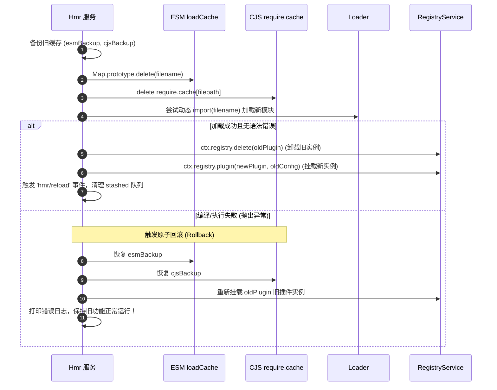

# 07. 模块热重载（HMR）引擎原理

在 Node.js 服务端开发中，传统的开发体验通常依赖 `nodemon` 或 `tsx watch` 这一类“进程级重启”方案。然而对于包含长连接、复杂状态缓存和多插件架构的应用而言，每次修改代码都重启进程会导致极高的等待成本。

`@cordisjs/plugin-hmr` 实现了**毫秒级、函数/类级别的服务端细粒度热模块替换（HMR）**，无需重启 Node.js 进程即可无感替换变更模块。

---

## 1. 服务端 HMR 的核心难点

在 Node.js 中实现 ESM 模块热重载存在三大核心屏障：
1. **ESM 缓存不可变性**：Node.js 原生 ESM 模块加载后，被永久缓存在 C++ 内部的 `ModuleMap` / `ModuleJob` 中，官方并未暴露清除特定 ESM 模块缓存的公共 API。
2. **CJS 与 ESM 双缓存并存**：在 Node 22-24 中，通过 `import()` 加载的 CJS 模块既存在于 CJS 的 `require.cache`，也存在于 ESM 的 `loadCache`。若只清除一方，会导致缓存不同步。
3. **副作用与依赖级联**：被修改的文件如果是底层工具库，依赖它的上层插件必须按正确的拓扑顺序重新装载；若新代码存在语法或运行时错误，必须具备**原子回滚（Rollback）**能力，避免系统处于损坏的半死状态。

---

## 2. 内部加载器劫持（Node.js Internal Hijacking）

Cordis 通过 `--expose-internals` 标志或 `node-addon-require-builtin` 原生插件，直接与 Node.js 内部的 `ModuleLoader` 交互：

```
                    Node.js 内部加载器适配
  ┌─────────────────────────────────────────────────────────────┐
  │ ModuleLoader.fromInternal()                                 │
  │   ├── Node 22/23 (ModuleLoaderV1)                           │
  │   │     • getModuleJobForImport()                           │
  │   │     • resolve() / resolveSync()                         │
  │   │     • loadCache: Map<url, ModuleJob>                    │
  │   └── Node 24+   (ModuleLoaderV2)                           │
  │         • getOrCreateModuleJob()                            │
  │         • resolveSync(parentURL, request)                   │
  │         • loadCache: LoadCache with Typed Slots             │
  └─────────────────────────────────────────────────────────────┘
```

---

## 3. 依赖图推演与变更分析算法（Analysis Algorithm）

当 Chokidar 监听到磁盘文件修改时，HMR 引擎通过有向图遍历算法将受影响的模块分类为 **Accepted（接受重载）** 与 **Declined（拒绝重载）**：

```mermaid
flowchart TD
    A[文件修改变更: url] --> B{是否属于 Externals?}
    B -- 是 (框架/CLI核心) --> C[退出进程，触发外部进程重启]
    B -- 否 --> D{是否为 Loader 配置文件?}
    D -- 是 (如 cordis.yml) --> E[通知 Include 刷新配置树]
    D -- 否 --> F[放入 Stashed 待处理集合]
    F --> G[分析依赖链: analyzeChanges()]
    G --> H[Accepted: 发生变更的模块及其下游依赖插件]
    G --> I[Declined: Externals 与无依赖关系的分支]
```

### 3.1 Accepted / Declined 传播判定
- **直接变更文件**：首先被加入 `Accepted` 集合。
- **依赖传递判定**：如果某个模块的所有子依赖均处于 `Declined`，则该模块也被标记为 `Declined`；若某个模块的子依赖中包含了 `Accepted` 模块，则该模块也必须加入 `Accepted` 重载列表。

---

## 4. 双缓存清理与原子热更流程

为确保新代码生效，HMR 引擎在重新 `import()` 之前必须执行彻底的缓存净化：



### 4.1 Node 24 兼容性要点
在 Node 24 中，`loadCache.delete()` 默认只将类型插槽置为 `undefined` 而不移除 Key。Cordis 显式调用 `Map.prototype.delete.call(this.internal.loadCache, filename)`，保证在各版本 Node.js 下完全清除内存引用。

### 4.2 零停机开发体验
即使开发者在代码中写错了语法或抛出了运行时异常，Cordis 的 HMR 回滚机制也能保证正在运行的服务不受破坏，修正代码后保存即可立即再次生效。
