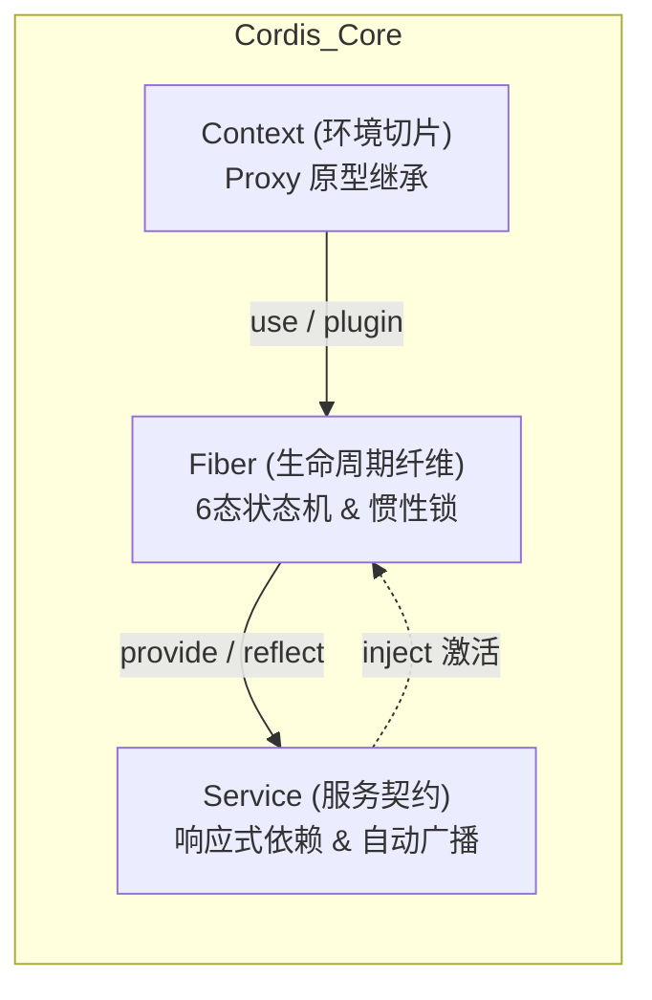
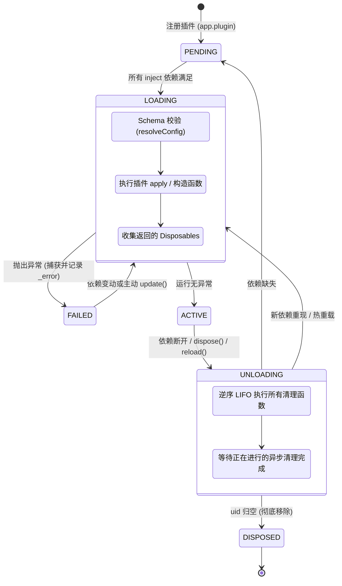

# Cordis (TypeScript) 开发者完全指南：从入门到深入剖析与高频 Q&A

> 本文档面向 Cordis TypeScript 原生实现（位于 [`packages/core`](../packages/core)）。适用于 Node.js 18+ 环境与现代 TypeScript。

---

## 目录

- [1. 全景认知：Cordis 是什么与解决什么问题](#1-全景认知cordis-是什么与解决什么问题)
  - [1.1 架构哲学与时空可组合性](#11-架构哲学与时空可组合性)
  - [1.2 为什么传统 IoC (NestJS / InversifyJS) 在动态插件场景不够用？](#12-为什么传统-ioc-nestjs--inversifyjs-在动态插件场景不够用)
  - [1.3 Cordis 核心价值与三要素](#13-cordis-核心价值与三要素)
- [2. 核心概念与数据模型 (Core Primitives)](#2-核心概念与数据模型-core-primitives)
  - [2.1 Context（上下文）：Proxy 驱动的原型树](#21-context上下文proxy-驱动的原型树)
  - [2.2 Fiber（纤程）：活态生命周期运行句柄](#22-fiber纤程活态生命周期运行句柄)
  - [2.3 Service（服务基类）：响应式依赖与生命周期](#23-service服务基类响应式依赖与生命周期)
  - [2.4 Effect 与 Disposable：全受管的副作用闭包](#24-effect-与-disposable全受管的副作用闭包)
- [3. 开发者入门实战：编写健壮的插件体系](#3-开发者入门实战编写健壮的插件体系)
  - [3.1 环境初始化与基础配置](#31-环境初始化与基础配置)
  - [3.2 编写最简插件（箭头函数 vs 类插件 vs 对象插件）](#32-编写最简插件箭头函数-vs-类插件-vs-对象插件)
  - [3.3 模块扩充（Module Augmentation）与强类型 Context](#33-模块扩充module-augmentation与强类型-context)
  - [3.4 实现自定义 Service：异步 `[Service.init]` 与清理](#34-实现自定义-service异步-serviceinit-与清理)
  - [3.5 响应式依赖注入：`inject` 与乱序自愈演练](#35-响应式依赖注入inject-与乱序自愈演练)
  - [3.6 Stage 3 `@Inject` 装饰器用法](#36-stage-3-inject-装饰器用法)
  - [3.7 高级事件流调度：`emit`, `parallel`, `serial`, `bail`, `waterfall`](#37-高级事件流调度emit-parallel-serial-bail-waterfall)
  - [3.8 服务隔离与多租户：`ctx.isolate` 与 `ctx.intercept`](#38-服务隔离与多租户ctxisolate-与-ctxintercept)
  - [3.9 函数式服务：`[Service.invoke]` 可调用服务](#39-函数式服务serviceinvoke-可调用服务)
- [4. 深入剖析与底层原理 (Deep Dive & Internals)](#4-深入剖析与底层原理-deep-dive--internals)
  - [4.1 Context 的 Proxy 拦截机制与安全防越权](#41-context-的-proxy-拦截机制与安全防越权)
  - [4.2 Fiber 6 态状态机与驱动循环](#42-fiber-6-态状态机与驱动循环)
  - [4.3 惯性锁（Inertia Lock）与并发重入保护](#43-惯性锁inertia-lock与并发重入保护)
  - [4.4 上下文追踪（Tracker / Associate）与调用溯源](#44-上下文追踪tracker--associate与调用溯源)
  - [4.5 声明式加载器 `Loader` 与 `EntryTree`](#45-声明式加载器-loader-与-entrytree)
  - [4.6 源码级热重载（HMR）与 Node.js ESM 原生劫持](#46-源码级热重载hmr-与-nodejs-esm-原生劫持)
- [5. 高频问答与生产避坑指南 (Q&A)](#5-高频问答与生产避坑指南-qa)
  - [Q1: 为什么访问 `ctx.myService` 报错 `cannot get property "myService" without inject`？](#q1-为什么访问-ctxmyservice-报错-cannot-get-property-myservice-without-inject)
  - [Q2: 为什么我的插件状态一直是 `PENDING`？排查路径是什么？](#q2-为什么我的插件状态一直是-pending排查路径是什么)
  - [Q3: 普通函数插件的清理函数为什么没有执行？](#q3-普通函数插件的清理函数为什么没有执行)
  - [Q4: 为什么 `ctx.on` 监听事件完全不需要手动 `removeListener`？](#q4-为什么-ctxon-监听事件完全不需要手动-removelistener)
  - [Q5: 插件如何支持“配置原地热更”而不销毁服务？](#q5-插件如何支持配置原地热更而不销毁服务)
  - [Q6: `ctx.bail` 与 `ctx.waterfall` 的典型工业场景有哪些？](#q6-ctxbail-与-ctxwaterfall-的典型工业场景有哪些)
  - [Q7: 什么是 `symbols.shadow` 与 `symbols.caller`？](#q7-什么是-symbolsshadow-与-symbolscaller)
  - [Q8: 循环依赖（A 依赖 B，B 依赖 A）在 Cordis TS 中如何表现？](#q8-循环依赖a-依赖-bb-依赖-a在-cordis-ts-中如何表现)
  - [Q9: 同一插件多次挂载时会发生什么？如何实现单例？](#q9-同一插件多次挂载时会发生什么如何实现单例)
  - [Q10: 生产级系统使用 Cordis TS 的性能与规范建议？](#q10-生产级系统使用-cordis-ts-的性能与规范建议)
- [6. 配套代码示例索引 (Runnable Examples)](#6-配套代码示例索引-runnable-examples)

---

## 1. 全景认知：Cordis 是什么与解决什么问题

### 1.1 架构哲学与时空可组合性

Cordis 是一个面向**时空可组合性（Spatiotemporal Composability）**的现代化元框架与轻量微内核。它起源于复杂长周期机器人/服务架构（如 Koishi），旨在解决超大型模块化系统中**插件动态性、生命周期交织与资源泄漏**的终极难题。

```
               ┌────────────────────────────────────────────────────────┐
               │                  Spatiotemporal Space                  │
               │                                                        │
   Temporal    │   • Reactive Service Lifecycle (Inject / Refresh)     │
  (时间维度)   │   • Fiber State Machine & Inertia Lock                 │
               │   • Automatic Effect / Disposable Cleanup              │
               ├────────────────────────────────────────────────────────┤
   Spatial     │   • Prototypal Context Tree (ctx.extend)               │
  (空间维度)   │   • Namespace Isolation (ctx.isolate / Realms)         │
               │   • Config Interception (ctx.intercept)                │
               └────────────────────────────────────────────────────────┘
```

1. **时间维度（Temporal）**：运行期间，服务可以随时上线、重载、离线；依赖它的上层插件感知变化并自动响应、挂起或自愈，所有副作用（定时器、事件监听器、网络句柄）全自动逆序销毁。
2. **空间维度（Spatial）**：基于 JavaScript 原型链与 Proxy 深度定制，Context 支持分层派生、隔离域（Realms）多租户共存以及局部配置拦截覆盖。

### 1.2 为什么传统 IoC (NestJS / InversifyJS) 在动态插件场景不够用？

| 核心维度 | 传统 IoC 框架 (NestJS / InversifyJS / TypeDI) | Cordis 微内核 |
| :--- | :--- | :--- |
| **容器模型** | 静态单例容器 / 请求作用域，启动时固化依赖图 | **活态原型链 Context 树**，按需派生与隔离 |
| **动态插件拔插** | 极度困难；模块一旦加载，卸载时极易残留内存泄漏 | **第一类公民**：随时 `plugin()` 与 `dispose()`，0 残留 |
| **依赖响应式** | 依赖缺失直接崩溃或报错 | **响应式等待**：依赖未就绪自动挂起（Pending），就绪即刻唤醒 |
| **服务下线级联** | 需人工实现复杂的 teardown 逻辑，难以处理依赖反向排空 | **拓扑反向自动清理**：消费者先安全回退，底层服务才执行断开 |
| **副作用生命周期** | 不托管开发者在方法内创建的 `setInterval` 或监听器 | **`ctx.effect` 全托管**：卸载时自动逆序执行所有的 Dispose 函数 |
| **多租户隔离** | 依赖不同的 Container 实例，代码需传参感知 | **原生 `ctx.isolate`**：无感运行相同插件于独立隔离空间 |

### 1.3 Cordis 核心价值与三要素



1. **Context 作为一等公民**：插件内的一切操作（读写服务、发收事件、申请资源）都必须通过 `ctx` 进行，从而确保所有行为被安全纳入生命周期追踪。
2. **状态驱动的 Fiber**：每一个插件实例对应一个 Fiber 句柄，通过状态机精确控制加载、活跃、卸载与异常回滚。
3. **副作用完全闭环（Effect Scope）**：没有孤儿定时器，没有悬挂事件监听器，没有未关闭的 Socket。

---

## 2. 核心概念与数据模型 (Core Primitives)

### 2.1 Context（上下文）：Proxy 驱动的原型树

在 Cordis 中，`Context` 并非简单的字典对象，而是一个**经过 `Proxy` 深度包裹的原型链结构**：
- **属性拦截**：当你访问 `ctx.database` 时，经过 `ReflectService.handler` 代理拦截。运行时不仅校验属性是否存在，还会**强行检查当前插件是否通过 `inject` 声明了该依赖**。未声明直接抛错，从根源杜绝隐式隐蔽耦合！
- **原型派生（`ctx.extend()`）**：派生子上下文采用 `Object.create(parent)`，子上下文天然享有父级的所有服务与方法，同时拥有自己独立的局部元数据。

### 2.2 Fiber（纤程）：活态生命周期运行句柄

当调用 `ctx.plugin(...)` 时，Cordis 会在内部实例化一个 `Fiber` 对象：
- **`FiberState` 6 态流转**：`PENDING`（等待依赖）、`LOADING`（加载中）、`ACTIVE`（已就绪）、`FAILED`（加载异常）、`UNLOADING`（卸载中）、`DISPOSED`（已销毁）。
- **`fiber.dispose()`**：返回 `Promise<void>`，用于主动卸载该插件并销毁其所有副作用。

### 2.3 Service（服务基类）：响应式依赖与生命周期

- 继承自 `Service` 的类，在实例化时会自动将自身挂载到 `ctx[name]` 上，并通知系统向所有声明了该依赖的插件发起激活广播。
- 支持 `[Service.init]()` 异步生命周期钩子，支持返回清理函数。
- 支持 `[Service.invoke]` 定义可调用服务（Callable Service）。

### 2.4 Effect 与 Disposable：全受管的副作用闭包

任何在 Cordis 体系下申请的外部资源都被统称为 **Effect**，其清理动作被称为 **Disposable**：
- 函数签名：`type Disposable = () => any`。
- 注册方式：`ctx.effect(() => { ... return () => cleanup() })`。
- 清理保证：当插件被卸载或依赖服务下线时，Cordis 会以**严格的后进先出（LIFO）逆序**执行所有的 Disposable 回调。

---

## 3. 开发者入门实战：编写健壮的插件体系

我们将结合仓库中的可执行代码示例，一步步掌握 Cordis TS 的核心实战模式。

### 3.1 环境初始化与基础配置

在 Node.js 18+ 环境中，推荐使用 `pnpm` 或 `yarn` 安装依赖：

```bash
yarn add cordis
# 开发依赖
yarn add -D typescript @types/node tsx
```

### 3.2 编写最简插件（箭头函数 vs 类插件 vs 对象插件）

Cordis 支持三种插件形态。**注意：推荐使用箭头函数或对象字面量编写函数式插件**：

```typescript
import { Context, Plugin } from 'cordis'

// 1. 推荐：箭头函数形式（返回值自动作为 Dispose 清理回调）
const greetingPlugin = (ctx: Context, config: { name: string }) => {
  console.log(`[GreetingPlugin] 加载成功，你好，${config.name}！`)
  return () => {
    console.log(`[GreetingPlugin] 卸载清理操作`)
  }
}

// 2. 对象形式（适用于复杂规格声明）
const timerPlugin: Plugin.Object<{ interval: number }> = {
  name: 'timer-plugin',
  apply(ctx: Context, config) {
    ctx.effect(() => {
      const timer = setInterval(() => console.log('Tick'), config.interval)
      return () => clearInterval(timer)
    })
  },
}

// 3. 类形式插件
class MyClassPlugin {
  constructor(ctx: Context, config: any) {
    console.log('Class Plugin 构造函数执行')
  }
}
```

> ⚠️ **重要避坑**：Cordis 内部使用 `func.prototype` 判断是否为 Class 构造函数。若使用标准 `function foo() {}`，Cordis 会通过 `new foo()` 执行它，导致普通函数的返回值清理机制失效！因此，普通函数插件请始终声明为**箭头函数** `const foo = (ctx) => {}`。

### 3.3 模块扩充（Module Augmentation）与强类型 Context

为了让 `ctx.database` 拥有原生的 TypeScript 类型推导与自动补全，必须使用模块扩充：

```typescript
// contracts.ts
import { Context } from 'cordis'
import type { DatabaseService } from './database'

// 核心：扩充 cordis 模块的 Context 接口
declare module 'cordis' {
  interface Context {
    database: DatabaseService
  }
  // 还可以扩充自定义事件类型
  interface Events {
    'order/created'(orderId: string, amount: number): void
  }
}
```

### 3.4 实现自定义 Service：异步 `[Service.init]` 与清理

继承 `Service` 基类，实现全自动服务注册与生命周期管理：

```typescript
// database.ts
import { Context, Service } from 'cordis'

export class DatabaseService extends Service {
  public connected = false

  constructor(ctx: Context, public config: { url: string }) {
    // 传入 ctx 与服务唯一标识名 'database'
    // 自动绑定到 ctx.database
    super(ctx, 'database')
  }

  // 异步初始化钩子
  async [Service.init]() {
    console.log(`正在连接数据库: ${this.config.url}...`)
    await new Promise((resolve) => setTimeout(resolve, 100))
    this.connected = true
    console.log(`数据库连接就绪！`)

    // 返回清理函数：当该服务卸载时自动调用！
    return () => {
      this.connected = false
      console.log(`数据库连接已断开！`)
    }
  }

  query(sql: string) {
    if (!this.connected) throw new Error('Database is offline!')
    return [{ id: 1, name: 'Alice' }]
  }
}
```

### 3.5 响应式依赖注入：`inject` 与乱序自愈演练

在业务插件中，只需声明 `inject: ['database']`，即可享有完整的响应式生命周期保护：

```typescript
// consumer.ts
import { Context } from 'cordis'

export const consumerPlugin = {
  name: 'order-consumer',
  inject: ['database'], // 显式声明依赖 database 服务
  apply(ctx: Context) {
    console.log(`🚀 [Consumer] 依赖就绪，插件成功激活！`)

    // 此时直接安全调用 ctx.database，绝对可用
    const rows = ctx.database.query('SELECT * FROM users')
    console.log('查询结果:', rows)

    // 注册定时任务
    ctx.effect(() => {
      const timer = setInterval(() => {
        console.log('定时巡检数据库状态:', ctx.database.connected)
      }, 500)
      return () => clearInterval(timer)
    })
  },
}
```

#### 运行逻辑：
1. **先挂载 Consumer**：`app.plugin(consumerPlugin)`。此时缺少 `database`，插件静默挂起在 `PENDING` 状态。
2. **后挂载 Database**：`app.plugin(DatabaseService, ...)`。数据库连接完成后，Consumer 自动感知并**瞬间激活**！
3. **卸载 Database**：调用 `dbFiber.dispose()`，Consumer 的定时器立刻被自动清理，插件平滑休眠回 `PENDING`，**无任何内存泄漏与报错**！

### 3.6 Stage 3 `@Inject` 装饰器用法

如果你喜欢现代装饰器风格（TypeScript 5.0+ Stage 3 装饰器），Cordis 提供了原生支持：

```typescript
import { Context, Inject } from 'cordis'

class AdvancedService {
  // 在类上声明依赖
  @Inject('database')
  class Worker {
    constructor(ctx: Context) {
      // 拥有 database 依赖
    }
  }

  // 或直接在方法上声明依赖（该方法只在依赖满足时动态生效）
  @Inject('database')
  async performSync() {
    // 依赖已就绪
  }
}
```

### 3.7 高级事件流调度：`emit`, `parallel`, `serial`, `bail`, `waterfall`

Cordis 提供了 5 种不同维度的事件调度策略：

```typescript
const app = new Context()

// 1. emit: 异步广播 (Fire-and-forget)
app.on('notice', (msg) => console.log('收到通知:', msg))
app.emit('notice', '系统启动完成')

// 2. parallel: 并发执行并等待全部完成 (Fan-out / Fan-in)
app.on('sync', async () => { /* 异步操作 A */ })
app.on('sync', async () => { /* 异步操作 B */ })
await app.parallel('sync')

// 3. serial: 顺序依次执行，遇到非 undefined/false 返回值则短路终止
await app.serial('fallback/chain')

// 4. bail: 同步短路熔断 (常用于权限守卫与拦截校验)
app.on('auth', (token) => token === 'banned' ? '已被封禁' : undefined)
app.on('auth', (token) => token === 'admin' ? true : undefined)
const authResult = app.bail('auth', 'banned') // 返回: "已被封禁"

// 5. waterfall: 洋葱模型流水线 (类似 Koa/Express 中间件链)
app.on('transform', (text, next) => `[Wrapper] ${next().trim()}`)
app.on('transform', (text, next) => next().toUpperCase())
const output = app.waterfall('transform', '  hello  ', () => '  hello  ')
// 输出: "[Wrapper] HELLO"
```

### 3.8 服务隔离与多租户：`ctx.isolate` 与 `ctx.intercept`

```typescript
// 1. 隔离命名空间实现多租户
const tenantA = root.isolate('storage')
const tenantB = root.isolate('storage')

// 分别挂载独立的存储服务实现
tenantA.plugin(StorageService, 'sqlite')
tenantB.plugin(StorageService, 'redis')

// 挂载相同的业务插件，互不干扰！
tenantA.plugin(businessPlugin) // 访问 SQLite
tenantB.plugin(businessPlugin) // 访问 Redis

// 2. 上下文配置拦截与覆盖
const debugCtx = root.intercept('logger', { level: 'debug' })
```

### 3.9 函数式服务：`[Service.invoke]` 可调用服务

服务不仅可以是对象，还可以是一个可调用的函数！

```typescript
class HttpService extends Service {
  constructor(ctx: Context) {
    super(ctx, 'http')
  }

  // 定义此符号后，自身可以直接作为函数调用！
  [Service.invoke](url: string) {
    return fetch(url).then(r => r.json())
  }

  // 依然可以挂载类方法
  post(url: string, body: any) { ... }
}

// 使用形态：
app.plugin(HttpService)
await app.http('https://api.example.com')      // 直接作为函数调用
await app.http.post('https://api.example.com') // 也可以调用方法
```

---

## 4. 深入剖析与底层原理 (Deep Dive & Internals)

### 4.1 Context 的 Proxy 拦截机制与安全防越权

在 [`packages/core/src/reflect.ts`](../packages/core/src/reflect.ts) 中，Context 的每次属性存取都受到严格监管：

```typescript
static handler: ProxyHandler<Context> = {
  get: (target, prop, ctx: Context) => {
    // 1. 特殊属性放行（原型、then、Symbol、_ 开头私有属性）
    if (isSpecialProperty(prop)) return Reflect.get(target, prop, ctx)
    // 2. 内部核心属性放行 (events, logger, registry, reflect)
    if (Reflect.has(target, prop)) return getTraceable(ctx, Reflect.get(target, prop, ctx))

    const error = new Error(`cannot get property "${prop}" without inject`)
    ...
    // 3. 依赖越权检测：若当前 Fiber 没有在 inject 声明该 prop，抛出未声明异常！
    if (prop in fiber.inject) {
      error.message = `cannot get required service "${prop}" in inactive context`
      throw error
    }
    ...
  }
}
```

**设计精妙之处**：
- 任何业务代码试图跳过 `inject` 偷读服务，都会在开发期被直接拦截。
- 如果服务已在 `inject` 声明，但当前处于离线状态，会精确报告 `in inactive context`，彻底消除隐式未定义行为。

### 4.2 Fiber 6 态状态机与驱动循环



### 4.3 惯性锁（Inertia Lock）与并发重入保护

在异步世界中，服务可能在毫秒内频繁上下线（例如网络波动或高频保存代码触发 HMR）。
- **`fiber.inertia: Promise<void> | undefined`**：表示当前纤程正在进行的重载/卸载任务。
- 当处于重载阶段时，外部再次触发变更，运行时不会强行掐断当前 Promise，而是通过 `while (this.inertia) await this.inertia` 等待前序状态单调落地，再平滑切入下一次状态计算，确保不会出现双重挂载或资源悬挂。

### 4.4 上下文追踪（Tracker / Associate）与调用溯源

在复杂系统中，了解“哪一个插件在调用本服务”至关重要：
- 通过 `getTraceable(ctx, value)`，任何通过 Context 访问的服务实例都会被隐式绑定当前调用者的 `ctx`（记录在 `symbols.caller`）。
- 服务方法可以通过 `this.ctx[symbols.caller]` 极其优雅地获知当前是谁在调用自己，实现细粒度的按调用方鉴权、审计与统计。

### 4.5 声明式加载器 `Loader` 与 `EntryTree`

位于 [`packages/loader`](../packages/loader)。
- 将 YAML/JSON 配置文件解析为有向树 `EntryTree`。
- 支持 `reconcile` 增量调和算法：只对发生变化的配置项或新加入的插件执行 Fiber 重载，对无变更插件保持零干扰热存活。

### 4.6 源码级热重载（HMR）与 Node.js ESM 原生劫持

位于 [`packages/hmr`](../packages/hmr)。
- 运行时通过 `--expose-internals` 深度集成 Node.js 的内部 ESM 加载器。
- 当 `.ts` 源码文件修改时，HMR 引擎结合 AST 依赖图推演受影响的 Entry，事务性清除 Node.js 模块缓存，重新动态导入。若编译报错则自动回滚旧模块，保持生产系统 100% 持续可用。

---

## 5. 高频问答与生产避坑指南 (Q&A)

### Q1: 为什么访问 `ctx.myService` 报错 `cannot get property "myService" without inject`？

> **原因：这是 Cordis 最核心的防腐层机制（Dependency Guard）。**

- **机制**：你必须在插件中显式声明所依赖的服务。
- **解法**：
  ```typescript
  // 错误：直接在 apply 里访问 ctx.myService
  
  // 正确：显式声明依赖
  export const myPlugin = {
    inject: ['myService'], // 添加这行声明！
    apply(ctx: Context) {
      ctx.myService.doSomething()
    }
  }
  ```

---

### Q2: 为什么我的插件状态一直是 `PENDING`？排查路径是什么？

> **根本原因：`inject` 列表中的某些依赖项在当前 Context 树中不可用。**

排查三部曲：
1. **检查服务名称是否拼写一致**：`Service` 构造函数里的名称与 `inject` 里的字符串是否 100% 一致（大小写敏感）。
2. **检查提供者是否报错**：提供者是否在 `[Service.init]` 中抛出了未捕获异常导致其进入了 `FAILED` 状态？
3. **检查是否被隔离域隔离**：提供者是否被挂载在隔离域中（如 `ctx.isolate('db')`），导致当前上下文无法穿透访问？

---

### Q3: 普通函数插件的清理函数为什么没有执行？

> **原因：使用了标准 `function` 声明，被 Cordis 误判为了 Class 构造函数。**

- **机理**：`isConstructor(func)` 会检查 `func.prototype` 是否存在。由于标准 `function plugin(ctx) {}` 具有 prototype，Cordis 会执行 `new plugin(ctx)`，其返回值不会被视为 Dispose 回调。
- **解法**：始终使用**箭头函数**（Arrow Function）编写函数式插件：
  ```typescript
  // 正确写法：
  const myPlugin = (ctx: Context) => {
    return () => console.log('清理被成功执行！')
  }
  ```

---

### Q4: 为什么 `ctx.on` 监听事件完全不需要手动 `removeListener`？

> **因为事件监听器被当前 Context 所属的 Fiber 自动纳管。**

当插件被卸载或依赖服务下线时，该 Fiber 上的所有 `_disposables` 会被全量弹出执行，绑定的事件监听器会由内核自动解绑并回收，开发者完全无需手动维护 `off` 句柄。

---

### Q5: 插件如何支持“配置原地热更”而不销毁服务？

通过在插件或 Service 上提供配置合并与原地更新钩子：
- 对于使用配置更新的场景，调用 `fiber.update(newConfig)`。
- 若服务继承自 `Service`，可在类中定义 `[symbols.resolveConfig]` 自定义配置合并逻辑。

---

### Q6: `ctx.bail` 与 `ctx.waterfall` 的典型工业场景有哪些？

- **`ctx.bail`（短路熔断）**：权限鉴权拦截、前置风控拦截、路由匹配短路。任何一个监听器返回有效结果就立即阻断并作为结果返回。
- **`ctx.waterfall`（洋葱管道）**：文本敏感词过滤、HTTP 请求响应修饰、数据格式化中间件链。每个监听器通过 `next()` 包裹下一层的执行结果。

---

### Q7: 什么是 `symbols.shadow` 与 `symbols.caller`？

- **`symbols.shadow`**：记录当前 Context 在原型链派生中的影子上下文，用于准确确定依赖定义的宿主位置。
- **`symbols.caller`**：记录最后发起当前方法调用的上下文。服务方法可以通过它获取调用者身份并做上下文反向追踪。

---

### Q8: 循环依赖（A 依赖 B，B 依赖 A）在 Cordis TS 中如何表现？

> **双方均会稳定挂起在 `PENDING` 状态，不会死锁，不会栈溢出。**

因为 A 等待 B 激活，B 也等待 A 激活，状态机判断双方 Target 均不满足，保持安全休眠。

---

### Q9: 同一插件多次挂载时会发生什么？如何实现单例？

- 默认情况下，每次 `ctx.plugin(MyPlugin)` 都会创建一个独立的 `Fiber` 运行实例。
- **若需要单例（Singleton）**：
  直接继承 `Service` 基类即可，因为同名 Service 在同一个 Realm 下只能注册一个，重复挂载会自动接管并更新。

---

### Q10: 生产级系统使用 Cordis TS 的性能与规范建议？

1. **类型严苛性**：始终使用模块扩充定义强类型接口，禁止在业务中使用 `(ctx as any).someService`。
2. **异步操作防御**：在 `[Service.init]` 中涉及网络连接或外部 I/O 时，必须设置超时控制（如配合 `AbortSignal`）。
3. **副作用全收敛**：切忌在插件中使用全局原生 `setInterval` 或 `process.on`，所有副作用必须通过 `ctx.effect` 挂载以享受自动生命周期释放。

---

## 6. 配套代码示例索引 (Runnable Examples)

仓库根目录下包含 6 个独立可直接执行的精炼实战 Demo，均可通过 `npx tsx` 即时运行：

| 示例文件 | 核心演示内容 | 执行命令 |
| :--- | :--- | :--- |
| [`examples/01-basic-plugin.ts`](../examples/01-basic-plugin.ts) | 基础函数插件、对象插件与 `ctx.effect` 定时器生命周期清理 | `npx tsx examples/01-basic-plugin.ts` |
| [`examples/02-custom-service.ts`](../examples/02-custom-service.ts) | 自定义 Service 基类、类型扩充与异步 `[Service.init]` 钩子 | `npx tsx examples/02-custom-service.ts` |
| [`examples/03-reactive-injection.ts`](../examples/03-reactive-injection.ts) | 乱序挂载、依赖响应式激活、服务下线级联清理与自愈重连 | `npx tsx examples/03-reactive-injection.ts` |
| [`examples/04-advanced-events.ts`](../examples/04-advanced-events.ts) | 5 种高级事件派发流实战（`emit`, `parallel`, `bail`, `waterfall`） | `npx tsx examples/04-advanced-events.ts` |
| [`examples/05-isolation-and-realms.ts`](../examples/05-isolation-and-realms.ts) | `ctx.isolate` 命名空间多租户隔离与 `ctx.intercept` 配置覆盖 | `npx tsx examples/05-isolation-and-realms.ts` |
| [`examples/06-callable-service.ts`](../examples/06-callable-service.ts) | `[Service.invoke]` 函数式可调用服务与上下文调用溯源 | `npx tsx examples/06-callable-service.ts` |
