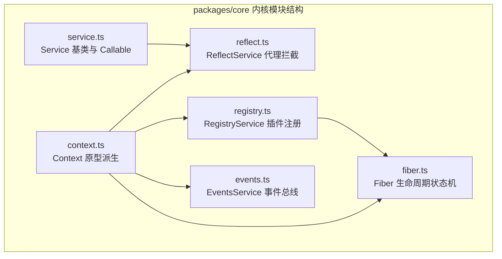
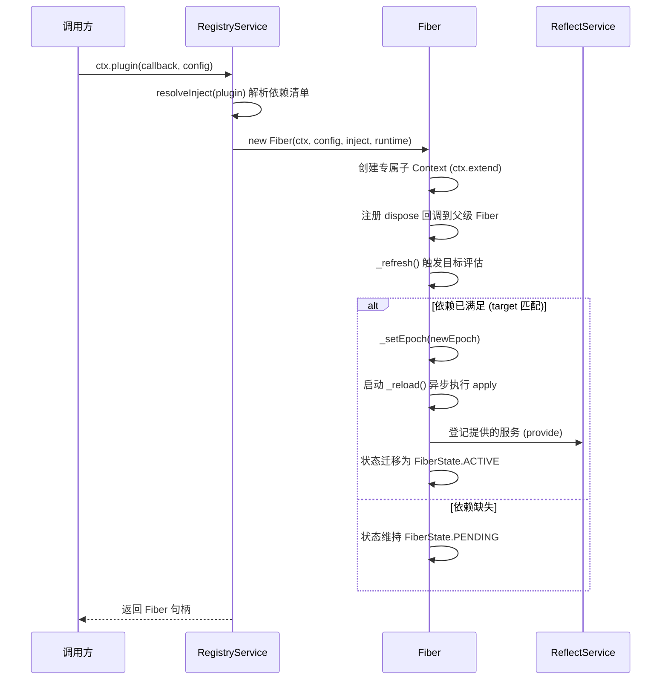
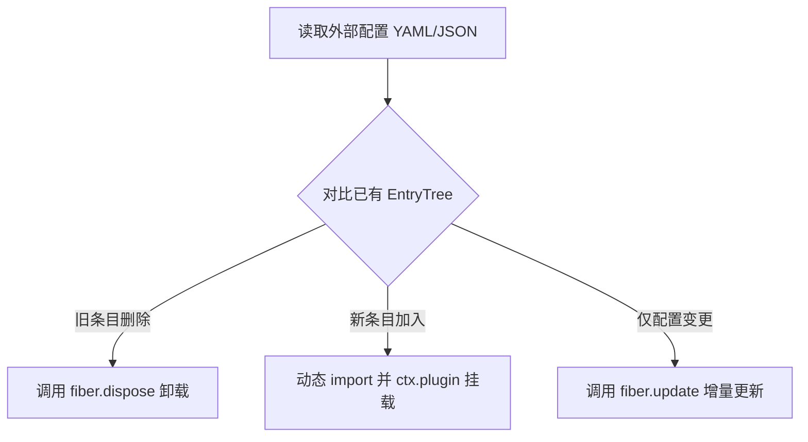
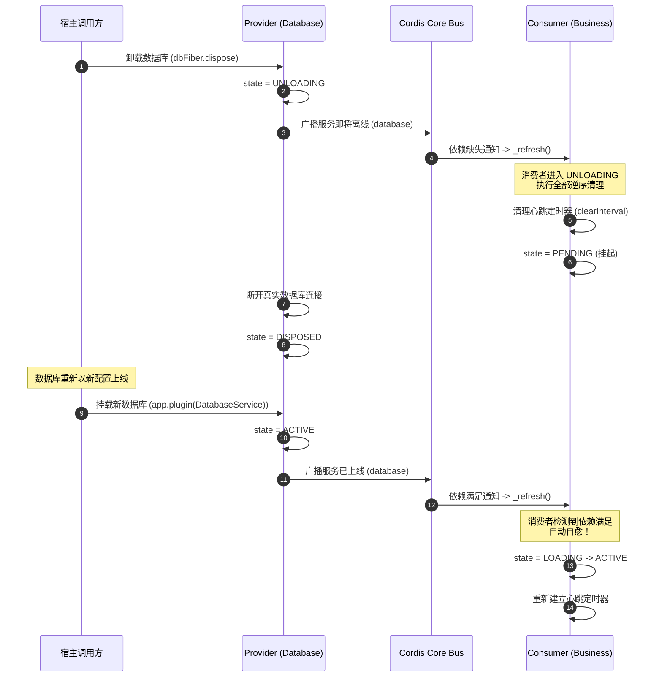
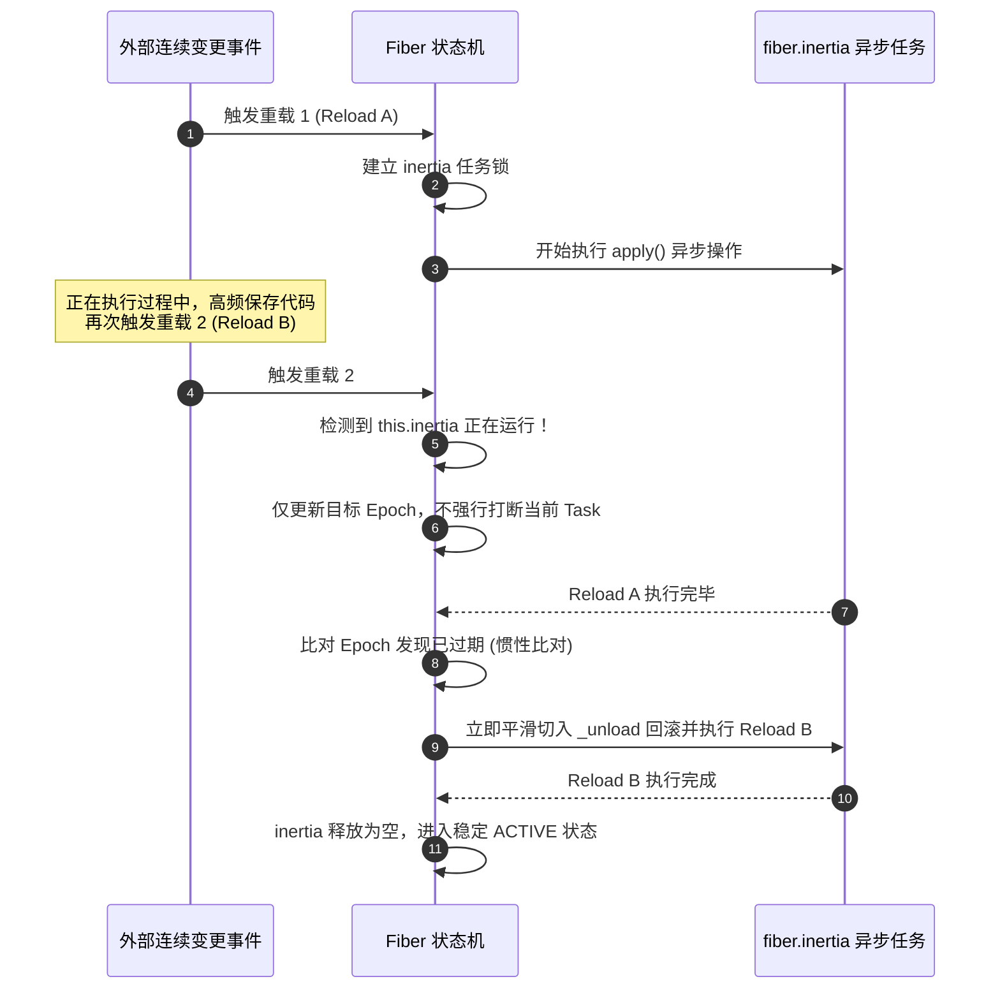

# Cordis (TypeScript) 核心原理代码走读与维护者手册

> 本文档面向 Cordis TypeScript 架构师与核心维护者。深入剖析 [`packages/core`](../packages/core)、[`packages/loader`](../packages/loader) 与 [`packages/hmr`](../packages/hmr) 的源码细节、内存拓扑、Proxy 代理陷阱与状态机扭转机制。

---

## 目录

- [1. 源码架构与 Monorepo 体系拓扑](#1-源码架构与-monorepo-体系拓扑)
  - [1.1 核心包职责划分](#11-核心包职责划分)
  - [1.2 内核数据流与调用总线拓扑](#12-内核数据流与调用总线拓扑)
- [2. 关键数据结构与内存布局解读](#2-关键数据结构与内存布局解读)
  - [2.1 `Context`：基于 Proxy 的轻量原型继承树](#21-context基于-proxy-的轻量原型继承树)
  - [2.2 `Fiber`：纤程控制块与其内部私有栈](#22-fiber纤程控制块与其内部私有栈)
  - [2.3 `ReflectService` 与 `Impl`：服务代理注册表](#23-reflectservice-与-impl服务代理注册表)
  - [2.4 `DisposableList`：高性能弱引用销毁链表](#24-disposablelist高性能弱引用销毁链表)
  - [2.5 `symbols`：Cordis 核心元编程符号全景](#25-symbolscordis-核心元编程符号全景)
- [3. 核心机制逐行走读与执行流程](#3-核心机制逐行走读与执行流程)
  - [3.1 插件挂载全流程：`ctx.plugin` 到 `Fiber` 激活](#31-插件挂载全流程ctxplugin-到-fiber-激活)
  - [3.2 Proxy 陷阱深度剖析：`ReflectService.handler.get`](#32-proxy-陷阱深度剖析reflectservicehandlerget)
  - [3.3 状态驱动与生命周期循环 (`_refresh`, `_reload`, `_unload`)](#33-状态驱动与生命周期循环-_refresh-_reload-_unload)
  - [3.4 副作用收集引擎：`_execute` 归一化模型](#34-副作用收集引擎_execute-归一化模型)
  - [3.5 服务实例化与 Callable 魔法：`Service` 与 `createCallable`](#35-服务实例化与-callable-魔法service-与-createcallable)
  - [3.6 声明式加载器算法：`Loader.reconcile`](#36-声明式加载器算法loaderreconcile)
  - [3.7 Node.js ESM 原生加载器劫持与 HMR 拓扑推演](#37-nodejs-esm-原生加载器劫持与-hmr-拓扑推演)
- [4. 流程扭转、状态机与时序图解](#4-流程扭转状态机与时序图解)
  - [4.1 FiberState 6 态状态流转矩阵](#41-fiberstate-6-态状态流转矩阵)
  - [4.2 依赖上下线与自愈重载时序 (Sequence Diagram)](#42-依赖上下线与自愈重载时序-sequence-diagram)
  - [4.3 惯性锁（Inertia Lock）防重入执行时序](#43-惯性锁inertia-lock防重入执行时序)
- [5. 核心维护铁律与架构不变式 (Maintainer Invariants)](#5-核心维护铁律与架构不变式-maintainer-invariants)
  - [铁律 1：越权访问零容忍 (No-Undeclared-Access Invariant)](#铁律-1越权访问零容忍-no-undeclared-access-invariant)
  - [铁律 2：惯性锁单调落地 (Inertia Monotonicity Invariant)](#铁律-2惯性锁单调落地-inertia-monotonicity-invariant)
  - [铁律 3：逆序副作用完整释放 (Total LIFO Cleanup Invariant)](#铁律-3逆序副作用完整释放-total-lifo-cleanup-invariant)
  - [铁律 4：影子上下文与调用溯源完整性 (Shadow & Caller Integrity)](#铁律-4影子上下文与调用溯源完整性-shadow--caller-integrity)
- [6. 核心维护者避坑与调试指南](#6-核心维护者避坑与调试指南)
  - [6.1 `isConstructor` 的 prototype 陷阱](#61-isconstructor-的-prototype-陷阱)
  - [6.2 内部事件断点与 Trace 日志技巧](#62-内部事件断点与-trace-日志技巧)

---

## 1. 源码架构与 Monorepo 体系拓扑

### 1.1 核心包职责划分

```text
packages/
├── core/             # 运行时微内核 (Context, Fiber, Reflect, Registry, Events)
├── loader/           # 声明式拓扑配置加载器 (EntryTree, reconcile, include)
├── hmr/              # 模块热替换引擎 (Node.js ESM hooks, AST 分析, 依赖图)
├── timer/            # 内置受管定时器插件 (ctx.setTimeout, ctx.setInterval)
├── logger-console/   # 彩色控制台日志服务
└── utils/            # 跨包通用工具类
```

### 1.2 内核数据流与调用总线拓扑



---

## 2. 关键数据结构与内存布局解读

### 2.1 `Context`：基于 Proxy 的轻量原型继承树

位于 [`packages/core/src/context.ts`](../packages/core/src/context.ts)。

```typescript
export class Context {
  // 核心私有符号表
  [symbols.isolate]: Dict<symbol>      // 本地隔离域映射 { serviceName: symbolLabel }
  [symbols.intercept]: Dict            // 本地拦截配置原型链
  root: this                           // 根上下文引用
  events: EventsService                // 事件总线实例
  logger: LoggerService                // 日志服务实例
  reflect: ReflectService              // 属性反射与代理中枢
  registry: RegistryService            // 插件与依赖注册中心
  fiber: Fiber                         // 挂载到当前上下文的纤程实例
}
```

#### 原型链派生细节：`extend()`
```typescript
extend(meta = {}): this {
  const shadow = Reflect.getOwnPropertyDescriptor(this, symbols.shadow)?.value
  const self = Object.create(getTraceable(this, this)) // 以当前 Context 为原型
  for (const prop of Reflect.ownKeys(meta)) {
    Object.defineProperty(self, prop, Reflect.getOwnPropertyDescriptor(meta, prop)!)
  }
  if (!shadow) return self
  return Object.assign(Object.create(self), { [symbols.shadow]: shadow })
}
```
- **轻量级空间隔离**：无需复制整个环境，仅利用 JS 原型链继承父级能力。
- **`symbols.shadow` 机制**：记录当前派生节点的投影来源，确保无论派生多少层，反射引擎都能回溯到正确的定义宿主。

---

### 2.2 `Fiber`：纤程控制块与其内部私有栈

位于 [`packages/core/src/fiber.ts`](../packages/core/src/fiber.ts)。

```typescript
export class Fiber {
  public uid: number | null                       // 全局单调递增 ID (销毁后为 null)
  public readonly ctx: Context                    // 专属于该 Fiber 的子 Context
  public config: any                              // 经过校验的标准配置数据
  public state = FiberState.PENDING               // 6 态状态机
  public readonly dispose: () => Promise<void>    // 卸载本 Fiber 的闭包回调
  public store: Dict<Impl> | undefined            // 激活瞬间冻结的服务实现字典！
  public inertia: Promise<void> | undefined       // 惯性锁：正在运行的重载/卸载 Promise
  public readonly _disposables = new DisposableList<Disposable>() // 逆序清理动作栈
  private _runner: EffectRunner<string>           // 负责调用 apply 并收集 Effect 的运行器
  private _error: any                             // 加载失败时的异常对象
}
```

---

### 2.3 `ReflectService` 与 `Impl`：服务代理注册表

位于 [`packages/core/src/reflect.ts`](../packages/core/src/reflect.ts)。

```typescript
export interface Impl {
  name: string                 // 服务标识名
  fiber: Fiber                 // 提供该服务的 Fiber
  value?: any                  // 真实的服务对象（类实例或函数）
  check?: () => boolean        // 动态可用性检查谓词
}
```

- **`Impl` 是服务在内部的核心承载结构**。当提供者激活时，其 `Impl` 被写入自己的 `fiber.store`，并通过事件向外广播。
- 下游消费者的 Fiber 在激活时，会把依赖服务的 `Impl` 浅拷贝到自身的 `this.store` 中。

---

### 2.4 `DisposableList`：高性能弱引用销毁链表

位于 [`packages/core/src/utils.ts:4`](../packages/core/src/utils.ts#L4)。

```typescript
export class DisposableList<T extends WeakKey> {
  private sn = 0
  private map = new Map<number, T>()
  private weak = new WeakMap<T, number>()

  push(value: T): () => boolean { ... }
  delete(value: T): boolean { ... }
  clear(): T[] {
    const values = [...this.map.values()]
    this.map.clear()
    return values.reverse() // 关键：返回严格的逆序数组以供 LIFO 执行！
  }
}
```
- 结合 `Map`（保证遍历顺序）与 `WeakMap`（支持 O(1) 反向索引），`clear()` 方法将所有已收集的清理函数以**倒序（LIFO）**形式一次性弹出。

---

### 2.5 `symbols`：Cordis 核心元编程符号全景

位于 [`packages/core/src/utils.ts:47`](../packages/core/src/utils.ts#L47)。

| Symbol 标识 | 作用与含义 |
| :--- | :--- |
| `symbols.shadow` | 记录派生 Context 的原始定义位置 |
| `symbols.caller` | 记录最后一次通过 Context 调用服务方法的**调用方上下文** |
| `symbols.receiver`| 记录 Proxy 调用的当前接收器 |
| `symbols.initHooks`| 存放需要在服务构造后立即触发的初始化钩子 |
| `symbols.effect` | 标记对象或函数为一个 Cordis 受管副作用句柄 |
| `symbols.isolate` | Context 上的隔离域字典键 |
| `symbols.intercept`| Context 上的配置拦截器字典键 |

---

## 3. 核心机制逐行走读与执行流程

### 3.1 插件挂载全流程：`ctx.plugin` 到 `Fiber` 激活



#### 关键源码定位：[`packages/core/src/registry.ts:180`](../packages/core/src/registry.ts#L180)
```typescript
plugin(plugin: any, config?: any) {
  // 1. 获取调用站点的调用栈（便于排错跟踪）
  const getOuterStack = buildOuterStack()
  // 2. 解析插件对象规格 (支持函数、类、对象规格)
  const runtime = this.resolve(plugin)
  // 3. 实例化 Fiber
  return new Fiber(this.ctx, config, runtime.inject, runtime, getOuterStack)
}
```

---

### 3.2 Proxy 陷阱深度剖析：`ReflectService.handler.get`

位于 [`packages/core/src/reflect.ts:62`](../packages/core/src/reflect.ts#L62)。

当开发者在代码中执行 `const db = ctx.database` 时：

```typescript
get: (target, prop, ctx: Context) => {
  // 1. 特殊系统保留属性放行
  if (isSpecialProperty(prop)) return Reflect.get(target, prop, ctx)
  // 2. 内置服务放行
  if (Reflect.has(target, prop)) return getTraceable(ctx, Reflect.get(target, prop, ctx))

  const error = new Error(`cannot get property "${prop}" without inject`)

  // 3. 查找是否为自定义 Accessor
  const def = target.reflect.props[prop]
  if (def?.type === 'accessor') {
    return def.get.call(ctx, ctx[symbols.receiver], error)
  }

  // 4. 定位定义站点 (Definition Site)
  const defSite = (ctx[symbols.shadow] as Context | undefined) ?? ctx
  if (!defSite.fiber.runtime) return ctx.reflect.get(prop, false)

  // 5. 依赖安全防线检查 (核心防腐层)
  return ctx.events.waterfall('internal/get', ctx, prop, error, () => {
    const key = target[symbols.isolate][prop]
    let fiber = defSite.fiber
    while (true) {
      // 在当前 fiber 提交的服务快照中查找
      const impl = fiber.store?.[prop]
      if (impl) return getTraceable(ctx, impl.value) // 包装追踪器并返回！
      
      // 若声明了 inject 但尚未就绪
      if (prop in fiber.inject) {
        error.message = `cannot get required service "${prop}" in inactive context`
        throw error
      }
      // 若未声明 inject 强行访问
      if (!fiber.runtime) throw error
      if (fiber.parent[symbols.isolate][prop] !== key) throw error
      fiber = fiber.parent.fiber
    }
  })
}
```

---

### 3.3 状态驱动与生命周期循环 (`_refresh`, `_reload`, `_unload`)

位于 [`packages/core/src/fiber.ts:400-450`](../packages/core/src/fiber.ts#L400)。

#### 状态推进循环：
1. **`_refresh()`**：遍历当前声明的所有 `this.inject`，通过 `_checkImpl(name)` 检查上游服务是否均处于就绪状态。若全部就绪，生成一个新的 Epoch 字符串标识；否则 Epoch 标记为 `INACTIVE`。
2. **`_setEpoch(epoch)`**：比对当前运行器的 `runner.epoch`：
   - 若由 `INACTIVE` -> `ActiveEpoch`：切入 `FiberState.LOADING`，启动 `_reload()` 协程。
   - 若由 `ActiveEpoch` -> `INACTIVE`：切入 `FiberState.UNLOADING`，启动 `_unload()` 协程。
3. **`_reload()` 流程**：
   - 浅拷贝当前已固化的依赖到 `this.store`。
   - 执行 `await this._execute(this._runner)`。
   - 检查执行期间 Epoch 是否发生漂移（即惯性检测）；若未漂移则重载完成，状态切入 `FiberState.ACTIVE`。
4. **`_unload()` 流程**：
   - 逆序弹出所有已注册的清理函数：`this._disposables.clear()`。
   - 并发等待所有清理操作执行落地。

---

### 3.4 副作用收集引擎：`_execute` 归一化模型

位于 [`packages/core/src/fiber.ts:229`](../packages/core/src/fiber.ts#L229)。

`_execute` 抹平了 JavaScript 的各种异步/同步与生成器差异：
- **返回函数**：直接作为 Disposable 清理回调收集；
- **返回 Promise**：等待其 resolve 后，将其结果作为 Disposable 收集；
- **返回 Generator**：获取迭代器，逐个收集 `yield` 产出的清理函数；
- **Class 实例**：调用其 `[symbols.init]()` 方法并收集返回值。

---

### 3.5 服务实例化与 Callable 魔法：`Service` 与 `createCallable`

位于 [`packages/core/src/service.ts:18`](../packages/core/src/service.ts#L18) 与 [`packages/core/src/utils.ts:100`](../packages/core/src/utils.ts#L100)。

```typescript
export abstract class Service {
  constructor(protected ctx: Context, name: string) {
    let self = this
    const tracker: Tracker = { associate: name, property: 'ctx' }
    
    // 如果类上定义了 [symbols.invoke]，则执行动态 Proxy 变换
    if (self[symbols.invoke]) {
      self = createCallable(
        name,
        joinPrototype(Object.getPrototypeOf(this), Function.prototype),
        tracker
      )
    }
    self.ctx = ctx
    self.name = name
    defineProperty(self, symbols.tracker, tracker)
    
    // 向运行时注册提供服务
    self.ctx.reflect.provide(name, self, this[symbols.check])
    return self
  }
}
```

- **`createCallable` 原理**：创建一个目标为空函数 `function () {}` 的特殊 Proxy，将其原型链通过 `joinPrototype` 缝合当前类原型与 `Function.prototype`。
- 当直接执行 `ctx.service(...)` 时，触发 Proxy 的 `apply` trap，转发至类的 `[symbols.invoke]`；当访问属性 `ctx.service.foo` 时，转发至类的普通方法！

---

### 3.6 声明式加载器算法：`Loader.reconcile`

位于 [`packages/loader/src/index.ts`](../packages/loader/src/index.ts)。



- **增量调和（Reconciliation）**：与 React Virtual DOM 树对比类似，Loader 将每个插件的配置视为树节点。当文件变动时，不采取粗暴的全局重启，而是针对变更子树做精确局部的动态重载。

---

### 3.7 Node.js ESM 原生加载器劫持与 HMR 拓扑推演

位于 [`packages/hmr/src/index.ts`](../packages/hmr/src/index.ts)。

Cordis HMR 不依赖 Webpack/Vite 前端打包工具，而是直接在 Node.js 运行时实现无编译热更：
1. **模块解析劫持**：通过 `module.register()` 劫持 Node.js 内部的 `resolve` 与 `load` 钩子。
2. **源码 AST 分析**：当 `.ts` 文件变更时，静态提取其 `import` 语句，推导出反向依赖链（Blast Radius）。
3. **内存双缓存置换**：原子重置 Node.js 内部的 `Module` 缓存与 Cordis 内部的 `Registry`，启动新 Fiber。若报错则平滑回滚至上一个可用版本的组件快照。

---

## 4. 流程扭转、状态机与时序图解

### 4.1 FiberState 6 态状态流转矩阵

| 状态 (State) | 触发条件 / 事件 | 下一状态 | 触发的内核行为 |
| :--- | :--- | :--- | :--- |
| **`PENDING`** | 声明的 `inject` 全部激活 | `LOADING` | 分配新 Epoch，启动 `_reload` 协程 |
| **`LOADING`** | `apply` 执行完毕且无未捕获异常 | `ACTIVE` | 标记服务上线，向依赖它的下级广播更新 |
| **`LOADING`** | `apply` 抛出异常 | `FAILED` | 捕获并记录错误到 `_error`，状态终止 |
| **`ACTIVE`** | 依赖服务下线 / 外部调用 `dispose()` | `UNLOADING` | 启动 `_unload` 协程，标记 `_setEpoch(INACTIVE)` |
| **`UNLOADING`**| 清理函数全部执行完毕，新依赖已就绪 | `LOADING` | 重入加载流程 |
| **`UNLOADING`**| 清理函数全部执行完毕，依赖仍缺失 | `PENDING` | 静默挂起等待新依赖 |
| **`UNLOADING`**| 清理函数全部执行完毕，且 `uid === null` | `DISPOSED` | 彻底从 `runtime.fibers` 中解绑注销 |

---

### 4.2 依赖上下线与自愈重载时序 (Sequence Diagram)



---

### 4.3 惯性锁（Inertia Lock）防重入执行时序



---

## 5. 核心维护铁律与架构不变式 (Maintainer Invariants)

向 `packages/core` 提交代码或重构时，**严禁违背以下四大铁律**：

### 铁律 1：越权访问零容忍 (No-Undeclared-Access Invariant)

$$\text{Service } S \text{ accessed in Fiber } F \implies S \in F.\text{inject}$$

- **铁律要求**：任何业务插件在 Context 上读取某服务时，必须在 `inject` 显式声明。
- **维护底线**：严禁为了“便利性”在 `ReflectService.handler.get` 中取消对 `prop in fiber.inject` 的强校验。否则动态卸载时系统将无法构建完整的反向拓扑图，导致资源无法级联清理。

---

### 铁律 2：惯性锁单调落地 (Inertia Monotonicity Invariant)

$$\forall t, \quad \text{fiber.inertia is Promise} \implies \text{No Concurrent Race in } \_reload / \_unload$$

- **铁律要求**：每个 Fiber 在同一时间戳内，有且仅有一个处于活跃状态的状态推进流。所有的重入请求必须挂载在当前 `inertia` 之后串行等待，绝不能并发启动两个驱动协程。

---

### 铁律 3：逆序副作用完整释放 (Total LIFO Cleanup Invariant)

$$\text{Cleanup Sequence} = \operatorname{Reverse}(\text{Registration Sequence})$$

- **铁律要求**：清理动作的执行顺序必须是绝对严格的 **LIFO（后进先出）**。后初始化的资源往往依赖先初始化的资源，先清理上层业务对象才能确保底层基础服务在断开时没有挂起的在途请求。

---

### 铁律 4：影子上下文与调用溯源完整性 (Shadow & Caller Integrity)

$$\text{Invocation on Context } C \implies \text{Method perceives } C \text{ as } \text{symbols.caller}$$

- **铁律要求**：通过 `getTraceable` 返回的对象，必须确保其方法在执行时能够准确识别当前调用栈的发起方上下文。切勿在派生时抹除或篡改 `symbols.caller` 与 `symbols.shadow`。

---

## 6. 核心维护者避坑与调试指南

### 6.1 `isConstructor` 的 prototype 陷阱

在 [`packages/core/src/utils.ts:76`](../packages/core/src/utils.ts#L76)：
- JavaScript 中所有通过 `function name() {}` 声明的函数都默认带有 `.prototype` 属性（即使它只是个普通工具函数）。
- Cordis 使用 `if (!func.prototype) return false` 识别函数插件与 Class 构造函数。
- **排错建议**：如果用户反馈“插件返回的清理函数没有被调用”，第一反应检查其是否使用了标准 `function` 而非箭头函数 `() => {}`。

---

### 6.2 内部事件断点与 Trace 日志技巧

在调试复杂的依赖自愈与插件生命周期时，在根 Context 上监听以下内部事件可获得最详尽的内核流转日志：

```typescript
// 1. 监听插件挂载与卸载
app.on('internal/plugin', (fiber) => {
  console.log(`[TRACE:Plugin] ${fiber.name} (UID: ${fiber.uid}) 状态更新: ${fiber.state}`)
})

// 2. 监听服务提供与注销
app.on('internal/service', (name) => {
  console.log(`[TRACE:Service] 核心服务路由变更 -> ${name}`)
})

// 3. 监听属性存取越权拦截
app.on('internal/get', (ctx, prop, error) => {
  // 可以在此打断点观测属性读取链路
})
```
