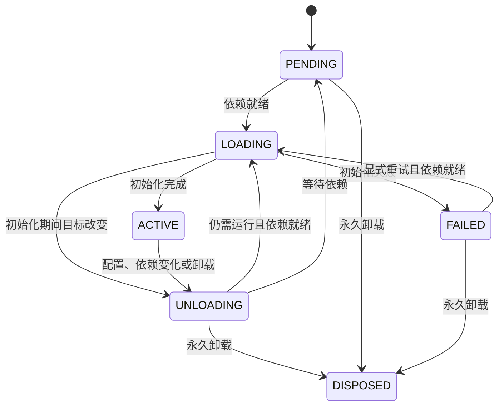

# 插件与生命周期 API

[返回 API 索引](../api.md) · [Context、服务与任务](context.md) · [Loader](loader.md)

源码：[`core.py`](../../src/cordis/core.py)。本页中的 `ConfigT` 是配置类型，`ContextT` 是 Context 子类；完整可运行示例见 [API 首页](../api.md#最小完整示例)。

## 定义插件

### plugin / component

```text
plugin(
    target=None,
    *,
    inject=(),
    provide=(),
    name=None,
    validate=None,
    update=None,
)
```

将带有 `(ctx, config)` 参数的函数或类声明为插件。支持 `@plugin`、`@plugin(...)` 和 `plugin(factory, ...)`；`component` 是同一个函数的别名。

| 参数 | 类型 / 默认值 | 行为 |
| --- | --- | --- |
| `target` | 插件回调；默认 `None` | 传入时直接返回 Component；省略时返回装饰器 |
| `inject` | `Injection`；默认 `()` | 必需服务；所有依赖就绪后才启动。映射值作为消费者的服务拦截元数据 |
| `provide` | `Iterable[ServiceName]`；默认 `()` | 初始化完成时检查这些服务是否已由本插件注册 |
| `name` | `str \| None`；默认 `None` | 日志和诊断名称；省略时使用回调或类名，不是单例标识 |
| `validate` | `Callable[[ConfigT], ConfigT \| Awaitable[ConfigT]] \| None` | 校验并返回实际使用的配置，可以同步或异步 |
| `update` | `Callable[[ContextT, ConfigT, ConfigT], object] \| None` | 可选原地更新函数，参数为 `(ctx, previous, next)`；异步返回值会被等待 |

装饰后的类型为 `Component[ConfigT, ContextT]`。无配置插件仍要接收第二个参数，写成 `_config: None`。

`provide` 声明是对列出服务的完成检查，不会禁止插件提供额外的服务。`inject` 是必需依赖，没有单独的“可选依赖”参数；依赖可用性的动态规则由 [`provide(check=...)`](context.md#provide) 指定。

**校验器应可重复调用。** 初次激活会调用它；`Fiber.update()` 也会先校验，在默认重启路径进入新一次激活时还可能再次调用。配置文件解码不会自动生成 dataclass，外部原始数据需要先转换，见 [Loader](loader.md#配置文件)。

### Component

```python
Component[ConfigT, ContextT](
    apply,
    inject=(),
    provide=(),
    name=None,
    validate=None,
    update=None,
)
```

不可变的插件定义，构造参数与装饰器含义相同。`apply(ctx, config)` 是初始化入口。它不代表某次运行，也不保证只能挂载一次；通过 `ctx.use()` 可得到多个独立 Fiber。

可读取 `apply`、`inject`、`provide`、`name`、`validate`、`update`。`inject` 规范化为以字符串服务名为键的只读映射，`provide` 规范化为 `frozenset[str]`。

### Plugin

`Plugin[ContextT, ConfigT]` 是描述对象式插件的 Protocol，泛型顺序与 Component 不同：

```python
def apply(self, ctx: ContextT, config: ConfigT, /) -> PluginResult: ...
```

对象实现 `apply()` 后，可以直接传给 `ctx.use(object_plugin, config)`，不要求继承这个 Protocol。这里的 `PluginResult` 是源码内部类型记号，包含下表中的初始化结果，不从 `cordis` 顶层导出。

普通可调用对象也可以直接挂载。未包装为 Component 的对象，其 `inject`、`provide`、`name`、`validate`、`update` 属性会作为插件声明读取。

### 初始化可以返回什么

| 形式 | 初始化与清理方式 |
| --- | --- |
| `None` | 初始化结束；通过 Context 注册的资源仍受管理 |
| 清理函数 | 退出时调用无参数函数；若返回 awaitable，则等待它 |
| `EffectHandle` | 将该嵌套 Effect 归入当前作用域 |
| 同步或异步可迭代对象 | 逐项登记清理函数、EffectHandle 或 `None`；生成器是常见用法 |
| 同步或异步上下文管理器 | 初始化时进入，退出时调用对应 exit 方法 |
| awaitable | 等待后，按上述规则处理结果 |
| 工厂返回的生命周期对象 | 调用 `start()`，登记 `stop()`；没有 `stop()` 时使用 `close()` |

清理按登记顺序的相反顺序执行。登记 `yield resource.close` 后，生成器会继续初始化；不是等到卸载时才继续执行 `yield` 后的语句。

生命周期类通过 `plugin(Server)` 包装，构造函数接收 `(ctx, config)`，`start()` / `stop()` 不接收额外参数。运行时先登记 stop 再调用 start，便于处理部分启动失败；构造函数自身抛错时尚未拿到实例，构造过程须自行处理已取得的资源。显式 `plugin(Server)` 比直接用类装饰器更适合静态类型推断，见[类型指南](../typing.md#typeddict-与类插件)。

上下文管理器的进入结果不会成为插件服务或 `effect()` 的返回值，需要服务时显式调用 `provide()`。当前退出调用传入 `(None, None, None)`，不传递宿主异常，不能依靠它抑制宿主异常。

## 挂载插件

### Context.use / Context.plugin

```text
ctx.use(value, config=None) -> Fiber[ConfigT, ContextT]
ctx.plugin(value, config=None) -> Fiber[ConfigT, ContextT]
```

`ctx.plugin` 是 `ctx.use` 的别名。`value` 可以是 Component、插件回调或实现 `apply()` 的对象；字符串定位符交给 Loader 或 `import_plugin()`，不能直接传给 `use()`。

调用立即返回 Fiber，并安排生命周期推进，不会同步等到服务就绪。返回值保留配置类型和 Context 子类；类型化插件的配置不是 `None` 时，必须传入匹配的配置。

子插件归属于调用 `use()` 的 Fiber 或当前嵌套 Effect。父插件退出时，子插件也会被清理；关闭或过期的作用域不能再挂载插件。

### Context.inject

```text
ctx.inject(dependencies, callback, config=None) -> Fiber[ConfigT, ContextT]
```

创建一个声明了 `dependencies` 的临时插件并挂载。`dependencies` 接受和 `@plugin(inject=...)` 相同的格式，`callback` 接收 `(ctx, config)`；返回值与 `use()` 相同。

它创建的是新的子 Fiber，不会修改当前插件的依赖声明。要复用同一份插件定义，优先使用 `@plugin`。

## Fiber

由 `ctx.use()`、`ctx.inject()` 或 `Loader.get()` 获取。应用代码不需要直接构造 Fiber；它的构造函数依赖内部 Runtime。

### 常用属性

| 属性 | 类型 | 含义 |
| --- | --- | --- |
| `ctx` | `ContextT` | 本次挂载传入插件的 Context |
| `parent` | `ContextT` | 调用 `use()` 的父 Context |
| `component` | `Component[ConfigT, ContextT] \| None` | 插件定义；根 Fiber 为 `None` |
| `config` | `ConfigT` | 当前记录的配置，包括校验器规范化后的值 |
| `name` | `str` | 插件的诊断名称 |
| `uid` | `int \| None` | 挂载身份；根为 `0`，从运行时移除后为 `None` |
| `state` | `FiberState` | 当前生命周期状态 |
| `inject` | `Mapping[str, object]` | 规范化后的依赖声明 |
| `error` | `Exception \| None` | 初始化错误；受管后台任务失败查看 `ctx.errors` |
| `cleanup_error` | `ExceptionGroup \| None` | 最近卸载阶段收集的清理错误 |
| `tasks` | `tuple[asyncio.Task[Any], ...]` | 本 Fiber 尚未完成的受管任务快照，包括嵌套 Effect 的任务 |

这些属性供读取和诊断。生命周期操作使用以下方法；不要直接写 `state` 或原地修改 `config` 来更新插件。

### wait / await fiber

```python
async def wait(*, raise_error: bool = True) -> Self: ...
```

`await fiber` 等价于 `await fiber.wait()`，返回同一个 Fiber。它等待**当前的生命周期转换**，不是持续等待未来的依赖出现；没有可推进的转换时可以在 `PENDING` 状态返回。

`raise_error=True` 时，记录的初始化错误会重新抛出；传 `False` 可只等待并自行读取错误。等待使用 shield，取消这个等待者不会直接取消内部生命周期任务。

### update

```python
async def update(config: ConfigT, *, rollback: bool = True) -> None: ...
```

先校验新配置；校验后与当前配置 `==` 时直接返回。建议用不可变 dataclass，在更新时构造新值。

- **默认路径**：保存新配置，卸载旧实例并重新激活。启动失败且 `rollback=True` 时，尝试用旧配置重新启动；即使恢复成功，也会抛出本次更新的失败原因。
- **原地更新路径**：插件处于 `ACTIVE` 且提供了 `update` hook 时，调用 `update(ctx, previous, next)`，成功后保存新配置，不自动重启消费者。

`rollback=False` 只关闭默认重启路径的恢复尝试。自定义 hook 必须自行恢复它修改的对象或外部状态，`rollback=True` 不会自动撤销 hook 的副作用。新配置的运行时激活可能再次调用 validate。

更新成功也不意味着所有依赖方已经激活；需要时调用 `root.flush()` 并检查相关 Fiber。对已经 disposed 的实例应重新 `use()`，不要通过 `update()` 恢复它。

### restart

```python
async def restart() -> None: ...
```

即使配置未变，也要求重新运行当前插件；清除之前的初始化错误，可用来重试 `FAILED` 的插件。等待当前转换完成；缺少依赖时仍可能停在 `PENDING`。已 disposed 的 Fiber 抛出 `InactiveContextError`。

### dispose

```python
async def dispose() -> None: ...
```

永久卸载本次挂载，等待消费者、任务和清理结束，从运行时移除 Fiber。重复调用不会重复执行清理；若先前记录了清理错误，重复调用仍可能重新抛出它。需要再次运行时创建新的 Fiber。

### refresh

```python
def refresh() -> None: ...
```

高级接口：重新计算当前依赖与目标状态，必要时安排转换；立即返回，不等待。它不会替代 `restart()` 清除失败状态。通常使用 `ctx.notify(...)` 通知服务可用性变化，无需直接调用它。

受管任务不能等待自身、父插件或依赖服务的卸载、重启等转换，否则会形成自等待并抛出 `InactiveContextError`。这些管理操作由宿主发起。

## FiberState

继承 `str` 和 `Enum`：

| 成员 | 值 | 含义 |
| --- | --- | --- |
| `PENDING` | `"pending"` | 等待依赖或父插件就绪，尚未激活 |
| `LOADING` | `"loading"` | 正在校验配置、建立依赖视图和初始化 |
| `ACTIVE` | `"active"` | 初始化完成，服务可供依赖方使用 |
| `FAILED` | `"failed"` | 初始化失败并尝试撤销部分初始化；可显式重试 |
| `UNLOADING` | `"unloading"` | 正在让依赖方退出、处理任务和释放资源 |
| `DISPOSED` | `"disposed"` | 本次挂载永久结束 |



图中重试省略了短暂的 `PENDING` 中间状态。状态变化通过 `internal/status` 发出；初始化期间目标改变时，会等当前异步步骤结束，再撤销已经登记的资源。
