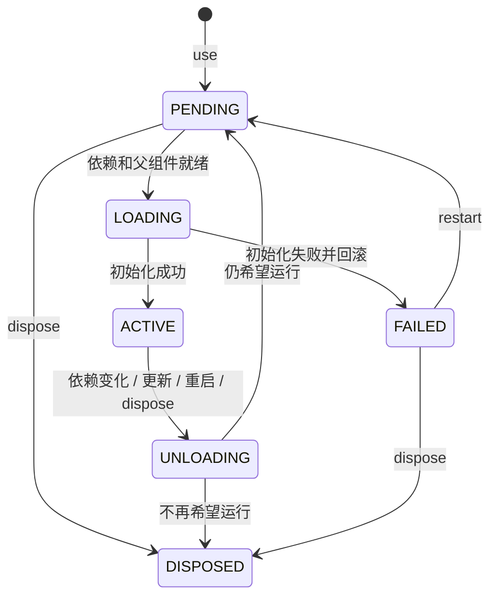
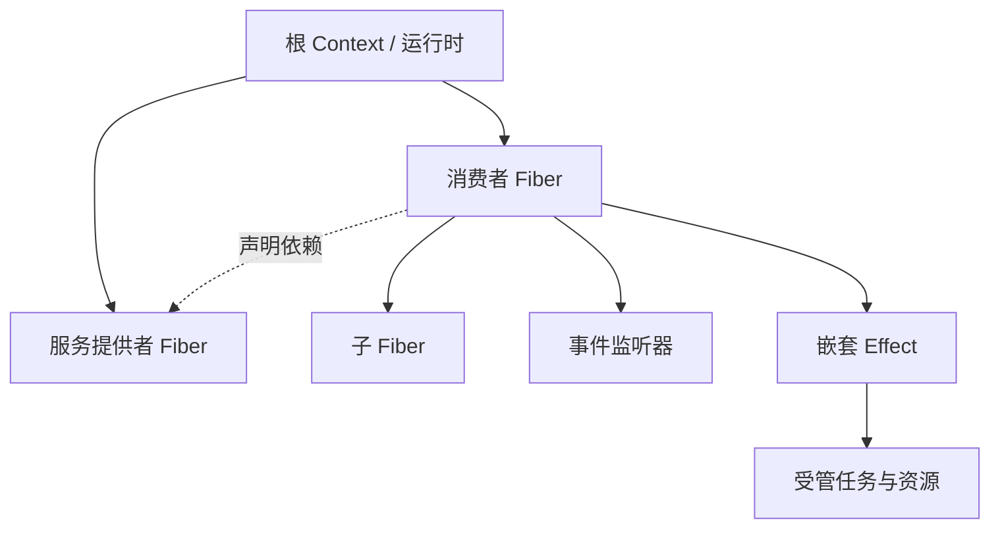

# 核心概念

Cordis 把插件的生命周期、服务依赖和资源清理放进同一个运行时。声明插件需要什么、注册它提供什么、为资源提供清理操作后，运行时负责在依赖出现、消失和更新时启动或卸载插件。

本文解释本仓库 Python API 的实际行为。第一次使用建议先跑完[使用教程](tutorial.md)，再按下面的概念定位设计问题。

## 1. Component：可复用的插件定义

`@plugin` 把函数包装为 `Component[Config, Context]`。它描述初始化逻辑、配置类型、依赖、服务承诺以及可选的校验和更新 hook。

```python
@plugin(inject=[DATABASE])
def worker(ctx: AppContext, config: WorkerConfig) -> Cleanup:
    ...
```

这里只定义了组件，还没有启动它。函数体在对应实例具备激活条件时才执行；重启会再次执行初始化，因此初始化逻辑必须为每次产生的资源登记清理。

同一个 Component 可以用不同配置挂载多次。组件定义适合在模块间共享，每次运行的资源应放在对应实例的闭包、对象或受管作用域里。

## 2. Fiber：一次挂载的运行实例

`fiber = ctx.use(worker, config)` 创建一次挂载，返回 `Fiber[WorkerConfig, AppContext]`。Fiber 保存配置、当前 Context、状态、错误和任务等运行信息。

| 操作 | 含义 |
| --- | --- |
| `fiber.config` / `fiber.ctx` | 当前配置和实例 Context，保留泛型类型 |
| `await fiber` | 等待这个实例当前的生命周期转换，检查保存的启动错误 |
| `await fiber.update(new_config)` | 校验配置；默认在变化时重启，失败时尝试恢复旧配置 |
| `await fiber.restart()` | 使用当前组件和配置重新启动，不重新导入 Python 模块 |
| `await fiber.dispose()` | 永久移除该挂载；之后不能再重启这个 Fiber |
| `fiber.tasks` | 该实例当前未结束的受管任务快照 |

生命周期的主要路径：



`PENDING` 通常表示等待条件，不等于故障；`FAILED` 表示启动失败。上图突出常见路径，状态名在 Python 中是 `FiberState`，值为小写字符串。

“惯性”意味着已开始的初始化或清理会先完成，运行时再根据最新目标继续转换。它不会为了立刻切换配置，任意打断初始化到一半的插件；这也意味着长期阻塞的初始化会延迟后续变更。

`await fiber` 不保证返回时一定 `ACTIVE`：没有正在进行的转换、但依赖仍缺失时，它可以保持 `PENDING` 返回。`ctx.flush()` 同样只等待生命周期转换，不是全局就绪屏障，也不会等待所有业务任务完成。

## 3. Context：实例的运行入口与服务视图

Context 同时携带生命周期归属和服务解析规则：

| 调用 | 归属与作用 |
| --- | --- |
| `ctx.use(...)` | 创建属于当前作用域的子插件 |
| `ctx.provide(KEY, value)` | 注册属于当前作用域的服务 |
| `ctx.service(KEY)` / `ctx[KEY]` | 按声明、Realm 和依赖视图读取服务 |
| `ctx.on(...)` | 注册随当前作用域卸载的监听器 |
| `ctx.spawn(...)` | 创建先于所属资源清理完成的受管任务 |
| `await ctx.effect(...)` | 创建可单独释放的嵌套 Effect 作用域 |
| `ctx.isolate(...)` / `ctx.intercept(...)` | 派生具有不同服务解析规则的 Context |

宿主创建根 Context，插件接收运行时为它派生的 Context。子组件、服务、事件、任务和嵌套 Effect 都通过这个入口取得生命周期归属。



**父子归属和服务依赖是两种关系。** 子插件跟随父插件存在；消费者与提供者可以是兄弟插件，只通过服务声明建立依赖。父组件尚未激活时，子组件不会抢先运行。

派生 Context 共享同一个运行时。`ctx.close()` 关闭的是整个运行时，因此由宿主持有根 Context 并负责关闭；局部停用通过 Fiber 或 Loader 完成。

自定义 `AppContext` 适合声明服务描述符。派生过程会保留子类类型，但不会重新调用你的 `__init__`；不要假设在自定义构造函数里赋值的普通实例字段会自动复制给所有派生 Context。

## 4. Effect：操作与它的清理

Effect 是插件运行时创建的作用及其生命周期管理。可逆性来自明确的逆操作，例如注册监听器对应注销、打开连接对应关闭，而不是解释器自动记住所有改动。

有三种常用登记方式：

| 写法 | 适合场景 |
| --- | --- |
| 插件返回 `cleanup` | 一份需要统一释放的资源 |
| 生成器逐次 `yield cleanup` | 分步骤获得多个资源，保护部分初始化失败 |
| `handle = await ctx.effect(callback)` | 需要独立生命周期的嵌套资源组 |

`ctx.provide()`、`ctx.on()` 和 `ctx.use()` 已经登记相应的撤销动作。自己创建的外部资源则要显式登记清理。异步初始化和异步清理也受支持。

每个逆操作在生成器继续下一步前注册；后续步骤失败时，已经登记的操作仍会回滚。清理按后进先出（LIFO）执行；某个清理抛错后，其余清理仍会尝试执行，普通异常最终聚合报告。

`EffectHandle` 可以提前释放，例如 `await handle()`；重复释放是幂等的。嵌套 Effect 内注册的监听器、任务和资源随它一起释放，也随外层插件一起释放。

清理资源不等于撤销业务结果：关闭文件不会还原内容，关闭数据库连接不会回滚已经提交的交易，注销监听器不会收回已经发送的消息。Cordis 只管理已纳入作用域的操作及明确提供的逆操作。

## 5. Coeffect：插件运行所需的条件

可以把 Coeffect 理解为组件对运行环境的要求。在这个实现中，最常见的形式是 `inject=[KEY]`：必须有当前 Context 可见、可用的服务提供者，组件才能激活。

```text
消费者挂载 → 缺少服务 → pending
服务可用   → 条件满足 → 初始化消费者 → active
服务失效   → 条件失效 → 卸载消费者   → pending
服务恢复   → 条件恢复 → 再次初始化消费者
```

消费者使用服务键或描述符读取服务时，会进行运行时声明检查。通常直接在组件的 `inject` 中列出所需服务；父作用域已经声明且位于同一 Realm 的依赖也可以被继承。根 Context 可用于宿主读取服务。

`ctx.get(KEY)` 是反射式查询：类型为 `T | None`，允许查询未声明的服务，但不会自动增加响应式依赖。如果业务运行确实要求这个服务，仍应声明 `inject`。

提供者可用 `ctx.provide(KEY, value, check=...)` 定义针对消费者 Context 的可用性条件；外部条件变化后，调用 `ctx.notify(KEY)` 请求重新评估。

`ctx.set(KEY, new_value)` 是提供者更新已注册值的接口，本身不会触发一整轮消费者重启。若变更要求依赖者完整退出和重新初始化，应通过提供者的更新或重启流程表达。

## 6. Committed view：退出过程中仍然使用原依赖

插件激活时会保留当次使用的依赖视图。服务开始退出后，新消费者不能再进入，但已经运行的消费者在排空任务、执行 cleanup 时仍可以读取原来的服务。

以依赖数据库的 worker 为例，正常退出顺序是：

1. 数据库开始退出，停止对新消费者提供服务。
2. worker 停止接收新的事件和任务。
3. worker 的在途任务按策略完成或取消，`finally` 执行完毕。
4. worker 清理资源，期间仍能通过它的 Context 使用原数据库。
5. 数据库提供者执行自己的清理，关闭连接。

这称为 committed view：当次激活所采用的依赖在整个退出阶段保持可读。它保证生命周期中的引用一致性，不是业务数据快照或数据库事务隔离。

任务必须纳入运行时管理，资源也必须按约定登记清理，才能参与上述顺序。可运行示例见[安全卸载 Demo](../examples/graceful_unload.py)。

## 7. Task 与 Event：工作属于谁

`ctx.spawn(awaitable)` 返回普通 `asyncio.Task[T]`，同时把任务登记到当前插件或嵌套 Effect。卸载一个作用域时，运行时先处理其中的任务，再执行资源逆操作。

| 策略 | 卸载行为 |
| --- | --- |
| `policy="drain"`，默认 | 等待自然完成，适合有限请求 |
| `policy="drain", timeout=5` | 从卸载开始等待 5 秒，未结束则请求取消 |
| `policy="cancel"` | 立即请求取消，然后等待协程及其 `finally` 退出 |

取消是协作式的。忽略取消的协程可以阻止卸载完成；阻塞事件循环的代码也会阻塞其他插件。裸任务和底层线程不自动获得同样的生命周期保证。

异步事件监听器由运行时自动登记任务，其归属是**注册监听器的 Context**，不是派发事件的 Context。同步监听器内通过 Context 注册的操作也归属监听器所在作用域。

| 事件方法 | 使用方式 |
| --- | --- |
| `emit` | 同步触发监听器，调度异步结果后返回；不等待异步处理完成 |
| `parallel` | 并发等待监听器，返回 `None`；普通异常聚合报告 |
| `serial` | 顺序执行，返回第一个既不是 `None` 也不是 `False` 的结果 |
| `bail` | 同步短路派发，不接受异步结果 |
| `waterfall` | 通过 `next_` 延续调用的中间件链 |

`on()` 返回可释放的监听器句柄；`once()` 只接收一次调用。异步监听器通过 `task_policy` 和 `timeout` 设置任务退出策略。

更新、卸载和关闭由宿主协调。受管任务不能等待自身、所属父作用域或依赖提供者的卸载完成，否则会形成“卸载等任务、任务等卸载”的死锁；运行时会对这些情况报错。

## 8. ServiceKey、Protocol 和类型边界

这几个类型各自解决不同的问题：

| 类型 | 表达什么 |
| --- | --- |
| `Protocol` | 服务对象应支持哪些方法或调用签名 |
| `ServiceKey[T]` | 一个服务名关联的静态接口 `T` |
| `Component[Config, Ctx]` | 插件接受什么配置、需要什么 Context 类型 |
| `Fiber[Config, Ctx]` | 运行实例继续保留组件的配置与 Context 类型 |
| `AppContext` 上的服务描述符 | 把 `ctx.service(KEY)` 包装成有类型的只读属性 |

`ServiceKey[T]` 不会在运行时检查对象是否符合 `T`。类型检查器负责接口匹配，运行时负责依赖声明、可用性、隔离域和生命周期；两者互补。

服务键按字符串名称进入现有服务命名空间。同名的两个 key 不会创建两个服务身份，也不会因为类型参数不同而自动隔离。共享键应由一个 contracts 模块统一定义。

字符串服务读取、字符串事件、动态导入、配置文件和异构 `Entry` 都保留动态边界。外部配置应先检查并转换成业务类型；dataclass 注解本身不会验证任意 JSON/TOML 数据。完整类型契约见[类型化插件开发](typing.md)。

## 9. Realm 与 Intercept：选服务和调整视图

**Realm 决定同名服务解析到哪一组实例。** 同一个 Realm 内，同名服务只能有一个提供者；不同 Realm 可以同时运行各自的同名提供者。

```python
tenant = root.isolate(DATABASE)
tenant.use(database, DatabaseConfig(...))
tenant.use(worker, WorkerConfig(...))
```

这些名称是示意，完整可运行的问候服务隔离代码见[教程第 7 节](tutorial.md#7-为两套实例隔离服务)。一次 `isolate()` 产生一个派生视图，后续挂载必须复用它；未隔离的服务继续使用继承的 Realm。

**Intercept 给服务访问附加元数据。** `ctx.intercept(KEY, metadata)` 或注入声明中的 metadata 可以沿 Context 合并，提供者通过 `adapt(value, metadata, consumer_ctx)` 决定向消费者返回什么视图。

例如 `{"readonly": True}` 只是元数据，只有服务适配器真正实现只读限制时才有效。Intercept 不自动复制数据库，也不自动实施权限控制。Realm 和 Intercept 都不是操作系统或进程级安全隔离。

事件派发范围另由 `scope` 控制；隔离服务不会自动隔离所有事件。派生 Context 也共享根运行时的关闭边界。

## 10. Loader 与 HMR：协调配置和替换代码

Loader 用稳定的 `Entry.id` 比较“已有挂载”和“目标清单”，决定新增、更新、禁用或移除。`children` 可以表达有共同父生命周期的插件组。

Loader 中的 `isolate={"database": "tenant-a"}` 会让同一个 Loader 下使用同名标签的对应服务共享 Realm。`True` 表示该条目自己的私有 Realm；它与另一条目的 `True` 不相通。

| 层次 | 管理对象 | 关键边界 |
| --- | --- | --- |
| Fiber 更新 / 重启 | 一个组件实例及受影响的生命周期 | 重用当前已导入的组件定义 |
| Loader reconcile | 一组稳定 id 的配置条目 | 逐项变更，不是整个清单的原子事务 |
| HMR | 受静态导入关系影响的模块与插件 | 替换模块缓存并重建组件，失败时尝试恢复旧状态 |

`loader.reload(id)` 对字符串定位符执行代码重载，对直接传入的 Component 或函数执行实例重启。`loader.reload_changed(paths)` 用模块依赖图计算影响范围。

HMR 对模块缓存和受管组件进行恢复，不会撤销模块顶层已经产生的任意外部副作用；静态导入分析也无法完整捕获动态导入和外部长期持有的对象。触及配置的 `externals` 边界会抛出 `FullRestartRequired`，由宿主选择重启进程。

## 如何组织一个项目

通常可以分成四类文件：

```text
my_app/
  contracts.py       # Protocol、ServiceKey、AppContext
  config.py          # dataclass 配置与外部输入解析
  plugins/
    database.py      # 提供服务，登记资源清理
    worker.py        # 声明依赖，注册事件和任务
  main.py            # 根 Context、装配、更新、错误处理与退出
```

接口模块不依赖具体实现；插件通过 Context 使用服务，并负责登记自己的资源；宿主决定启动哪些插件、使用什么配置、何时更新和退出。更深入的实现与限制见[实现与维护参考](implementation.md)。
