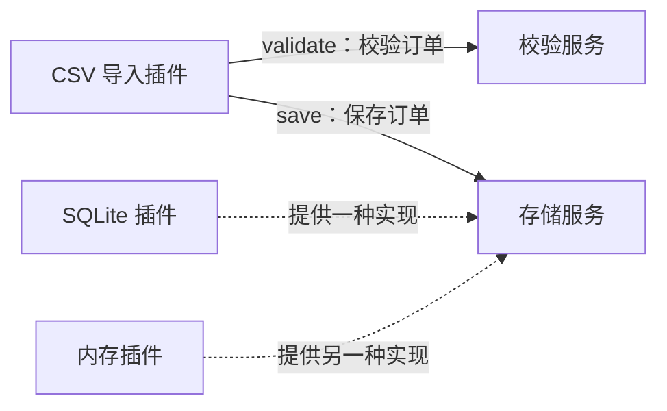
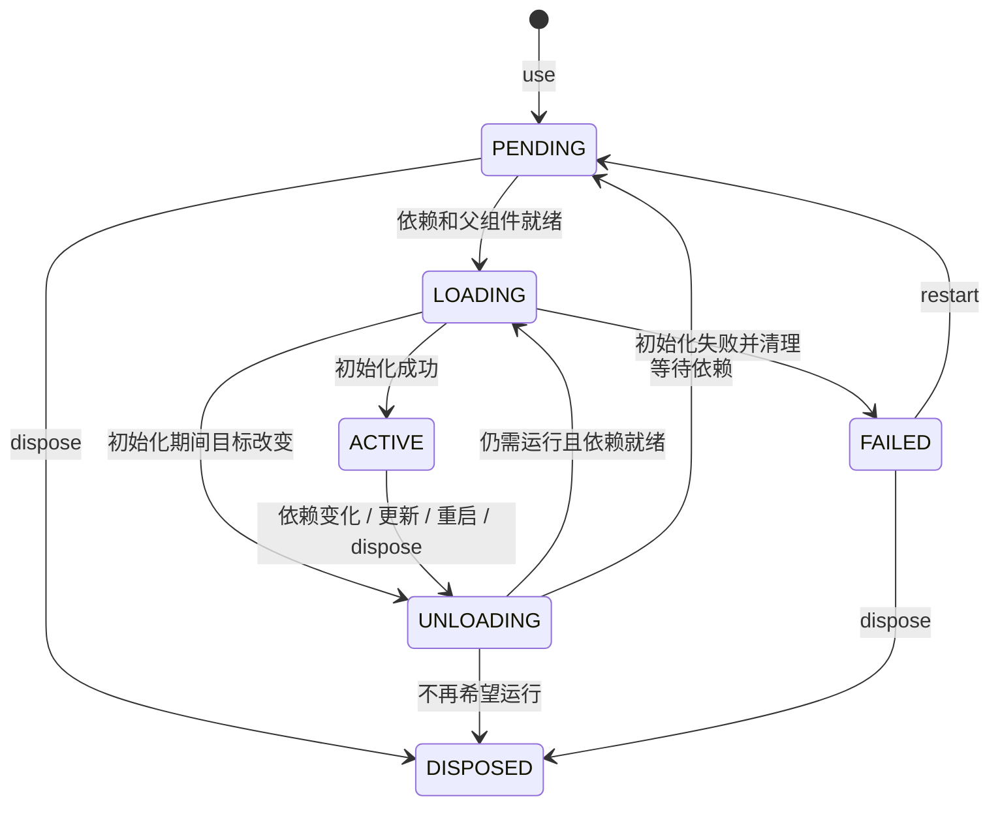
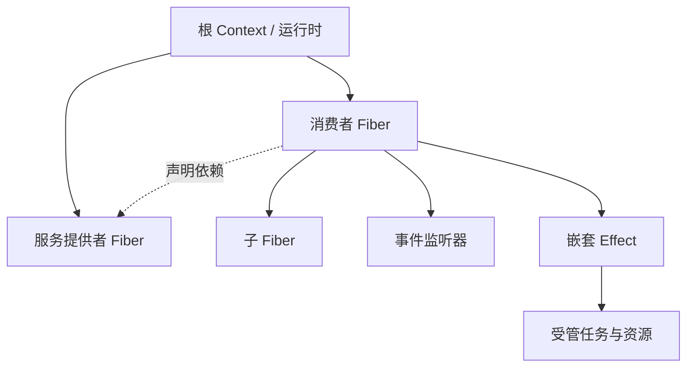

# 核心概念：场景讲解与术语参考

假设你正在写一个订单导入程序：发现 CSV 文件，检查订单金额，把合法订单写入数据库，再打印结果。

程序开始运行后，你希望把金额上限从 50 元调到 100 元，也可能换一个数据库，或临时关闭日志。这时，除了业务逻辑，还要安排一系列事情：停下旧监听器、处理正在导入的文件、关闭旧连接，再启动需要更新的部分。

**Cordis 帮你管理这些功能的启动、更新和退出。** 你告诉它功能之间需要什么、创建了哪些资源，它就能据此安排顺序。

这篇文档提供两种阅读方式：

- [沿着 CSV 示例理解](#1-写好一个插件还不等于运行了它)：先弄清插件、服务和 Context，再看配置变化时发生了什么。
- [按术语逐项查阅](#按术语查阅)：集中查看 Component、Fiber、Effect 等概念的定义、操作和边界。

场景部分使用仓库里的 [CSV 订单导入示例](scenarios.md)。方法参数和完整签名见 [API 参考](api.md)。

## 1. 写好一个插件，还不等于运行了它

先只看订单校验：给它订单号、客户和金额，它返回合法订单，或者说明哪里不符合规则。

项目中的 `validation` 插件负责创建这个校验对象。我们可以用下面的完整程序运行它。在 `python/` 目录保存为 `try_concepts.py`，执行 `uv run python try_concepts.py`：

```python
import asyncio

from examples.order_importer.definitions import AppContext, ValidateOrderRequest
from examples.order_importer.providers.validation import ValidationConfig, validation


async def main() -> None:
    async with AppContext() as root:
        # 创建并启动一次校验插件，金额上限为 5000 分，也就是 50 元。
        running = root.use(validation, ValidationConfig(max_amount_cents=5000))
        await running

        request = ValidateOrderRequest("ORD-001", "Alice", "25.00")
        print(root.validator.validate(request))

        # 更新这次运行的配置，让它接受 80 元的订单。
        await running.update(ValidationConfig(max_amount_cents=10000))
        request = ValidateOrderRequest("ORD-002", "Bob", "80.00")
        print(root.validator.validate(request))


asyncio.run(main())
```

输出中的金额以分为单位：

```text
Order(order_id='ORD-001', customer='Alice', amount_cents=2500)
Order(order_id='ORD-002', customer='Bob', amount_cents=8000)
```

这里有三个很像、但用途不同的名字：

| 代码里的名字 | 它是什么 | 什么时候使用 |
| --- | --- | --- |
| `validation` | 插件的定义，Cordis 称为 **Component** | 告诉运行时要运行哪一份功能 |
| `running` | 这一次运行的管理对象，称为 **Fiber** | 更新配置、重启或卸载这次运行 |
| `root.validator` | 插件提供的业务对象，称为**服务** | 真正调用 `validate()` 校验订单 |

所以，**管理插件用 Fiber，处理业务用服务**。`@plugin` 只是把函数变成插件定义；调用 `root.use(...)` 才把它加入应用。这个动作称为“挂载”：创建一次独立的运行，并在条件满足时启动插件。

同一份定义可以用不同配置挂载多次，每次都有自己的 Fiber 和资源。如果多次挂载会提供同名服务，就需要给它们分配不同的服务空间，后面的[两套实例](#6-同时运行两套实例让它们各用各的服务)会讲到。

`await running.update(...)` 在这里会按新配置重新运行校验插件。`await running.restart()` 则在配置没变时也重新运行；`await running.dispose()` 永久结束这次挂载。退出最外层的 `async with` 时，剩余插件会统一清理。

## 2. 插件通过服务协作

回到完整的 CSV 程序，导入一份文件需要两项能力：检查每一行是否合法，以及保存合法订单。

导入插件可以直接引用某个数据库类，但这样换存储时就要修改导入代码。这个例子选择把双方共同遵守的接口放进 [`definitions.py`](../examples/order_importer/definitions.py)：导入插件只调用存储接口，SQLite 和内存插件分别实现它。



图中的两个存储实现可以互换；在同一个服务空间里，一次只启用其中一个。

代码里的 `STORE`、`VALIDATOR` 就是找到这些服务的键。以存储为例：

```python
STORE = ServiceKey[OrderStore]("orders.store")
```

这一行摘自契约模块：`"orders.store"` 是服务名，`OrderStore` 说明服务要支持哪些操作，`ServiceKey` 把名字与接口类型关联起来。

三个动作分别负责不同的事：

| 写法 | 在表达什么 |
| --- | --- |
| 提供方调用 `ctx.provide(STORE, store)` | “这是我提供的存储对象。” |
| 调用方声明 `@plugin(inject=[STORE])` | “我运行时需要存储服务。” |
| 调用方执行 `ctx.store.save(order)` | “请当前的存储服务保存这份订单。” |

`ctx.store` 是示例在 `AppContext` 上定义的带类型属性，等价于 `ctx.service(STORE)`。它既能得到编辑器提示，也会检查调用方是否声明了依赖。

这就形成了你在 CSV 示例中看到的三角色：**契约定义能做什么，提供方实现它，调用方使用它。** `Protocol` 帮助类型检查器确认服务有哪些方法、接收什么参数；两种存储是否都按订单号更新、是否返回相同形式的结果，还需要共同的行为约定和测试。

如果只是想探查服务是否存在，可以用 `ctx.get(STORE)`，找不到时得到 `None`。但它不会自动替插件建立依赖关系；业务必须使用的服务仍应写进 `inject`。更多类型细节见[类型化插件开发](typing.md)。

## 3. Context 让这些操作有归属

前面一直出现 `ctx` 和 `root`，它们都是 **Context**。

`root` 由程序入口创建，用来装配整个应用。每个插件收到的 `ctx` 则带着这个插件的身份：通过它读取服务，也通过它登记监听器、任务和资源。

比如，[日志插件](../examples/order_importer/consumers/console.py)通过下面这行代码订阅导入完成事件；`completed` 是它自己定义的打印函数：

```python
ctx.on("orders/imported", completed)
```

由于监听器是通过日志插件的 Context 注册的，Cordis 知道：**日志插件卸载时，这个监听器也应移除。** 你不需要在程序入口另外维护一份“哪些监听器属于日志插件”的清单。

任务和子插件也一样：通过 `ctx.spawn(...)` 启动的工作由当前插件管理，通过 `ctx.use(...)` 挂载的子插件跟随父插件退出。后面会看到，资源还可以在插件内分组，单独结束其中一组。

这里要分清两种关系：

- **谁创建了谁**：日志插件创建了监听器，因此负责它的生命周期；父插件创建了子插件，子插件也跟随父插件存在。
- **谁需要谁**：CSV 导入插件需要存储服务，即使这两个插件都是由 root 分别挂载的，仍会通过依赖声明关联起来。

Context 同时帮助运行时回答这两个问题：当前代码可以取得哪些服务，以及当前创建的东西应该跟谁一起结束。

## 4. 配置变了，依赖它的功能也要跟着变

假设数据库还没启动，导入插件已经被挂载了。因为它声明了需要存储服务，Cordis 会先让它等待，而不是立即运行导入代码。

```text
缺少存储服务  → 等待
存储服务就绪  → 启动导入插件
存储服务退出  → 导入插件也开始退出
新存储就绪    → 重新启动导入插件
```

“运行需要先满足什么条件”，在 Cordis 的设计里叫 **Coeffect**。日常写插件时，最常见的用法就是 `inject=[STORE, VALIDATOR]`。你不需要自己写一个循环，不断判断两个服务有没有准备好。

金额配置从 50 元改成 100 元时，也会沿着同样的依赖关系更新。在本例中：

1. 宿主读到新配置，校验后要求更新校验插件。
2. 依赖旧校验服务的 CSV 导入插件开始退出；依赖导入服务的目录监听也停止扫描。
3. 已提交的导入任务按退出策略处理，旧校验服务等它们结束后再清理。
4. 新校验服务就绪，导入服务和目录监听重新启动。

目录监听重新启动后会再次检查已有 CSV，所以先前被拒绝的 80 元订单有机会通过。**重新扫描是这个示例的业务策略**；Cordis 本身只负责依赖变化引起的启动和退出，不会自动重试任意业务操作。

读状态时，先记住三个值就够了：`PENDING` 表示还在等条件，`ACTIVE` 表示初始化完成，`FAILED` 表示初始化失败。初始化中、退出中和永久结束也有对应状态，需要排查时再看 [FiberState 参考](api/plugins.md#fiberstate)。

状态变化也需要时间。例如，插件正在异步打开一个连接，已经开始的这一步会先完成，运行时再根据最新目标决定继续运行还是清理。这就是文档里“惯性”的含义；如果初始化一直不结束，配置切换也会被拖住。

有一点容易误会：`await fiber` 等的是当前这轮启动或退出操作，并不保证依赖一定齐全。它可能在 `PENDING` 状态返回；需要确认能否使用时，检查 `fiber.state`。`root.flush()` 也只等待这些状态变化稳定，不等待所有订单导入完成。

## 5. 退出时，先结束工作，再释放资源

如果文件导入到一半时更换数据库，直接关闭旧连接会让剩下的订单无处可写。先把新连接塞给导入任务，又可能让同一个文件的一部分写进旧库、一部分写进新库。

本例通过受管任务明确退出顺序：

```text
停止目录扫描，不再提交新文件
    ↓
已提交的导入任务继续使用旧服务，按策略完成或取消
    ↓
导入插件完成清理
    ↓
存储插件关闭旧连接
    ↓
新服务就绪后，恢复导入与目录扫描
```

### 正在运行的任务如何结束

两个任务的用途不同，退出方式也不同：

| 任务 | 为什么这样处理 | 示例使用的策略 |
| --- | --- | --- |
| 一直扫描目录 | 这是长期循环，需要告诉它停下来 | `policy="cancel"` |
| 导入一个 CSV | 希望让已经接下的有限工作先做完 | `policy="drain", timeout=5` |

这些策略在创建任务时传给 `ctx.spawn(...)`。其中的 5 秒是**开始卸载后的等待时间**，不是“每个文件只能处理 5 秒”；超过宽限期后请求取消，仍会等协程响应取消、执行完 `finally`。

目录监听还用 `asyncio.shield()` 等待文件导入，避免停止扫描时顺带取消本应排空的导入任务。裸 `asyncio.create_task()` 不会自动加入 Cordis 的这套管理；忽略取消或阻塞事件循环的代码也会拖延退出。

事件中的异步工作同样有归属。如果以后给日志插件加上异步上报函数，即使事件由目录监听插件发出，上报任务仍属于**注册它的日志插件**。事件派发方式和等待规则见[事件 API](api/context.md#事件)。

### 旧服务为什么还能用

插件开始运行时，Cordis 会记住它这次依赖的是哪个提供方。正常更新和卸载过程中，这份依赖关系会保留到该插件的任务与清理结束。

源码把它叫作 **committed view（已建立的依赖视图）**。放到这里理解，就是：使用旧连接的导入任务先退出，存储插件再关闭旧连接。它保持的是依赖关系，不会冻结数据库里的数据，也不是一笔数据库事务。

### 资源如何登记清理

Cordis 能安排清理顺序，还需要知道每项资源该怎样释放。它把这些有归属、带清理操作的工作称为 **Effect**。

通过 Context 注册的东西已经带着相应清理：监听器会注销，服务注册会移除，子插件会卸载。自己打开的数据库连接，则要把关闭方法交给运行时。SQLite 示例创建存储对象后，立即登记：

```python
yield store.close
```

这行位于生成器插件内部，传递的是关闭函数。Cordis 先记住它，再继续执行后续初始化；不是等到退出时才运行 `yield` 后面的代码。如果后面的建表步骤失败，已经登记的关闭操作仍会执行。

多个资源按登记的相反顺序清理。例如先取得连接，再创建依赖连接的资源，就先释放后者，再关闭连接。需要提前结束插件内的一组资源时，用 `handle = await ctx.effect(...)` 把它们放在一起，之后 `await handle()`；不手动结束也会跟随插件清理。

“清理”也有边界：关闭连接不会删除已经写入的订单，注销监听器不会收回已经发送的消息。业务数据要不要回滚，仍由应用的事务、幂等或补偿逻辑决定。

## 6. 同时运行两套实例，让它们各用各的服务

现在假设要同时为两个客户导入订单，各用各的存储和导入服务。它们的接口相同，但数据不能因为服务同名而混在一起。

Cordis 用 **Realm** 区分同名服务的使用空间。可以从 root 派生两个 Context，分别隔离存储和导入服务。下面的代码放在活跃的 root 中，服务键来自示例的契约模块：

```python
from examples.order_importer.definitions import IMPORTER, STORE

tenant_a = root.isolate(STORE, IMPORTER)
tenant_b = root.isolate(STORE, IMPORTER)
```

接着，把 A 的存储插件、导入插件和目录监听挂到 `tenant_a`，B 的挂到 `tenant_b`。它们读取同名服务时，就会各自找到本组的实例。这里只隔离了存储和导入服务；两组仍可以使用 root 中共同的校验服务。

要复用创建好的 `tenant_a`。每次重新调用 `root.isolate(...)` 都会创建新的服务空间，分别挂在不同空间的提供者和调用方无法因为键名相同而找到彼此。

有时不需要另一套服务，只希望同一个服务按调用方的要求提供不同用法。这时可以用 **Intercept** 传递元数据，让服务适配器决定如何处理。例如 `{"readonly": True}` 可以表达只读需求，但真正拒绝写操作的逻辑仍要由适配器实现。

这两个机制控制的是服务访问。隔离服务不会自动隔离事件，也不会创建新进程。所有派生 Context 仍共享根运行时，调用任一视图的 `close()` 都会关闭整个运行时；局部停用应使用对应 Fiber 或插件组。

## 7. 宿主把配置变化交给运行时

前面的最小程序直接写了 `root.use(...)`。插件多了之后，程序入口还要决定启用哪些插件、使用哪些配置，以及如何处理文件变更和错误。负责这些事的入口程序就是**宿主**。

**Loader** 帮宿主维护目标插件清单。每一项都有稳定的 `Entry.id`：第二次提交同一个 id、新的配置，Loader 就更新已有挂载；清单中移除某个 id，就卸载它。这样宿主可以表达“现在希望运行哪些插件”，不用手动对比每个实例。

CSV 示例中的分工是：宿主监听 TOML，校验外部数据并转成配置对象；Loader 应用插件清单；各插件负责自己的业务与资源。文件变化后自动重扫、打印什么日志，也由示例代码决定。

还要区分配置更新和代码更新：

| 你修改了什么 | 需要做什么 |
| --- | --- |
| 金额上限、数据库路径、日志开关 | 宿主读入新配置，交给 Fiber 或 Loader 更新 |
| Python 文件里的校验实现 | 重新启动进程，或接入 **HMR** 重新导入代码并替换插件 |

`fiber.restart()` 重新运行的是内存中已有的插件定义，不会重新读取修改后的 Python 文件。HMR 才处理模块代码变化：根据导入关系找到受影响插件，替换它们，失败时尝试恢复旧代码和挂载。

这些恢复都有范围。Loader 的整份清单更新不是原子事务；HMR 也无法撤销模块导入时已经发生的任意外部操作。更具体的失败处理、并发更新限制和 HMR 边界，放在[实现与维护参考](implementation.md#当前限制与风险)中。

## 按术语查阅

这一部分保留逐项解释的阅读方式。每节集中说明一个概念的定义、常用操作和边界，可以单独查阅；前面的 CSV 流程则提供它们如何一起工作的具体背景。

- [Component：可复用的插件定义](#component可复用的插件定义)
- [Fiber：一次挂载的运行实例](#fiber一次挂载的运行实例)
- [Context：实例的运行入口与服务视图](#context实例的运行入口与服务视图)
- [Effect：操作与它的清理](#effect操作与它的清理)
- [Coeffect：插件运行所需的条件](#coeffect插件运行所需的条件)
- [Committed view：退出过程中仍然使用原依赖](#committed-view退出过程中仍然使用原依赖)
- [Task 与 Event：工作属于谁](#task-与-event工作属于谁)
- [ServiceKey、Protocol 和类型边界](#servicekeyprotocol-和类型边界)
- [Realm 与 Intercept：选服务和调整视图](#realm-与-intercept选服务和调整视图)
- [Loader 与 HMR：协调配置和替换代码](#loader-与-hmr协调配置和替换代码)

### Component：可复用的插件定义

`@plugin` 把函数包装为 `Component[Config, Context]`。它描述初始化逻辑、配置类型、依赖、服务承诺以及可选的校验和更新 hook。

例如，下面是 [CSV 导入插件](../examples/order_importer/providers/csv.py)的定义节选，其中的类和服务键由该模块导入或定义：

```python
@plugin(inject=[STORE, VALIDATOR], provide=[IMPORTER])
def importer(ctx: AppContext, _config: None) -> None:
    ctx.provide(IMPORTER, CsvImporter(ctx))
```

这里只定义了组件，还没有启动它。函数体在对应实例具备激活条件时才执行；重启会再次执行初始化，因此初始化逻辑必须为每次产生的资源登记清理。

同一个 Component 可以用不同配置挂载多次。组件定义适合在模块间共享，每次运行的资源应放在对应实例的闭包、对象或受管作用域里。

### Fiber：一次挂载的运行实例

例如，`fiber = ctx.use(validation, config)` 创建校验插件的一次挂载，返回 `Fiber[ValidationConfig, AppContext]`。Fiber 保存配置、当前 Context、状态、错误和任务等运行信息。

| 操作 | 含义 |
| --- | --- |
| `fiber.config` / `fiber.ctx` | 当前配置和实例 Context，保留泛型类型 |
| `await fiber` | 等待这个实例当前的生命周期转换，检查保存的启动错误 |
| `await fiber.update(new_config)` | 校验配置；默认在变化时重启，失败时尝试恢复旧配置 |
| `await fiber.restart()` | 使用当前组件和配置重新启动，不重新导入 Python 模块 |
| `await fiber.dispose()` | 永久移除该挂载；之后不能再重启这个 Fiber |
| `fiber.tasks` | 该实例当前未结束的受管任务快照 |

生命周期的主要路径：



`PENDING` 通常表示等待条件，不等于故障；`FAILED` 表示启动失败。上图突出常见路径，状态名在 Python 中是 `FiberState`，值为小写字符串。

如果插件提供了自定义 `update` hook，处于 ACTIVE 时可以原地更新；hook 对业务对象的修改需要自行负责回滚。完整方法行为见 [Fiber API](api/plugins.md#fiber)。

“惯性”意味着已开始的初始化或清理会先完成，运行时再根据最新目标继续转换。它不会为了立刻切换配置，任意打断初始化到一半的插件；这也意味着长期阻塞的初始化会延迟后续变更。

`await fiber` 不保证返回时一定 `ACTIVE`：没有正在进行的转换、但依赖仍缺失时，它可以保持 `PENDING` 返回。`ctx.flush()` 同样只等待生命周期转换，不是全局就绪屏障，也不会等待所有业务任务完成。

### Context：实例的运行入口与服务视图

Context 同时携带生命周期归属和服务解析规则：

| 调用 | 归属与作用 |
| --- | --- |
| `ctx.use(...)` | 创建属于当前作用域的子插件 |
| `ctx.provide(KEY, value)` | 注册属于当前作用域的服务 |
| `ctx.service(KEY)` / `ctx[KEY]` | 按声明、Realm 和依赖视图读取服务 |
| `ctx.on(...)` | 注册随当前作用域卸载的监听器 |
| `ctx.spawn(...)` | 创建先于所属资源清理完成的受管任务 |
| `await ctx.effect(...)` | 创建可单独释放的嵌套 Effect 作用域 |
| `ctx.isolate(...)` / `ctx.intercept(...)` | 派生具有不同服务解析规则的 Context |

宿主创建根 Context，插件接收运行时为它派生的 Context。子组件、服务、事件、任务和嵌套 Effect 都通过这个入口取得生命周期归属。



**父子归属和服务依赖是两种关系。** 子插件跟随父插件存在；消费者与提供者可以是兄弟插件，只通过服务声明建立依赖。父组件尚未激活时，子组件不会抢先运行。

派生 Context 共享同一个运行时。`ctx.close()` 关闭的是整个运行时，因此由宿主持有根 Context 并负责关闭；局部停用通过 Fiber 或 Loader 完成。

自定义 `AppContext` 适合声明服务描述符。派生过程会保留子类类型，但不会重新调用你的 `__init__`；不要假设在自定义构造函数里赋值的普通实例字段会自动复制给所有派生 Context。

### Effect：操作与它的清理

Effect 是插件运行时创建的作用及其生命周期管理。可逆性来自明确的逆操作，例如注册监听器对应注销、打开连接对应关闭，而不是解释器自动记住所有改动。

有三种常用登记方式：

| 写法 | 适合场景 |
| --- | --- |
| 插件返回 `cleanup` | 一份需要统一释放的资源 |
| 生成器逐次 `yield cleanup` | 分步骤获得多个资源，保护部分初始化失败 |
| `handle = await ctx.effect(callback)` | 需要独立生命周期的嵌套资源组 |

`ctx.provide()`、`ctx.on()` 和 `ctx.use()` 已经登记相应的撤销动作。自己创建的外部资源则要显式登记清理。异步初始化和异步清理也受支持。

每个逆操作在生成器继续下一步前注册；后续步骤失败时，已经登记的操作仍会回滚。清理按后进先出（LIFO）执行；某个清理抛错后，其余清理仍会尝试执行，普通异常最终聚合报告。

`EffectHandle` 可以提前释放，例如 `await handle()`；重复释放是幂等的。嵌套 Effect 内注册的监听器、任务和资源随它一起释放，也随外层插件一起释放。

清理资源不等于撤销业务结果：关闭文件不会还原内容，关闭数据库连接不会回滚已经提交的交易，注销监听器不会收回已经发送的消息。Cordis 只管理已纳入作用域的操作及明确提供的逆操作。

### Coeffect：插件运行所需的条件

可以把 Coeffect 理解为组件对运行环境的要求。在这个实现中，最常见的形式是 `inject=[KEY]`：必须有当前 Context 可见、可用的服务提供者，组件才能激活。

```text
消费者挂载 → 缺少服务 → pending
服务可用   → 条件满足 → 初始化消费者 → active
服务失效   → 条件失效 → 卸载消费者   → pending
服务恢复   → 条件恢复 → 再次初始化消费者
```

消费者使用服务键或描述符读取服务时，会进行运行时声明检查。通常直接在组件的 `inject` 中列出所需服务；父作用域已经声明且位于同一 Realm 的依赖也可以被继承。根 Context 可用于宿主读取服务。

`ctx.get(KEY)` 是反射式查询：类型为 `T | None`，允许查询未声明的服务，但不会自动增加响应式依赖。如果业务运行确实要求这个服务，仍应声明 `inject`。

提供者可用 `ctx.provide(KEY, value, check=...)` 定义针对消费者 Context 的可用性条件；外部条件变化后，调用 `ctx.notify(KEY)` 请求重新评估。

`ctx.set(KEY, new_value)` 是提供者更新已注册值的接口，本身不会触发一整轮消费者重启。若变更要求依赖者完整退出和重新初始化，应通过提供者的更新或重启流程表达。

### Committed view：退出过程中仍然使用原依赖

插件激活时会保留当次使用的依赖视图。服务开始退出后，新消费者不能再进入，但已经运行的消费者在排空任务、执行 cleanup 时仍可以读取原来的服务。

以依赖数据库的 worker 为例，正常退出顺序是：

1. 数据库开始退出，停止对新消费者提供服务。
2. worker 停止接收新的事件和任务。
3. worker 的在途任务按策略完成或取消，`finally` 执行完毕。
4. worker 清理资源，期间仍能通过它的 Context 使用原数据库。
5. 数据库提供者执行自己的清理，关闭连接。

这称为 committed view：当次激活所采用的依赖在整个退出阶段保持可读。它保证生命周期中的引用一致性，不是业务数据快照或数据库事务隔离。

任务必须纳入运行时管理，资源也必须按约定登记清理，才能参与上述顺序。可运行示例见[安全卸载 Demo](../examples/graceful_unload.py)。

### Task 与 Event：工作属于谁

`ctx.spawn(awaitable)` 返回普通 `asyncio.Task[T]`，同时把任务登记到当前插件或嵌套 Effect。卸载一个作用域时，运行时先处理其中的任务，再执行资源逆操作。

| 策略 | 卸载行为 |
| --- | --- |
| `policy="drain"`，默认 | 等待自然完成，适合有限请求 |
| `policy="drain", timeout=5` | 从卸载开始等待 5 秒，未结束则请求取消 |
| `policy="cancel"` | 立即请求取消，然后等待协程及其 `finally` 退出 |

取消是协作式的。忽略取消的协程可以阻止卸载完成；阻塞事件循环的代码也会阻塞其他插件。裸任务和底层线程不自动获得同样的生命周期保证。

异步事件监听器由运行时自动登记任务，其归属是**注册监听器的 Context**，不是派发事件的 Context。同步监听器内通过 Context 注册的操作也归属监听器所在作用域。

| 事件方法 | 使用方式 |
| --- | --- |
| `emit` | 同步触发监听器，调度异步结果后返回；不等待异步处理完成 |
| `parallel` | 并发等待监听器，返回 `None`；普通异常聚合报告 |
| `serial` | 顺序执行，返回第一个既不是 `None` 也不是 `False` 的结果 |
| `bail` | 同步短路派发，不接受异步结果 |
| `waterfall` | 通过 `next_` 延续调用的中间件链 |

`on()` 返回可释放的监听器句柄；`once()` 最多执行一次回调。异步监听器通过 `task_policy` 和 `timeout` 设置任务退出策略。当前 `once()` 使用异步包装，不能与仅支持同步监听器的 `bail()` 搭配；详见[事件 API](api/context.md#事件)。

更新、卸载和关闭由宿主协调。受管任务不能等待自身、所属父作用域或依赖提供者的卸载完成，否则会形成“卸载等任务、任务等卸载”的死锁；运行时会对这些情况报错。

### ServiceKey、Protocol 和类型边界

这几个类型各自解决不同的问题：

| 类型 | 表达什么 |
| --- | --- |
| `Protocol` | 服务对象应支持哪些方法或调用签名 |
| `ServiceKey[T]` | 一个服务名关联的静态接口 `T` |
| `Component[Config, Ctx]` | 插件接受什么配置、需要什么 Context 类型 |
| `Fiber[Config, Ctx]` | 运行实例继续保留组件的配置与 Context 类型 |
| `AppContext` 上的服务描述符 | 把 `ctx.service(KEY)` 包装成有类型的只读属性 |

`ServiceKey[T]` 不会在运行时检查对象是否符合 `T`。类型检查器负责接口匹配，运行时负责依赖声明、可用性、隔离域和生命周期；两者互补。

服务键按字符串名称进入现有服务命名空间。同名的两个 key 不会创建两个服务身份，也不会因为类型参数不同而自动隔离。共享键应由一个契约模块统一定义，例如 CSV 示例中的 `definitions.py`。

字符串服务读取、字符串事件、动态导入、配置文件和异构 `Entry` 都保留动态边界。外部配置应先检查并转换成业务类型；dataclass 注解本身不会验证任意 JSON/TOML 数据。完整类型契约见[类型化插件开发](typing.md)。

### Realm 与 Intercept：选服务和调整视图

**Realm 决定同名服务解析到哪一组实例。** 同一个 Realm 内，同名服务只能有一个提供者；不同 Realm 可以同时运行各自的同名提供者。

例如，在活跃 root 中为 CSV 示例的存储和导入服务创建独立视图，服务键来自契约模块：

```python
from examples.order_importer.definitions import IMPORTER, STORE

tenant = root.isolate(STORE, IMPORTER)
```

把该组的存储、导入和目录监听插件都挂到 `tenant`，即可使用这组独立服务。一次 `isolate()` 产生一个派生视图，后续挂载必须复用它；未隔离的校验服务继续使用继承的 Realm。完整隔离示例也可参考[教程第 7 节](tutorial.md#7-为两套实例隔离服务)。

**Intercept 给服务访问附加元数据。** `ctx.intercept(KEY, metadata)` 或注入声明中的 metadata 可以沿 Context 合并，提供者通过 `adapt(value, metadata, consumer_ctx)` 决定向消费者返回什么视图。

例如 `{"readonly": True}` 只是元数据，只有服务适配器真正实现只读限制时才有效。Intercept 不自动复制数据库，也不自动实施权限控制。Realm 和 Intercept 都不是操作系统或进程级安全隔离。

事件派发范围另由 `scope` 控制；隔离服务不会自动隔离所有事件。派生 Context 也共享根运行时的关闭边界。

### Loader 与 HMR：协调配置和替换代码

Loader 用稳定的 `Entry.id` 比较“已有挂载”和“目标清单”，决定新增、更新、禁用或移除。`children` 可以表达有共同父生命周期的插件组。

Loader 中的 `isolate={"database": "tenant-a"}` 会让同一个 Loader 下使用同名标签的对应服务共享 Realm。`True` 表示该条目自己的私有 Realm；它与另一条目的 `True` 不相通。

| 层次 | 管理对象 | 关键边界 |
| --- | --- | --- |
| Fiber 更新 / 重启 | 一个组件实例及受影响的生命周期 | 重用当前已导入的组件定义 |
| Loader reconcile | 一组稳定 id 的配置条目 | 逐项变更，不是整个清单的原子事务 |
| HMR | 受静态导入关系影响的模块与插件 | 替换模块缓存并重建组件，失败时尝试恢复旧状态 |

`loader.reload(id)` 对字符串定位符执行代码重载，对直接传入的 Component 或函数执行实例重启。`loader.reload_changed(paths)` 用模块依赖图计算影响范围。

HMR 对模块缓存和受管组件进行恢复，不会撤销模块顶层已经产生的任意外部副作用；静态导入分析也无法完整捕获动态导入和外部长期持有的对象。`reload_changed()` 的影响范围触及配置的 `externals` 模块时，会抛出 `FullRestartRequired`，由宿主选择重启进程；低层显式重载的区别见 [HMR API](api/hmr.md)。

## 接下来可以做什么

| 你想进一步弄清楚什么 | 从哪里继续 |
| --- | --- |
| 实际修改配置，观察插件更新 | [CSV 导入实战](scenarios.md) |
| 自己写一个提供方和调用方 | [使用教程](tutorial.md) |
| 查询某个方法的参数和返回值 | [API 参考](api.md) |
| 给接口、配置和 Context 加上类型检查 | [类型化插件开发](typing.md) |
| 排查启动、清理或重载问题 | [实现与维护参考](implementation.md) |
