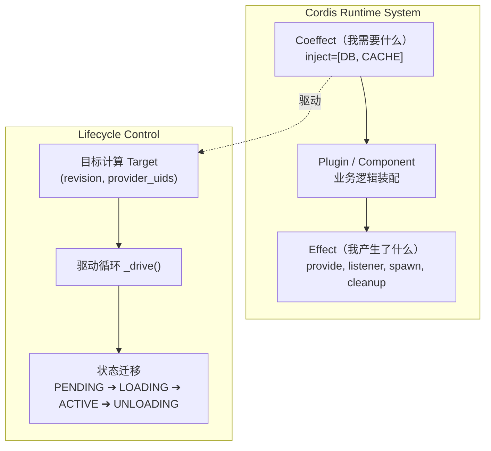
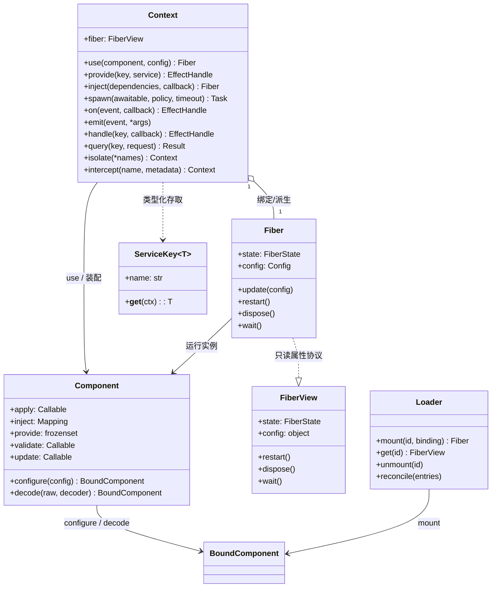
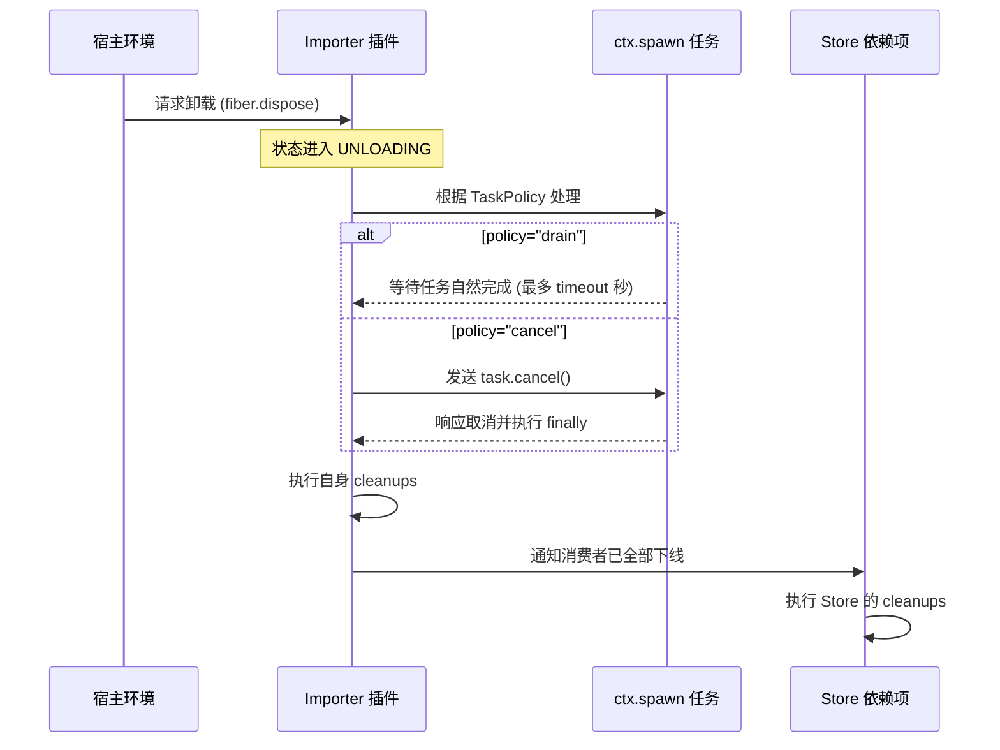
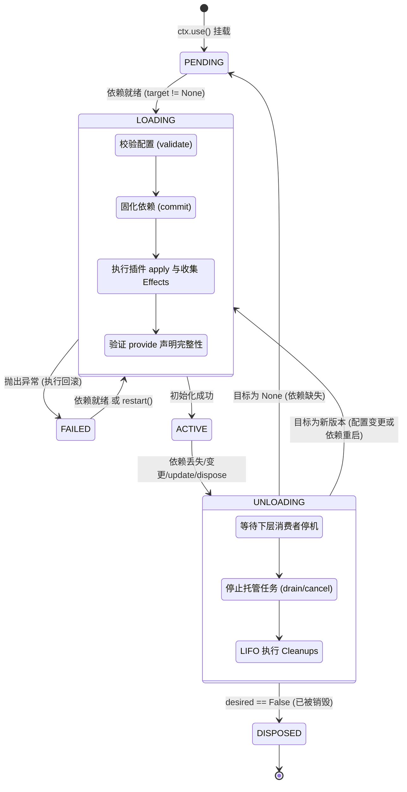
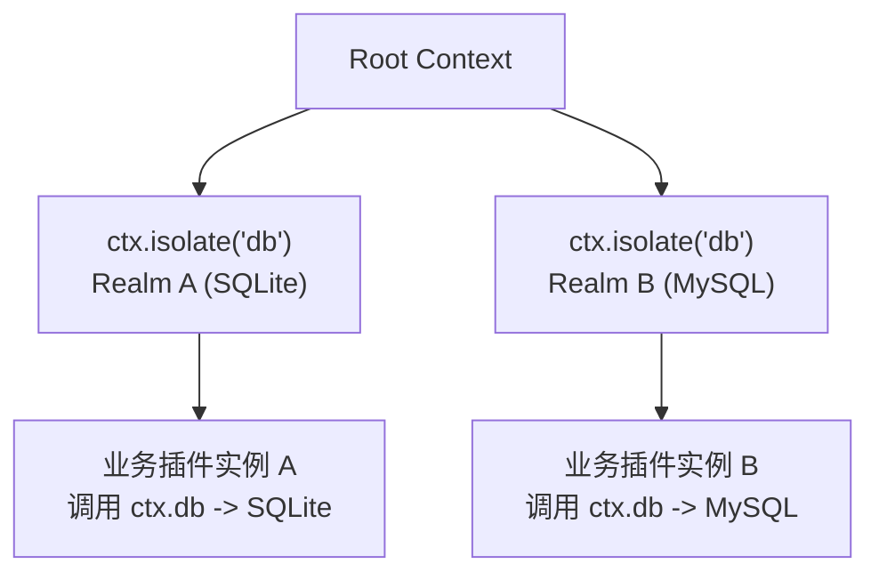

# Cordis (Python) 开发者完全指南：从入门到深入剖析与高频 Q&A

> 本文档针对 Cordis Python 原生实现（位于 [`src/cordis`](../src/cordis)）。要求 Python 3.11+ 环境。

---

## 目录

- [1. 全景认知：Cordis 是什么与解决什么问题](#1-全景认知cordis-是什么与解决什么问题)
  - [1.1 架构起源与设计哲学](#11-架构起源与设计哲学)
  - [1.2 为什么传统依赖注入与单例模式不够用？](#12-为什么传统依赖注入与单例模式不够用)
  - [1.3 Cordis 核心价值与三要素](#13-cordis-核心价值与三要素)
- [2. 核心架构与核心原语 (Core Primitives)](#2-核心架构与核心原语-core-primitives)
  - [2.1 Context（上下文）：时空与副作用的枢纽](#21-context上下文时空与副作用的枢纽)
  - [2.2 Component（组件/插件定义）：静态蓝图](#22-component组件插件定义静态蓝图)
  - [2.3 Fiber（纤程）：活态生命周期句柄](#23-fiber纤程活态生命周期句柄)
  - [2.4 Service 与 ServiceKey：强类型契约](#24-service-与-servicekey强类型契约)
  - [2.5 Effect 与 Coeffect：副作用与代数效应落地](#25-effect-与-coeffect副作用与代数效应落地)
- [3. 开发者入门实战：编写健壮的插件体系](#3-开发者入门实战编写健壮的插件体系)
  - [3.1 环境准备与基本结构](#31-环境准备与基本结构)
  - [3.2 编写与装配最简插件 (Hello World)](#32-编写与装配最简插件-hello-world)
  - [3.3 声明服务契约与带类型的 AppContext](#33-声明服务契约与带类型的-appcontext)
  - [3.4 服务的提供 (Provide) 与消费 (Inject)](#34-服务的提供-provide-与消费-inject)
  - [3.5 资源与清理：Effect 的四种实现形态](#35-资源与清理effect-的四种实现形态)
  - [3.6 托管后台并发任务：`ctx.spawn`](#36-托管后台并发任务ctxspawn)
  - [3.7 事件总线全景：广播、并行、短路与流水线](#37-事件总线全景广播并行短路与流水线)
- [4. 深入剖析与底层原理 (Deep Dive & Internals)](#4-深入剖析与底层原理-deep-dive--internals)
  - [4.1 Fiber 状态机与驱动循环 (`_drive`)](#41-fiber-状态机与驱动循环-_drive)
  - [4.2 目标计算 (Target Computation) 与惯性并发保护](#42-目标计算-target-computation-与惯性并发保护)
  - [4.3 提交视图 (Committed View) 防护依赖漂移](#43-提交视图-committed-view-防护依赖漂移)
  - [4.4 效应作用域树、Sink 与 `contextvars` 拦截机制](#44-效应作用域树sink-与-contextvars-拦截机制)
  - [4.5 优雅停机级联与 LIFO 清理序列](#45-优雅停机级联与-lifo-清理序列)
  - [4.6 多租户与服务隔离：Realm 体系](#46-多租户与服务隔离realm-体系)
  - [4.7 服务拦截与元数据适配：Intercept 机制](#47-服务拦截与元数据适配intercept-机制)
  - [4.8 声明式配置增量调和：`Loader.reconcile`](#48-声明式配置增量调和loaderreconcile)
  - [4.9 源码级模块热替换：`HMR` 与 `ModuleGraph`](#49-源码级模块热替换hmr-与-modulegraph)
- [5. 高频问答与生产避坑指南 (Q&A)](#5-高频问答与生产避坑指南-qa)
  - [Q1: Cordis 与常规依赖注入（如 FastAPI Depends / dependency-injector）有何本质差异？](#q1-cordis-与常规依赖注入如-fastapi-depends--dependency-injector有何本质差异)
  - [Q2: 为什么我的插件状态一直是 `pending`？排查路径是什么？](#q2-为什么我的插件状态一直是-pending排查路径是什么)
  - [Q3: `await fiber` 到底在等什么？它会无限挂起等待未来依赖吗？](#q3-await-fiber-到底在等什么它会无限挂起等待未来依赖吗)
  - [Q4: 为什么严禁在插件内直接调用 `asyncio.create_task()`？](#q4-为什么严禁在插件内直接调用-asynciocreate_task)
  - [Q5: `ctx.spawn` 的 `policy="drain"` 与 `policy="cancel"` 该如何抉择？](#q5-ctxspawn-的-policydrain-与-policycancel-该如何抉择)
  - [Q6: 清理阶段（Cleanup）抛出异常会怎样？会阻断其他资源释放吗？](#q6-清理阶段cleanup抛出异常会怎样会阻断其他资源释放吗)
  - [Q7: 插件如何支持“配置原地热更”而不重启销毁服务？](#q7-插件如何支持配置原地热更而不重启销毁服务)
  - [Q8: 为什么在协程任务内部调用 `await fiber.dispose()` 会抛出 `InactiveContextError`？](#q8-为什么在协程任务内部调用-await-fiberdispose-会抛出-inactivecontexterror)
  - [Q9: 如果插件之间出现循环依赖（A 依赖 B，B 依赖 A）会发生什么？](#q9-如果插件之间出现循环依赖a-依赖-bb-依赖-a会发生什么)
  - [Q10: 生产级系统使用 Cordis 有哪些已知局限与加固建议？](#q10-生产级系统使用-cordis-有哪些已知局限与加固建议)

---

## 1. 全景认知：Cordis 是什么与解决什么问题

### 1.1 架构起源与设计哲学

Cordis 是一个面向**时空可组合（Spatiotemporally Composable）组件**的微内核运行时。它起源于 Node.js/TypeScript 生态下高扩展聊天机器人与复杂长周期服务架构（如 Koishi），并在本仓库中针对 Python 3.11+ 异步生态（`asyncio`, `contextvars`, `ExceptionGroup`）进行了现代化原生重构。

在传统 Python 服务中，开发者通常把系统拆解为模块、类或简单的函数包。然而一旦进入**长时间常驻进程、配置动态调整、插件自主加载/卸载、多模块生命周期交织**的场景，系统复杂度往往会呈指数级上升：
- 数据库重配时，依赖数据库的 HTTP/MQ 消费者是否先停止拉取消息、再排空在途请求、再优雅关闭数据库连接？
- 动态插件卸载后，其注册的路由、事件监听器、文件句柄、定时器是否被 100% 撤销，不留下任何悬空对象与内存泄漏？
- 当某个插件因为缺少配置或网络超时加载失败时，已部分初始化的资源能否自动、安全地回滚？

Cordis 的核心哲学就是：**将“服务依赖（Coeffect）”与“资源副作用（Effect）”显式化纳入运行时拓扑管理。你只需声明插件“需要什么”与“创建了什么”，生命周期的调度、级联停机与资源回收全交由运行时接管。**

### 1.2 为什么传统依赖注入与单例模式不够用？

| 维度 | 全局单例 / 模块级导入 | 经典 DI 框架 (如 dependency-injector / FastAPI Depends) | Cordis 运行时 |
| :--- | :--- | :--- | :--- |
| **拓扑感知** | 静态单向导入，无法动态感知反向依赖 | 偏向请求级或静态启动图装配 | **全程动态拓扑管理**，感知依赖者与被依赖者双向关系 |
| **生命周期动态性** | 进程启动初始化，退出前销毁；中途无法变更 | 容器初始化后结构通常固化，动态启停/替换成本极高 | **第一类公民**：随时 `use()`, `dispose()`, `restart()`, `update()` |
| **级联停机顺序** | 需人工编写冗长脆弱的 teardown 逻辑 | 缺乏由消费者到提供者的级联反向排空机制 | **自动拓扑反向停机**：先排空消费者协程任务，再清理消费者资源，最后关闭底层提供者 |
| **异步任务管理** | 裸跑 `asyncio.create_task` 极易变成孤儿协程 | 通常不负责托管协程任务的生命周期边界 | **`ctx.spawn` 强绑定**：按 `drain` / `cancel` 策略在插件卸载前强制回收 |
| **多租户与隔离** | 全局唯一，多实例需改写代码传递实例参数 | 依赖 Provider 重定义或工厂，容易污染全局 | **原生 Realm 隔离**：同一个 Context 树下局部无感隔离独立服务实例 |

### 1.3 Cordis 核心价值与三要素



Cordis 的运行逻辑紧紧围绕三要素运转：
1. **契约（Contracts & Keys）**：通过 `ServiceKey` 声明强类型接口，消费者与提供者解耦，仅依赖接口契约。
2. **状态与纤程（Fiber & Drive Loop）**：每个加载的组件对应一个 Fiber。依赖可用即进入 `ACTIVE`，依赖缺失或变更即优雅卸载并回到 `PENDING`。
3. **效应闭包（Effect Sinks）**：所有注册的服务、事件监听、文件句柄、后台协程，都注册在当前作用域的 Sink 树中，卸载时以严格的 LIFO 逆序自动撤销。

---

## 2. 核心架构与核心原语 (Core Primitives)

在深入代码之前，必须建立清晰的概念模型：



### 2.1 Context（上下文）：时空与副作用的枢纽

`Context` 是 Cordis 中最核心的对象。它并非仅是简单传参的数据字典，而是**环境在特定时间和空间切片下的投影**：
- **时序生命周期（Time）**：每个插件执行时拿到的 `ctx` 都隐式绑定了该插件的 `Fiber` 和生命周期作用域。
- **空间隔离（Space）**：通过 `ctx.isolate()` 和 `ctx.intercept()`，可以在保留父级能力的同时，在子树中局部隔离服务或注入配置拦截元数据。
- **派生（Derivation）**：系统初始创建一个 Root Context，每当调用 `ctx.use()` 挂载插件时，运行时会自动通过 `_derive()` 派生出属于该插件的专用子 Context。

### 2.2 Component（组件/插件定义）：静态蓝图

`Component` 是无状态的静态定义，描述了一段功能逻辑：
- 包含 `apply`（初始化函数）、`inject`（依赖的服务清单）、`provide`（对外提供的服务名列表）。
- 可选包含 `validate`（配置校验逻辑）和 `update`（配置原地更新钩子）。
- **同一个 Component 可以被多次 `use()`**，每一次挂载都生成一个独立的运行实例。

代码内交给 Loader 装配时，先 `component.configure(config)` 得到 BoundComponent，再 `await loader.mount(id, binding)`。外部配置先 `await component.decode(raw, decoder)` 转为业务配置；两种方式都保留配置与 Context 的类型关系，尚未挂载时不会执行 validate 或初始化。

### 2.3 Fiber（纤程）：活态生命周期句柄

`Fiber` 是 `Component` 挂载到 `Context` 后生成的动态运行实例：
- 拥有独立的状态机（`FiberState`）：`PENDING`、`LOADING`、`ACTIVE`、`FAILED`、`UNLOADING`、`DISPOSED`。
- `ctx.use()` 与 `Loader.mount()` 返回 Fiber[ConfigT, ContextT]：调用 update 时检查 ConfigT，dispose 时卸载。`await fiber` 等待当前生命周期转换，缺少依赖时仍可返回 PENDING。

`ctx.fiber`、运行时列表、错误归属和 `loader.get/reload` 返回 FiberView。它的属性只读，支持等待、重启和卸载，静态接口没有 update。业务更新应保存挂载返回的类型化 Fiber；视图不是运行时包装或配置深拷贝。迁移例子见[类型化运行接口迁移](migration-typed-interfaces.md)。

### 2.4 Service 与 ServiceKey：强类型契约

- **Service**：插件暴露给其他插件调用的业务实例（如数据库连接池、HTTP 客户端、加解密引擎）。
- **ServiceKey[T]**：继承自 `Generic[T]` 的不可变数据结构，将字符串服务名与 Python 类型绑定。它同时是一个 **Descriptor（描述符）**，挂载到自定义的 `AppContext` 类上，能够获得 mypy 严格类型检查和 IDE 智能补全。

### 2.5 Effect 与 Coeffect：副作用与代数效应落地

- **Coeffect（入边依赖）**：组件正常工作所需的先决上下文。例如“我必须在有可用缓存服务与数据库服务时才能运行”。
- **Effect（出边效应）**：组件在运行期间向环境引入的变化。例如“我向 Context 注册了订单服务”、“我打开了 TCP 端口”、“我监听了新文件通知事件”。**Cordis 确保任何 Effect 都有对应的逆操作（Cleanup）**。

---

## 3. 开发者入门实战：编写健壮的插件体系

我们将通过一个渐进式示例，演示如何使用 Cordis 搭建高扩展、高可维护的插件化系统。

### 3.1 环境准备与基本结构

推荐标准的项目目录组织：

```text
my_project/
├── contracts.py       # 共享契约：接口定义、ServiceKey、AppContext
├── main.py            # 宿主入口：初始化 Context 并装配插件
└── plugins/
    ├── database.py    # 底层服务提供者
    ├── greeter.py     # 业务能力提供者
    └── consumer.py    # 业务消费者与后台任务
```

### 3.2 编写与装配最简插件 (Hello World)

最基础的插件就是一个接收 `(ctx, config)` 的普通函数，使用 `@plugin` 装饰：

```python
import asyncio
from cordis import Context, plugin


@plugin
def hello_plugin(ctx: Context, name: str) -> None:
    print(f"[HelloPlugin] 加载成功，你好，{name}！")


async def main() -> None:
    async with Context() as root:
        fiber = root.use(hello_plugin, "World")
        await fiber  # 等待插件激活就绪


if __name__ == "__main__":
    asyncio.run(main())
```

运行输出：
```text
[HelloPlugin] 加载成功，你好，World！
```

### 3.3 声明服务契约与带类型的 AppContext

在正式项目中，切忌使用散落的硬编码字符串存取服务。使用 `ServiceKey` 与 `Protocol` 构建强类型契约：

```python
# contracts.py
from dataclasses import dataclass
from typing import Protocol
from cordis import Context, ServiceKey


# 1. 定义服务接口
class Database(Protocol):
    def query(self, sql: str) -> list[dict[str, object]]: ...


class Greeter(Protocol):
    def greet(self, user: str) -> str: ...


# 2. 定义强类型服务键
DB_KEY = ServiceKey[Database]("database")
GREETER_KEY = ServiceKey[Greeter]("greeter")


# 3. 声明子类化 AppContext，挂载只读描述符
class AppContext(Context):
    db = DB_KEY
    greeter = GREETER_KEY


# 4. 定义插件配置（推荐不可变 dataclass）
@dataclass(frozen=True)
class GreeterConfig:
    prefix: str = "Hello"
```

### 3.4 服务的提供 (Provide) 与消费 (Inject)

#### 服务提供者（Provider）
服务提供者使用 `provide=[KEY]` 声明能力，并在函数体内通过 `ctx.provide()` 发布：

```python
# plugins/greeter.py
from cordis import plugin
from contracts import AppContext, GREETER_KEY, GreeterConfig, Greeter


class StandardGreeter:
    def __init__(self, prefix: str) -> None:
        self.prefix = prefix

    def greet(self, user: str) -> str:
        return f"{self.prefix}, {user}!"


@plugin(provide=[GREETER_KEY])
def greeter_plugin(ctx: AppContext, config: GreeterConfig) -> None:
    # 注册服务实例到运行时
    ctx.provide(GREETER_KEY, StandardGreeter(config.prefix))
    print(f"[GreeterPlugin] 已发布 Greeter 服务 (前缀: {config.prefix})")
```

#### 服务消费者（Consumer）
服务消费者通过 `inject=[KEY]` 声明依赖。**只有当依赖项就绪时，消费者的代码才会执行**：

```python
# plugins/consumer.py
from cordis import plugin
from contracts import AppContext, GREETER_KEY


@plugin(inject=[GREETER_KEY])
def consumer_plugin(ctx: AppContext, _config: None) -> None:
    # 直接通过带类型的属性访问服务，享有 IDE 代码补全与类型推导
    msg = ctx.greeter.greet("Cordis Developer")
    print(f"[ConsumerPlugin] 调用结果: {msg}")
```

### 3.5 资源与清理：Effect 的四种实现形态

插件生命周期不仅包含“启动”，还必须包含“卸载与清理”。Cordis 原生支持四种声明清理操作的形态：

#### 形态 1：返回清理 Callable（同步或异步）
```python
@plugin
def resource_plugin_1(ctx: Context, _config: None):
    print("资源已申请")
    # 返回一个无参函数作为清理器
    return lambda: print("资源已释放 (形态 1)")
```

#### 形态 2：使用 `yield` 生成器（推荐，最直观）
```python
@plugin
def resource_plugin_2(ctx: Context, _config: None):
    print("打开文件流")
    # yield 后面跟清理逻辑
    yield lambda: print("关闭文件流 (形态 2)")
    print("继续执行其他初始化...")
```

#### 形态 3：返回 Context Manager / Async Context Manager
```python
from contextlib import asynccontextmanager

@asynccontextmanager
async def database_lifespan():
    print("建立数据库连接池")
    yield
    print("断开数据库连接池 (形态 3)")

@plugin
def resource_plugin_3(ctx: Context, _config: None):
    return database_lifespan()
```

#### 形态 4：类插件与生命周期协议 (`start`, `stop`, `close`)
```python
@plugin
class ServerPlugin:
    def __init__(self, ctx: Context, port: int) -> None:
        self.port = port

    async def start(self) -> None:
        print(f"TCP 监听启动在端口 {self.port}")

    async def stop(self) -> None:
        print(f"TCP 端口 {self.port} 关闭 (形态 4)")
```

> **核心原则**：清理操作执行顺序严格遵循 **LIFO（后进先出）**。后初始化的资源会先被清理，确保没有半解构的悬垂依赖。

### 3.6 托管后台并发任务：`ctx.spawn`

在插件内部启动后台协程时，**绝对禁止直接使用 `asyncio.create_task`**！必须使用 `ctx.spawn`，将任务挂载到当前插件的生命周期中。



```python
import asyncio
from cordis import Context, plugin


@plugin
def worker_plugin(ctx: Context, _config: None) -> None:
    async def background_loop() -> None:
        try:
            while True:
                print("[Worker] 正在轮询业务...")
                await asyncio.sleep(1)
        except asyncio.CancelledError:
            print("[Worker] 收到取消信号，保存状态并退出...")
            raise
        finally:
            print("[Worker] 协程清理完毕！")

    # 策略 1: policy="cancel" - 插件退出时立即取消协程并等待其退出
    ctx.spawn(background_loop(), policy="cancel", name="poll-loop")

    async def heavy_job() -> None:
        print("[Job] 正在导入大文件...")
        await asyncio.sleep(2)
        print("[Job] 大文件导入完成！")

    # 策略 2: policy="drain" - 插件退出时允许最多等待 5 秒自然完成，超时再强制取消
    ctx.spawn(heavy_job(), policy="drain", timeout=5.0, name="csv-job")
```

### 3.7 事件总线全景：广播、并行、短路与流水线

Cordis 的通知和查询注册随所属插件或 Effect 清理。类型化通知使用 EventKey，单处理器查询使用 QueryKey；字符串事件继续支持多参数和动态派发策略：

| 方法 | 调度方式 | 适用场景 |
| :--- | :--- | :--- |
| `ctx.emit(name, *args)` | **广播（Fire-and-Forget）** | 常规通知。异步监听器会被作为托管任务独立调度，不阻塞当前流程。 |
| `await ctx.parallel(name, *args)` | **并发聚合（Fan-out/Fan-in）** | 并行执行所有监听器，等待全部完成。如有异常汇总为 `ExceptionGroup` 抛出。 |
| `await ctx.serial(name, *args)` | **串行短路（Sequential Fallback）** | 顺序执行异步监听器，一旦某个监听器返回非 `None`/非 `False` 即刻终止并返回该值。 |
| `ctx.bail(name, *args)` | **同步短路（Sync Fast-Path）** | 必须由同步函数处理，首个命中有效结果的监听器截断后续分发。 |
| `ctx.waterfall(name, *args, final=...)` | **流水线/洋葱圈（Pipeline）** | 类似 Express/Koa 中间件链，每个监听器接收 `next` 闭包并传递修改后的参数。 |
| `await ctx.query(key, request)` | **类型化单处理器查询** | QueryKey 关联请求与结果，返回 Result 或 None；False 是正常结果。 |

#### 类型化通知与查询

下面的定义放在共享契约模块，调用方与注册方导入同一组键：

```python
from cordis import Context, EventKey, QueryKey

ORDER_CREATED = EventKey[str]("order/created")
FIND_ORDER = QueryKey[str, int]("order/amount")


async def example(ctx: Context) -> None:
    def announce(order_id: str) -> None:
        print(f"订单 {order_id} 创建")

    async def find_amount(order_id: str) -> int | None:
        return 5000 if order_id == "ORD-001" else None

    ctx.on(ORDER_CREATED, announce)
    ctx.handle(FIND_ORDER, find_amount)
    await ctx.parallel(ORDER_CREATED, "ORD-001")
    amount = await ctx.query(FIND_ORDER, "ORD-001")
    if amount is not None:
        print(amount / 100)
```

EventKey 用于 on/once 与 emit/parallel，只有一个 payload 参数，回调没有业务返回值；多个字段可放进 dataclass。QueryKey 通过 handle 注册，单个运行时每个键只允许一个处理器，重复注册抛出 DuplicateQueryError。无有效处理器时 query 返回 None。

这两种键按对象身份匹配，同名的新键及字符串事件都不会互通；与 ServiceKey 的字符串名路由不同。异步通知、查询任务均归注册方作用域，支持 task_policy 和卸载 timeout。查询不建立服务依赖，也不提供 Realm 路由。完整可运行示例见 [`typed_interfaces.py`](../examples/typed_interfaces.py)。

#### 字符串事件示例
```python
from cordis import Context

ctx = Context()

# 1. 注册监听
ctx.on("order/created", lambda order_id: print(f"通知: 订单 {order_id} 创建"))

# 2. 短路鉴定示例 (Bail)
ctx.on("order/verify", lambda order: "金额超限" if order["amount"] > 1000 else None)
ctx.on("order/verify", lambda order: "用户被封禁" if order["user"] == "black" else None)

reason = ctx.bail("order/verify", {"amount": 5000, "user": "normal"})
print("校验拦截:", reason)  # 输出: 金额超限
```

serial、bail、waterfall 的结果为 object；读取结果成员前要收窄。字符串事件仍可运行，但检查器不能关联名称和参数类型。QueryKey 的单处理器与 False 返回规则不同，不能直接替换原有多监听器短路链。

---

## 4. 深入剖析与底层原理 (Deep Dive & Internals)

### 4.1 Fiber 状态机与驱动循环 (`_drive`)

Cordis 的核心是 `Fiber` 的状态流转。一个组件的生命周期绝不是单向线性的，它会在复杂的网络与配置变化中反复自治迁移：



#### 驱动循环的核心代码解析
在 [`core.py`](../src/cordis/core.py) 中，`_drive()` 是一个通过 `asyncio.Task` 跑在后台的协程：
```python
# 核心片段概览 (src/cordis/core.py)
async def _drive(self) -> None:
    while True:
        if self.state is FiberState.UNLOADING:
            await self._drain_dependents() # 1. 必须先等待依赖自己的下级消费者完全卸载！
            await self._recover()          # 2. 执行自身所有的清理操作
            self.committed.clear()
            if not self.desired:
                self._set_state(FiberState.DISPOSED)
                self.runtime.remove(self)
                return
            self.target = self._compute_target()
            if self.target is None:
                self._set_state(FiberState.PENDING)
                return
            self._set_state(FiberState.LOADING)

        if self.state is not FiberState.LOADING:
            return

        # 进入 LOADING 阶段执行装配
        ...
```

### 4.2 目标计算 (Target Computation) 与惯性并发保护

Fiber 如何知道自己是否需要重载？答案在于**目标元组（Target Tuple）**：

$$\text{Target} = (\text{revision}, (\text{provider\_uid}_1, \text{provider\_uid}_2, \dots))$$

1. **`revision`**：当前 Fiber 配置的版本号计数器。每次执行 `fiber.restart()` 或配置发生语义改变时递增。
2. **`provider_uids`**：当前插件所依赖的每一个服务提供者的全局唯一 UID 元组。如果任何一个依赖服务被重载（其 UID 发生变化），当前 Fiber 的 Target 就会发生变化。

#### 惯性机制（Inertia）
当并发调用触发多次重载时，如果 Fiber 正在加载中，Cordis 不会粗暴打断它，而是保证当前异步加载流程具备**“惯性”**：加载执行完毕后，检测到 `target` 已经发生漂移，立即无缝滑入 `UNLOADING` 阶段回滚，随后按照最新 `target` 重新加载。

### 4.3 提交视图 (Committed View) 防护依赖漂移

在常规 Python 开发中，动态更新经常会引发**“幽灵依赖”**：插件 A 正在进行卸载，但底层数据库已经被换成了新的，导致 A 在执行清理逻辑保存最后的数据时，把数据写进了错误的新数据库。

Cordis 引入了 **Committed View（提交视图）**：
- 当 Fiber 从 `LOADING` 成功进入 `ACTIVE` 的一瞬间，运行时将其读取到的所有依赖服务实例快照冻结在 `fiber.committed` 中。
- **直到整个 `UNLOADING` 阶段彻底完成、所有 cleanup 全部执行完毕之前，`committed` 绝不清空**。
- 这确保了组件在整个生命周期内看到的依赖视图绝对原子、自洽，彻底杜绝依赖中途漂移。

### 4.4 效应作用域树、Sink 与 `contextvars` 拦截机制

Cordis 是如何在不需要开发者显式传参的情况下，感知到 `ctx.provide()` 或 `ctx.on()` 是由哪个插件调用的？

答案是 Python 标准库的 [`contextvars`](https://docs.python.org/3/library/contextvars.html)：
- 内部维护了一个 `_collector: ContextVar[_Sink | None]`。
- 每一个 Fiber 拥有专属的 `_Sink` 结构（包含 actions 列表、tasks 字典与父子引用）。
- 在调用组件回调 `callback(ctx, config)` 之前，运行时使用 `_collector.set(sink)` 将当前 Sink 注入异步上下文环境。
- 当执行 `ctx.provide(...)`、`ctx.on(...)` 或 `ctx.spawn(...)` 时，自动从当前 `ContextVar` 提取对应的 Sink 并登记资源。
- 即使是通过 `ctx.spawn` 衍生的后台协程，也会通过 `contextvars.copy_context()` 完整继承作用域！

### 4.5 优雅停机级联与 LIFO 清理序列

停止一个组件的完整级联时序：

```text
[发起停机] 
   │
   ▼
1. 检查是否有循环等待 (assert_can_wait_for)
   │
   ▼
2. 递归查找所有下游消费者 (dependents_of)
   │
   ▼
3. 等待所有下游消费者全部排空并进入安全状态 (drain_dependents)
   │
   ▼
4. 关闭当前作用域的新任务准入通道 (sink.closed = True)
   │
   ▼
5. 处置当前作用域的所有后台任务 (drain 或 cancel，等待协作退出)
   │
   ▼
6. 逆序弹出并执行清理钩子 (LIFO pop actions: cleanup/close/stop)
   │
   ▼
7. 标记状态为 DISPOSED 并从运行时移除
```

### 4.6 多租户与服务隔离：Realm 体系

默认情况下，所有的服务都在全局根 Realm 中注册。如果有多个同名服务需求呢？例如：
- 租户 A 使用 SQLite，租户 B 使用 MySQL，但它们运行完全相同的业务插件。
- 测试环境与生产环境的服务共存。

Cordis 提供了基于 Realm 的多维空间隔离：



```python
# 派生两个相互隔离的上下文
tenant_a_ctx = root.isolate(DB_KEY)
tenant_b_ctx = root.isolate(DB_KEY)

# 分别在各自的作用域提供不同的实现
tenant_a_ctx.provide(DB_KEY, SQLiteDatabase())
tenant_b_ctx.provide(DB_KEY, MySQLDatabase())

# 在各自作用域挂载相同的业务插件，互不干扰！
tenant_a_ctx.use(business_plugin)
tenant_b_ctx.use(business_plugin)
```

### 4.7 服务拦截与元数据适配：Intercept 机制

如果想为服务调用附带元数据（如日志前缀、权限 Scope、限流阈值），可以使用 `ctx.intercept()`：

```python
# 1. 消费者上下文附带拦截元数据
scoped_ctx = ctx.intercept("logger", {"tag": "ORDER_MODULE"})

# 2. 服务提供方可以通过 adapt 钩子或 __cordis_intercept__ 动态包装服务
class TaggedLogger:
    def __init__(self, base_logger, tag: str) -> None:
        self.base = base_logger
        self.tag = tag

    def info(self, msg: str) -> None:
        self.base.info(f"[{self.tag}] {msg}")

def adapt_logger(service, metadata, ctx):
    if metadata and "tag" in metadata:
        return TaggedLogger(service, metadata["tag"])
    return service

# 注册服务时提供 adapt 适配器
ctx.provide("logger", BaseLogger(), adapt=adapt_logger)
```

### 4.8 声明式配置增量调和：`Loader.reconcile`

`Loader` 同时提供类型化挂载和动态清单管理。代码内装配用 `await loader.mount(id, component.configure(config))`，保存返回 Fiber 来检查后续 update 的配置；外部数据可先 `await component.decode(raw, decoder)`。需要完整配置清单、停用项、children 分组和字符串定位符时使用 reconcile：

```python
from cordis import Entry, Loader

loader = Loader(root)

# 传入目标状态清单：
await loader.reconcile([
    Entry("log", "plugins.log:console_plugin", enabled=True),
    Entry("db", "plugins.db:sqlite_plugin", config={"path": "data.db"}),
    Entry("api", "plugins.api:server_plugin", config={"port": 8080}),
])
```

调和算法执行流程：
1. **删除（Prune）**：存在于旧列表但不存在于新列表中的 Entry，执行 `await fiber.dispose()`。
2. **新增（Mount）**：新出现在列表中的 Entry，解析其 locator 字符串并执行 `ctx.use()`。
3. **配置更新（Update）**：如果插件未变但 `config` 发生变化，调用 `await fiber.update(new_config)`；默认重启插件，自定义 update hook 才执行原地更新。
4. **属性热更（Patch）**：增量同步 `isolate` 隔离配置与 `intercept` 拦截参数。

Entry 不保留插件与配置的静态关联，原始配置仍需边界校验。mount 条目不进入 entries，不被 reconcile([]) 删除；unmount(id) 与 close() 可以清理两种入口的条目。id 冲突在修改前拒绝，其他清单更新仍是增量执行，不能保证全局事务。管理操作应由宿主串行协调。

### 4.9 源码级模块热替换：`HMR` 与 `ModuleGraph`

源码 HMR 只处理动态 Entry 的字符串定位符。类型化 mount 的 reload(id) 重启已有组件定义；两种入口的 get/reload 均返回 FiberView。事件键所在的共享契约模块应保持稳定，或与所有通信参与方共同更新，避免重导入产生新键身份。

Cordis 包含真正针对 Python 代码文件的源码级热替换引擎（[`src/cordis/hmr.py`](../src/cordis/hmr.py)）：
1. **AST 静态分析**：`ModuleGraph` 在启动时扫描模块源码的 AST 抽象语法树，精准解析 `import` 与 `from ... import ...`，建立模块之间的有向无环依赖图。
2. **受影响链路推导（Blast Radius）**：当某个 `.py` 文件被修改时，不仅该模块本身失效，所有引用它的下游模块都会被递归加入待重载集合。
3. **缓存清洗与安全恢复**：从 `sys.modules` 中安全清理过期模块，重新加载后指令 Loader 重载对应 Entry。如发生语法错误，自动回滚保留上一版本运行状态。

---

## 5. 高频问答与生产避坑指南 (Q&A)

### Q1: Cordis 与常规依赖注入（如 FastAPI Depends / dependency-injector）有何本质差异？

> **核心差异在于：时空动态性 vs 静态装配。**

- **常规 DI 框架**是“静态组装器”，通常假定应用在启动时将对象图（Object Graph）构建完毕，并在进程生命周期内保持不变（或者以 HTTP Request 为单次构建销毁单元）。它们**无法处理运行中单项服务的卸载、配置热更新以及由此触发的级联拓扑重组**。
- **Cordis** 是一个“微内核运行时”，所有依赖关系都是活态的（Living Topology）。服务可以在运行时上线、下线、崩溃、恢复，依赖它的上游模块会被自动调度退出与重新启动。此外，Cordis 还原生统一了**事件分发、协程并发托管、多租户隔离与文件热重载**。

---

### Q2: 为什么我的插件状态一直是 `pending`？排查路径是什么？

> **根本原因：插件声明的 `inject` 依赖项中，有至少一个在当前作用域下不可用。**

排查四步法：
1. **检查服务名称/键是否完全一致**：字符串名称是否拼写错误？`ServiceKey("orders.db")` 的 name 是否匹配？
2. **检查提供者是否成功激活**：提供者自身是否也因为依赖缺失停留在 `pending`，或者在初始化时抛出了未捕获异常导致进入 `FAILED` 状态？
   ```python
   # 查看当前所有 Fiber 的状态
   for fiber in root.fibers:
       print(f"插件: {fiber.name} -> 状态: {fiber.state}, 错误: {fiber.error}")
   ```
3. **检查提供者的 `provide` 声明**：提供者不仅要在 `@plugin(provide=[KEY])` 声明，还必须在函数体内部真正调用 `ctx.provide(KEY, instance)`。声明了但没有提供，提供者自身会抛出 `MissingProvisionError` 并进入 `FAILED`。
4. **检查是否被 Realm 隔离**：如果提供者被挂载在某个 `ctx.isolate("db")` 派生上下文下，而消费者运行在根 Context 下，消费者是看不到被隔离的服务的。

---

### Q3: `await fiber` 到底在等什么？它会无限挂起等待未来依赖吗？

> **答案：不会无限等待！`await fiber` 等待的是“当前一次生命周期状态流转的完成”，而不是等到它激活。**

- 当你执行 `fiber = root.use(my_plugin); await fiber` 时，`await` 会一直等待当前这一轮 `_drive()` 调度落地。
- 如果所需依赖当前不存在，Fiber 经过目标计算后直接确定为当前无法加载，状态迁移为 `PENDING`，此时 `await fiber` **立即返回**。
- **推荐实践**：
  ```python
  fiber = root.use(worker_plugin)
  await fiber
  if fiber.state is FiberState.PENDING:
      print("警告: 插件缺少依赖，当前处于挂起等待状态")
  elif fiber.state is FiberState.ACTIVE:
      print("插件已就绪工作")
  ```

---

### Q4: 为什么严禁在插件内直接调用 `asyncio.create_task()`？

> **原因：逃逸协程会引发悬挂死锁与内存泄漏。**

如果使用原生的 `asyncio.create_task()`：
1. **脱离生命周期**：插件卸载后，该协程依然在后台运行。它可能继续向已经关闭的数据库连接发送 SQL，或者向已经注销的消息队列发送消息，导致无法预知的运行时崩溃。
2. **阻断依赖回收**：底层服务卸载时，无法感知到上层还有裸协程正在访问它，导致底层服务强行关闭，裸协程抛出未捕获异常。
3. **Cordis 解决方案**：必须使用 `ctx.spawn()`。它会将任务注册到当前 Fiber 的 Sink 中，在卸载前强制完成排空或取消。

---

### Q5: `ctx.spawn` 的 `policy="drain"` 与 `policy="cancel"` 该如何抉择？

| 业务特征 | 推荐策略 | 示例场景 | 行为说明 |
| :--- | :--- | :--- | :--- |
| **无限循环 / 长时间监听** | `policy="cancel"` | TCP 监听循环、目录 Watcher、消息拉取消费者 | 卸载时无需等待它自行结束，直接发送 Cancelled 信号中断 |
| **有状态事务 / 批处理** | `policy="drain"` | CSV 导入、订单结算落库、批量数据同步 | 卸载时优先给与缓冲期（配合 `timeout=5.0`），让正在处理的这一单完成，不再接新单 |

> **提示**：为 `drain` 设置 `timeout` 是防御性编程的最佳实践：`ctx.spawn(job(), policy="drain", timeout=10.0)`。超时后会自动降级为取消并等待退出。

---

### Q6: 清理阶段（Cleanup）抛出异常会怎样？会阻断其他资源释放吗？

> **答案：不会阻断！Cordis 会确保所有已注册的清理逻辑“尽可能全部执行”，最后使用 `ExceptionGroup` 汇总报告。**

在 [`core.py`](../src/cordis/core.py) 的 `_dispose_actions` 中：
- 清理操作以 `while actions: action = actions.pop()` 逆序逐个弹出执行。
- 即使某个清理函数抛出异常，循环不会中断，剩余的 cleanup 仍会依次执行完毕。
- 所有异常会被包装进 `ExceptionGroup("errors while disposing ...", errors)`，记录到 `fiber.cleanup_error` 并通过事件 `"internal/error"` 上报。

---

### Q7: 插件如何支持“配置原地热更”而不重启销毁服务？

> **通过在组件定义中声明 `update` 钩子。**

默认情况下，调用 `await fiber.update(new_cfg)` 会走 `restart()` 路径（完全卸载旧服务，重新加载新服务）。如果你的服务对象本身支持动态刷新（例如动态调整线程池大小、刷新内存规则上限），可以实现自定义更新钩子：

```python
from cordis import plugin

class RateLimiter:
    def __init__(self, limit: int) -> None:
        self.limit = limit

def update_limiter(ctx, old_cfg, new_cfg) -> None:
    # 直接在已有实例上原地修改属性，避免重新建立对象
    limiter = ctx.service("rate_limiter")
    limiter.limit = new_cfg.limit
    print(f"限流器阈值原地更新: {old_cfg.limit} -> {new_cfg.limit}")

@plugin(
    provide=["rate_limiter"],
    update=update_limiter,  # 声明原地更新钩子
)
def limiter_plugin(ctx, cfg):
    ctx.provide("rate_limiter", RateLimiter(cfg.limit))
```

---

### Q8: 为什么在协程任务内部调用 `await fiber.dispose()` 会抛出 `InactiveContextError`？

> **这是 Cordis 刻意设计的自锁保护（Deadlock Prevention）。**

报错信息示例：
```text
InactiveContextError: a managed task cannot wait for teardown of its own scope or a dependency; request the change from the host instead
```
- **死锁逻辑**：`fiber.dispose()` 会等待该 Fiber 下的所有受管协程任务结束；如果该协程本身就是由这个 Fiber 托管的，它等待自己结束就会导致**“自己等待自己死掉”**的永久自锁！
- **正确解法**：如果协程需要触发自我卸载，应该通过事件通知宿主或解耦的第三方去调用销毁：
  ```python
  # 错误写法：
  # await ctx.fiber.dispose()
  
  # 正确写法：触发事件通知宿主处理
  ctx.emit("app/request_shutdown", "任务自发完成")
  ```

---

### Q9: 如果插件之间出现循环依赖（A 依赖 B，B 依赖 A）会发生什么？

> **现象：两个插件都将稳定停留在 `PENDING` 状态，不会死循环，不会栈溢出。**

- **原理**：
  - A 启动前计算目标：发现缺少 B 提供的服务，目标为 `None`，保持 `PENDING`；
  - B 启动前计算目标：发现缺少 A 提供的服务，目标为 `None`，保持 `PENDING`；
  - 驱动循环结束，两者安静等待。
- **架构建议**：循环依赖属于严重的设计异味（Code Smell）。应引入第三个中立的共享契约服务（例如抽取共享的数据总线或事件中继），消除强耦合环路。

---

### Q10: 生产级系统使用 Cordis 有哪些已知局限与加固建议？

1. **同步阻塞防护**：Cordis 驱动层基于 `asyncio` 事件循环。严禁在插件 `apply` 或事件回调中执行高耗时 CPU 密集计算或同步阻塞 I/O（如 `time.sleep()`, 同步 `requests.get()`），这会冻结整个运行时的调度驱动。必须使用 `asyncio.to_thread` 转移到线程池。
2. **优雅停机信号集成**：生产中需捕获 `SIGTERM` 与 `SIGINT`，并在退出处理器中正确 `await root.close()`：
   ```python
   loop = asyncio.get_running_loop()
   for sig in (signal.SIGTERM, signal.SIGINT):
       loop.add_signal_handler(sig, lambda: asyncio.create_task(root.close()))
   ```
3. **全局错误监控**：始终在 Root Context 上注册错误监听，防范未捕获异常：
   ```python
   root.on("internal/error", lambda error, fiber: logger.error("Cordis 内部异常: %s (来自 %s)", error, fiber))
   ```

---

## 6. 延伸阅读与相关链接

- [中文快速上手（订单导入示例）](zh-CN.md)
- [API 完整参考手册](api.md)
- [核心概念深度图解](core-concepts.md)
- [类型化插件开发与 Mypy 规范](typing.md)
- [FiberView、事件键与 Loader 绑定迁移](migration-typed-interfaces.md)
- [运行时实现与维护参考](implementation.md)
