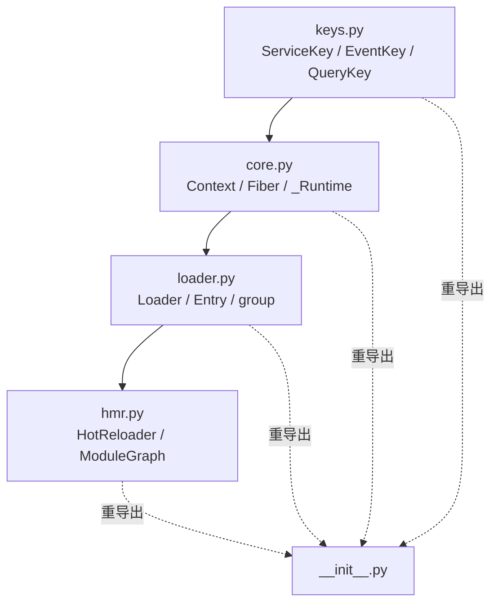
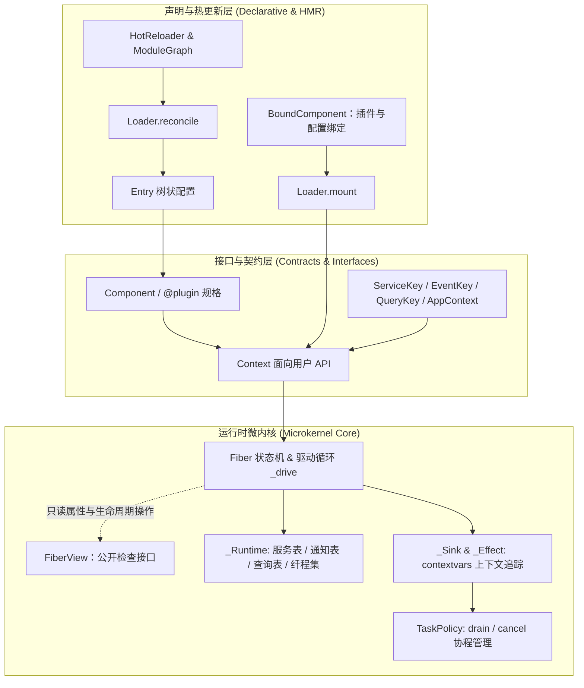
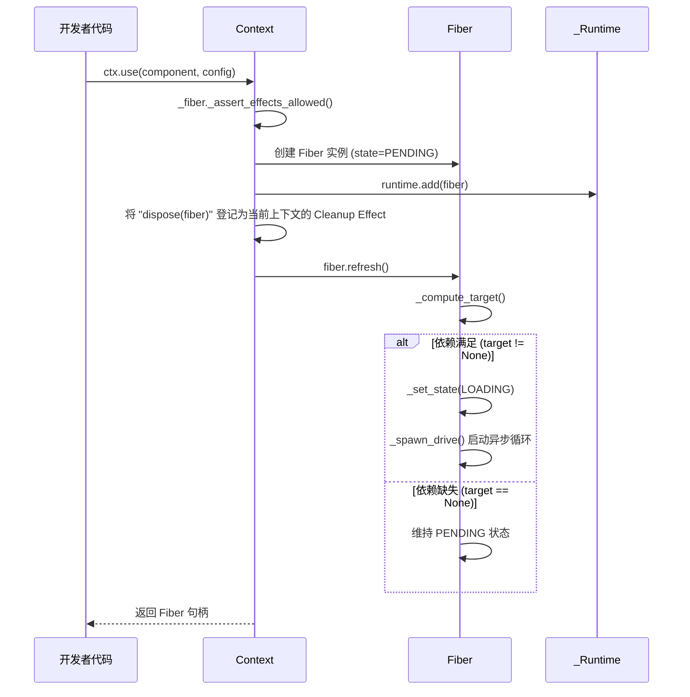
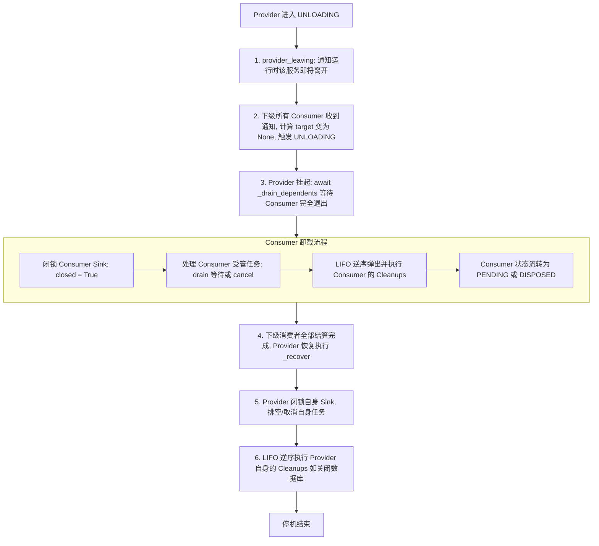
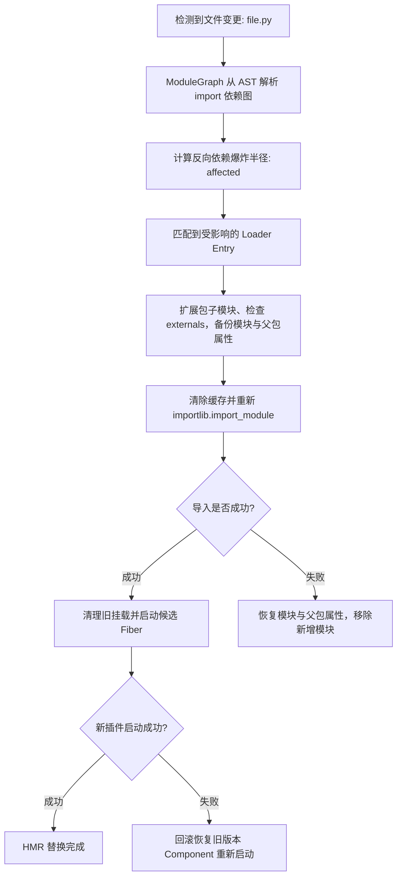
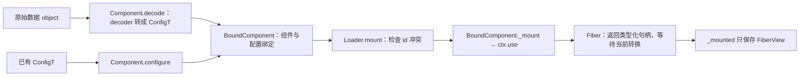
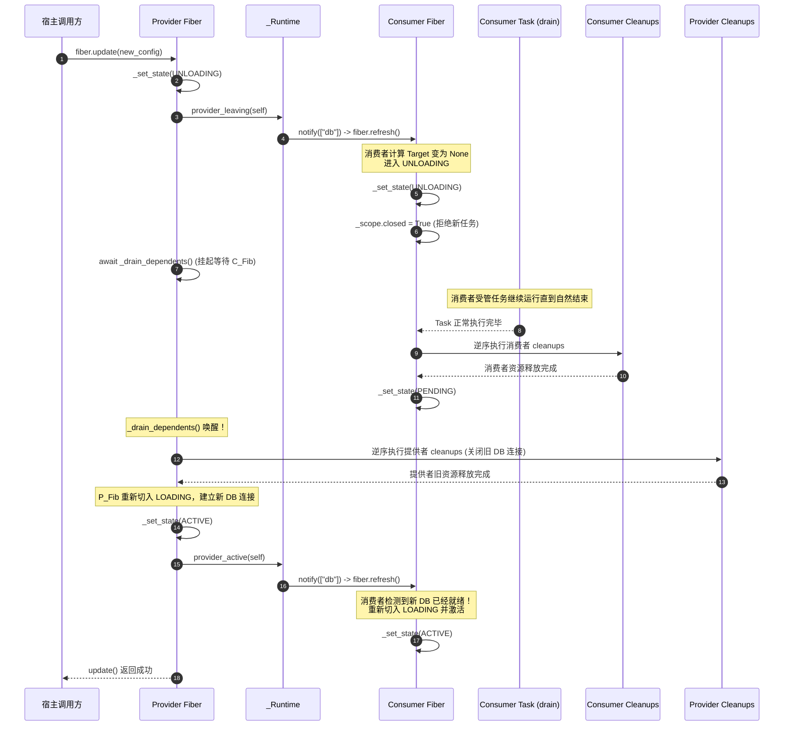
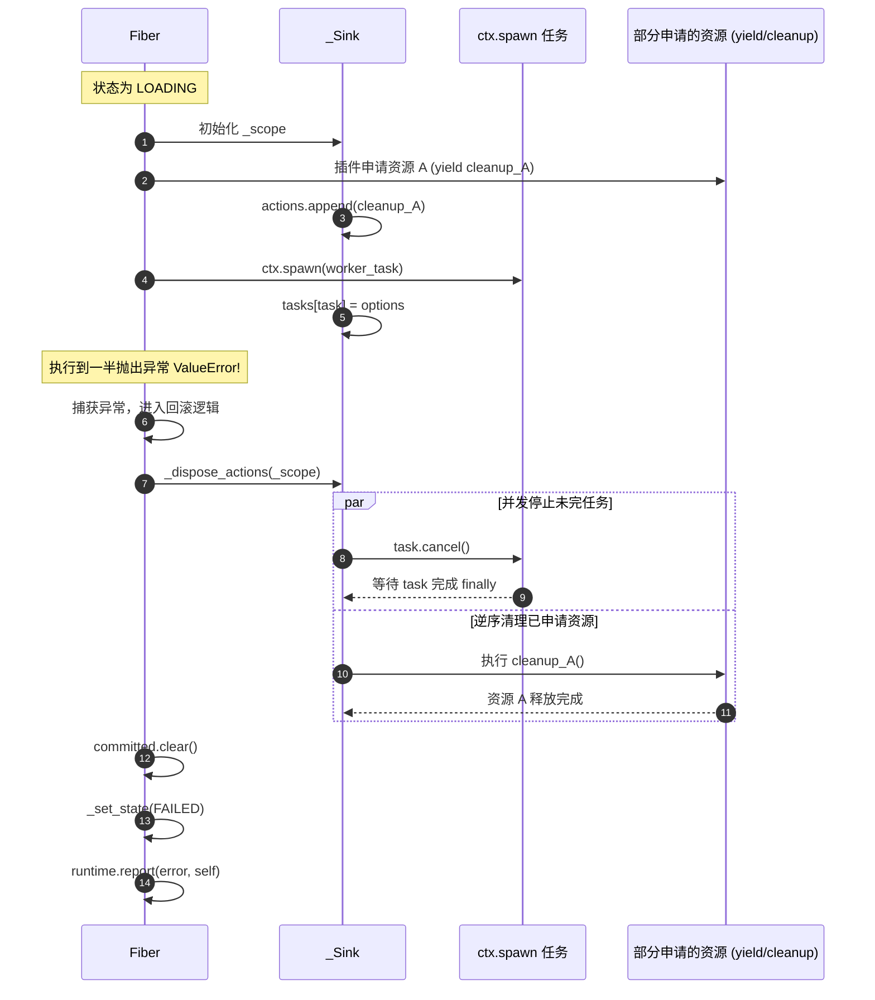

# Cordis (Python) 核心原理代码走读与维护者手册

> 本文档面向 Cordis Python 运行时的**核心开发者与维护者**。涵盖 [`src/cordis`](../src/cordis) 的逐模块代码走读、关键数据结构在内存中的拓扑关系、驱动循环与状态机扭转细节、以及维护系统时必须坚守的不变式规则（Invariants）。

---

## 目录

- [1. 架构总览与模块依赖拓扑](#1-架构总览与模块依赖拓扑)
  - [1.1 源码文件职责划分](#11-源码文件职责划分)
  - [1.2 运行时内核分层结构](#12-运行时内核分层结构)
- [2. 关键数据结构与内存布局解读](#2-关键数据结构与内存布局解读)
  - [2.1 `_Runtime`：全局中枢与注册表](#21-_runtime全局中枢与注册表)
  - [2.2 `Context`：基于原型链的环境切片](#22-context基于原型链的环境切片)
  - [2.3 `Fiber`：纤程控制块 (PCB)](#23-fiber纤程控制块-pcb)
  - [2.4 `Component`：无状态组件规格](#24-component无状态组件规格)
  - [2.5 `_Sink` 与 `_Effect`：副作用作用域树与上下文隔离](#25-_sink-与-_effect副作用作用域树与上下文隔离)
  - [2.6 `_Service`、`_Listener` 与 `_TaskOptions`：运行时元数据](#26-_service_listener-与-_taskoptions运行时元数据)
  - [2.7 公开视图、键身份与类型擦除边界](#27-公开视图键身份与类型擦除边界)
- [3. 核心机制逐行走读与执行流程](#3-核心机制逐行走读与执行流程)
  - [3.1 挂载与依赖目标计算 (`use` -> `_compute_target`)](#31-挂载与依赖目标计算-use---_compute_target)
  - [3.2 纤程驱动循环深度剖析 (`Fiber._drive`)](#32-纤程驱动循环深度剖析-fiber_drive)
  - [3.3 效应归一化执行器 (`_execute` 与 `_collector`)](#33-效应归一化执行器-_execute-与-_collector)
  - [3.4 反向拓扑停机与 LIFO 清理 (`_drain_dependents` -> `_dispose_actions`)](#34-反向拓扑停机与-lifo-清理-_drain_dependents---_dispose_actions)
  - [3.5 服务解析、Realm 隔离与 Intercept 适配](#35-服务解析realm-隔离与-intercept-适配)
  - [3.6 声明式调和状态机 (`Loader.reconcile`)](#36-声明式调和状态机-loaderreconcile)
  - [3.7 模块图 AST 静态分析与 HMR 事务回滚](#37-模块图-ast-静态分析与-hmr-事务回滚)
  - [3.8 类型化挂载与查询的执行路径](#38-类型化挂载与查询的执行路径)
- [4. 状态流转与关键时序图解](#4-状态流转与关键时序图解)
  - [4.1 Fiber 状态流转完整矩阵](#41-fiber-状态流转完整矩阵)
  - [4.2 级联排空与依赖隔离时序 (Sequence Diagram)](#42-级联排空与依赖隔离时序-sequence-diagram)
  - [4.3 初始化失败与原子回滚时序](#43-初始化失败与原子回滚时序)
- [5. 核心维护铁律与不变式 (Maintainer Invariants)](#5-核心维护铁律与不变式-maintainer-invariants)
  - [规则 1：依赖视图不可漂移 (Committed View Invariant)](#规则-1依赖视图不可漂移-committed-view-invariant)
  - [规则 2：防自等待死锁 (Anti-Deadlock Invariant)](#规则-2防自等待死锁-anti-deadlock-invariant)
  - [规则 3：逆操作完全执行 (Total Teardown Invariant)](#规则-3逆操作完全执行-total-teardown-invariant)
  - [规则 4：加载惯性与状态单调性 (Inertial Guard Invariant)](#规则-4加载惯性与状态单调性-inertial-guard-invariant)
- [6. 已知缺陷、竞态边缘与调试指南](#6-已知缺陷竞态边缘与调试指南)
  - [6.1 审计缺陷 (B01-B08) 代码机理深度剖析](#61-审计缺陷-b01-b08-代码机理深度剖析)
  - [6.2 开发者维护与排错技巧](#62-开发者维护与排错技巧)

---

## 1. 架构总览与模块依赖拓扑

### 1.1 源码文件职责划分

Cordis Python 核心位于 `python/src/cordis`，运行时使用标准库，YAML 解析可选依赖 `PyYAML`。下文数据结构与算法片段用于解释当前实现，省略部分字段、重载和错误处理；完整定义以链接的源码为准。

```text
src/cordis/
├── __init__.py    # 公共符号统一重导出与 __all__ 控制
├── keys.py        # ServiceKey、EventKey、QueryKey 与服务描述符
├── core.py        # Context, Fiber/FiberView, Component/BoundComponent, Effect, _Runtime
├── loader.py      # 类型化 mount、声明式 Entry/reconcile、group、dynamic import
└── hmr.py         # 源码级模块热替换引擎：ModuleGraph, HotReloader
```



### 1.2 运行时内核分层结构



---

## 2. 关键数据结构与内存布局解读

### 2.1 `_Runtime`：全局中枢与注册表

位于 [`_Runtime`](../src/cordis/core.py#L1035)。每一个根 Context (`Context()`) 创建时，会分配一个私有的 `_Runtime` 实例。该实例被其衍生出的所有子 Context 与 Fiber 共享。

```python
class _Runtime:
    uid: int                                       # 全局单调递增 UID 发生器
    fibers: list[Fiber[Any, Any]]                  # 当前运行时接管的所有 Fiber 列表
    services: dict[object, _Service]               # 核心服务路由表：{realm: _Service}
    listeners: dict[str | EventKey[Any], list[_Listener]] # 通知注册表
    queries: dict[QueryKey[Any, Any], _Listener]   # 每个查询键只有一个处理器
    errors: list[tuple[Exception, Fiber[Any, Any] | None]] # 追加的错误历史
    root: Context                                  # 根上下文引用
```

- **`services` 映射键不是字符串，而是 `realm`（域对象）**：未显式隔离时，根 Context 为每个服务名分配并复用一个 Realm；不是全部服务共用一个对象。
- **`listeners` 包含所有静态与动态绑定的监听器**：每个监听器绑定有所属的 `_Sink`，卸载时通过 Sink 的生命周期直接失效。
- **`queries` 使用身份键**：handle 注册后保留一个 `_Listener`；清理时仅移除仍属于该处理器的记录。查询没有服务 Realm 路由。

---

### 2.2 `Context`：基于原型链的环境切片

位于 [`Context`](../src/cordis/core.py#L1277)。Context 采用类似 JavaScript 原型继承的链式模型。

```python
class Context:
    _runtime: _Runtime               # 共享的全局运行时内核
    _parent: Context | None          # 指向父级 Context，形成向上溯源链
    _fiber: Fiber[Any, Self]         # 私有字段擦除配置类型，保留当前 Context 类型
    _realms_local: dict[str, object] # 本地隔离域重载表: {service_name: realm_object}
    _intercepts_local: dict[str, object] # 本地拦截元数据: {service_name: metadata}
    _closed: bool                    # 根 Context 是否已关闭
    _close_task: asyncio.Task[None] | None # 正在进行的 close 协程任务缓存（防重入）
```

#### 链式向上回溯寻址（Prototype Chain Lookup）
- **寻找 Realm**：`_realm(name)` 从当前 `ctx` 递归回溯 `_parent`，一旦在 `_realms_local` 找到即返回；若一直到达根节点仍无局部重载，则返回根节点的全局 Realm。
- **寻找 Metadata**：`metadata(name)` 向上收集各层 `_intercepts_local[name]`，并自顶向下合并（若是字典则进行字典合并，否则以最底层为准）。

---

### 2.3 `Fiber`：纤程控制块 (PCB)

位于 [`Fiber`](../src/cordis/core.py#L687)。代表一个组件在运行时中的一次激活执行。

```python
class Fiber(Generic[ConfigT, ContextT]):
    runtime: _Runtime                      # 内核引用
    parent: ContextT                       # 挂载此 Fiber 的父上下文
    component: Component[ConfigT, ContextT] | None # 静态组件定义（Root Fiber 为 None）
    config: ConfigT                        # 当前生效的配置数据
    uid: int | None                        # 实例全局唯一 ID（被 dispose 后置为 None）
    name: str                              # 标识名称（排错日志用）
    state: FiberState                      # 状态机：PENDING / LOADING / ACTIVE / ...
    desired: bool                          # 期望存在标志：False 表示外部要求销毁
    revision: int                          # 配置修订版本计数器
    target: tuple[int, tuple[int, ...]] | None | object # 目标状态元组
    committed: dict[str, _Service]         # 激活瞬间锁定的依赖服务快照！
    committed_realms: dict[str, object]    # 激活瞬间锁定的依赖服务所属 Realm 快照！
    _committed_contexts: dict[Context, dict[str, object]] # 本次激活的祖先 Realm 覆盖
    _parent_effect: _Effect | None         # 成功 dispose 后 detach，释放父级引用
    inertia: asyncio.Task[None] | None     # 正在运行的 _drive 驱动协程任务
    error: Exception | None                # 启动失败时捕获的异常
    cleanup_error: ExceptionGroup | None   # 清理阶段捕获的异常组
    _actions: list[Cleanup | _Effect]      # 当前作用域登记的清理动作栈（LIFO）
    _load_token: object                    # 每次启动分配的唯一代币，防过期待闭包
    _scope: _Sink                          # 根效应收集桶
    _tasks: set[asyncio.Task[object]]      # 不同结果类型的未结束受管任务集
    _ctx: ContextT                        # 内部存储，公开 ctx 是只读属性
```

---

### 2.4 `Component`：无状态组件规格

位于 [`Component`](../src/cordis/core.py#L186)。由 `@plugin` 或 `Component` 构造函数创建的不可变对象。

```python
@dataclass(frozen=True, init=False)
class Component(Generic[ConfigT, ContextContra]):
    apply: PluginCallback[ContextContra, ConfigT]            # Context 参数逆变
    inject: Mapping[str, object]                             # 依赖清单：{service_name: metadata}
    provide: frozenset[str]                                  # 对外宣告提供的服务名集合
    name: str | None                                         # 组件命名
    validate: Callable[[ConfigT], ConfigT | Awaitable[ConfigT]] | None # 配置校验器
    update: Callable[[ContextContra, ConfigT, ConfigT], object] | None # 原地更新钩子

    def configure(self, config: ConfigT) -> BoundComponent[ConfigT, ContextContra]: ...
    async def decode(
        self, raw: object, decoder: Callable[[object], ConfigT | Awaitable[ConfigT]]
    ) -> BoundComponent[ConfigT, ContextContra]: ...
```

BoundComponent 是不可变的组件与配置二元组。configure 不激活插件；decode 调用 decoder 后再 configure，validate 仍在激活/更新时执行。Context 逆变允许基础 Context 插件挂到子类，配置参数保持不变。

---

### 2.5 `_Sink` 与 `_Effect`：副作用作用域树与上下文隔离

位于 [`_Sink`](../src/cordis/core.py#L342) 与 [`_Effect`](../src/cordis/core.py#L576)。用于精确控制组件内创建的所有副作用。

```python
@dataclass(slots=True)
class _Sink:
    fiber: Fiber[Any, Any]                          # 所属 Fiber
    token: object                                   # 校验代币（必须与 fiber._load_token 一致）
    actions: MutableSequence[Cleanup | _Effect]     # 清理动作栈
    parent: _Sink | None = None                     # 父 Sink（嵌套 Effect 形成树状结构）
    closed: bool = False                            # 是否已关闭新动作准入
    tasks: dict[asyncio.Task[object], _TaskOptions] # 归属此 Sink 的后台任务及其策略
```

- **`_collector`（全局 ContextVar）**：
  ```python
  _collector: contextvars.ContextVar[_Sink | None] = contextvars.ContextVar(
      "cordis_effect_collector", default=None
  )
  ```
  通过 `_collector`，任何执行流（包括异步任务和事件回调）均能隐式获取当前的 `_Sink`。如果试图在 `sink.closed == True` 或者 `token != fiber._load_token`（说明当前生命周期已过期）的作用域内创建新 Effect，运行时会立即抛出 `InactiveContextError`。

---

### 2.6 `_Service`、`_Listener` 与 `_TaskOptions`：运行时元数据

```python
@dataclass(slots=True)
class _Service:
    name: str                                          # 服务名
    value: object                                      # 真正的业务实例
    fiber: Fiber[Any, Any]                             # 提供该服务的 Fiber
    realm: object                                      # 所属 Realm
    check: Callable[[Context], bool] | None = None     # 可用性谓词（用于动态按条件暴露）
    adapt: Callable[[object, object, Context], object] | None = None # 异构存储边界

@dataclass(slots=True)
class _Listener:
    ctx: Context                                       # 注册监听器的上下文
    callback: Callable[..., object]                    # 回调函数
    sink: _Sink                                        # 绑定的 Sink 作用域
    global_: bool = False                              # 是否忽略 scope 过滤全局生效
    task_policy: TaskPolicy = "drain"                  # 异步回调时的并发停机策略
    timeout: float | None = None                       # 异步回调排空超时

@dataclass(slots=True)
class _TaskOptions:
    policy: TaskPolicy                                 # "drain" 或 "cancel"
    timeout: float | None                              # 排空时限
    stopping: asyncio.Task[None] | None = None         # 正在执行停机的任务（防重入）
```

---

### 2.7 公开视图、键身份与类型擦除边界

异构存储中的配置、服务值和回调结果不具有同一个类型。维护时应区分保存这些对象的内部容器与业务调用入口：

| 边界 | 内部存储 | 公开保证 |
| --- | --- | --- |
| Fiber 检查 | 运行时保存不同配置的 Fiber | FiberView 只读属性、支持 dispose/restart/wait，配置为 object，不暴露 update |
| 类型化配置 | BoundComponent 保留 Component 与 ConfigT 的配对 | mount 返回 Fiber[ConfigT, ContextT]，之后才存入 `_mounted` 的视图集合 |
| 动态配置 | `_Loaded` 保存 Entry、动态 Component 与 Fiber | get/reload 返回 FiberView；Entry 本身不证明插件与配置匹配 |
| 服务适配 | `_Service` 的值、metadata 和适配结果为 object | provide 的泛型适配器闭包在注册边界恢复 T；服务键检查读写参数 |
| 通知与查询 | `_Listener.callback` 接受异构调用签名 | EventKey/QueryKey 在注册和调用入口关联参数，query 在注册表出口恢复 ResultT |
| 任务快照 | Task[object] | 单次 spawn 返回 Task[T]；查看任务集合不虚假承诺结果类型 |

FiberView 是协议，不创建包装对象。await/wait 使用 Self，确保从视图等待后仍是视图。Fiber.ctx 和 Loader.ctx 都是只读属性，避免更宽的静态视图替换底层的具体 Context。

EventKey/QueryKey 的 dataclass 使用 `eq=False`，继承对象身份相等和哈希；名称是诊断标签。ServiceKey 仍按字符串名字路由。不要为了统一存储而把事件键改成按名字相等，否则同名但不兼容的泛型键可能把错误数据交给处理器。

---

## 3. 核心机制逐行走读与执行流程

### 3.1 挂载与依赖目标计算 (`use` -> `_compute_target`)

当用户调用 `fiber = ctx.use(my_plugin, config)` 时：



#### 关键代码片段：[`Fiber._compute_target`](../src/cordis/core.py#L763) `_compute_target`
```python
def _compute_target(self) -> tuple[int, tuple[int, ...]] | None:
    # 1. 如果组件被显式销毁，或当前处于 FAILED 状态，目标为 None
    if not self.desired or self.state is FiberState.FAILED:
        return None
    # 2. 如果父级 Fiber 存在且尚未 ACTIVE，目标为 None（父子生命周期层级绑定）
    if self.parent._fiber is not self.runtime.root._fiber:
        if self.parent._fiber.state is not FiberState.ACTIVE:
            return None
    # 3. 解析依赖服务
    providers: list[int] = []
    for name in self.inject:
        service = self.runtime.resolve(self.ctx, name)
        # 依赖服务缺失，或者该服务的提供者 Fiber UID 为空（已离开），目标判定为 None
        if service is None or service.fiber.uid is None:
            return None
        providers.append(service.fiber.uid)
    # 4. 返回目标：(自身配置版本号, (所有依赖提供者的 UID 元组))
    return self.revision, tuple(providers)
```

> **核心逻辑**：只要声明依赖的任何一个提供者 UID 改变（比如服务重启了），或者自身 `revision` 改变（配置热更），计算出的 `target` 就会与旧值不等，从而立即触发刷新。

---

### 3.2 纤程驱动循环深度剖析 (`Fiber._drive`)

位于 [`Fiber._drive`](../src/cordis/core.py#L879)。这是整个运行时状态机的发动机。每个 Fiber 同一时刻最多只有一个 `_drive` 协程在跑（记录在 `fiber.inertia` 中）。

当前 `_drive` 按以下顺序推进（具体实现见上方源码链接）：

1. 旧激活卸载时先等待依赖方，排空任务、执行逆操作，再清除 committed 服务、Realm 与 Context 覆盖快照。
2. 已撤销 desired 的 Fiber 进入 DISPOSED 并移出运行时；没有依赖目标的 Fiber 等待下一次 refresh。
3. 初始化先异步校验配置，校验返回后重新检查目标与 desired；过时目标不再提交依赖或运行插件。
4. 提交本次依赖后运行 `_execute`；仅目标未变且 desired 仍为真时检查声明服务。正常目标变化中断不会误报 MissingProvisionError。
5. 初始化失败会回滚并记录错误；desired 为真时进入 FAILED，否则直接 DISPOSED 并移除。成功且目标仍有效时进入 ACTIVE。

`_commit` 除保存服务引用和 Realm，还保存 Fiber Context 及祖先的 `_realms_local`。`_committed_realm` 使旧工作与 cleanup 在换域后仍读原依赖；激活后新派生 Context 的显式隔离仍生效。


---

### 3.3 效应归一化执行器 (`_execute` 与 `_collector`)

位于 [`_execute`](../src/cordis/core.py#L480)。Cordis 使用 `_execute` 函数实现了代数效应（Algebraic Effects）的归一化处理。

`_execute` 设置 `_collector`，归一化普通回调、上下文管理器、生命周期对象以及同步/异步迭代器，并将逆操作登记到当前 Sink。

迭代器每次步进前检查 guard，仅捕获 StopIteration/StopAsyncIteration 时标记 exhausted。非法 yield、初始化异常或 guard 中断都通过 finally 关闭尚未耗尽的迭代器，使生成器 finally 执行；即使 close/aclose 也失败，最外层 finally 仍重置 `_collector`。初始化错误和关闭错误同时发生时以 ExceptionGroup 保存两者，避免关闭异常掩盖根因。


---

### 3.4 反向拓扑停机与 LIFO 清理 (`_drain_dependents` -> `_dispose_actions`)

当 Provider 需要卸载或重启时，停机流程严格按照拓扑依赖反向推进：



#### 关键清理函数：[`_dispose_actions`](../src/cordis/core.py#L449) `_dispose_actions`
```python
async def _dispose_actions(sink: _Sink, label: str) -> None:
    # 第一步：先停掉所有协程任务，确保没有任何代码在并发访问即将被释放的资源
    await _stop_tasks(sink)
    actions = sink.actions
    errors: list[Exception] = []
    # 第二步：严格 LIFO 逆序弹出执行
    while actions:
        action = actions.pop()
        try:
            if isinstance(action, _Effect):
                await action.dispose()
            else:
                await _await(action())
        except (Exception, asyncio.CancelledError) as error:
            # 异常不阻断循环！记录后继续清理其余资源
            errors.append(_effect_error(error, f"cleanup in {label}"))
    if errors:
        # 汇聚所有清理异常，统一抛出 ExceptionGroup
        raise ExceptionGroup(f"errors while disposing {label}", errors)
```

---

### 3.5 服务解析、Realm 隔离与 Intercept 适配

#### 服务解析核心：[`_Runtime.resolve`](../src/cordis/core.py#L1091) `_Runtime.resolve`
```python
def resolve(self, ctx: Context, name: str, *, active: bool = True) -> _Service | None:
    # 1. 计算上下文在当前服务名下的 Realm 键
    realm = ctx._realm(name)
    # 2. 从服务字典查找对应 Realm 下登记的服务
    service = self.services.get(realm)
    if service is None:
        return None
    # 3. 检查提供者是否 ACTIVE
    if active and service.fiber.state is not FiberState.ACTIVE:
        return None
    # 4. 检查动态谓词 check(ctx) 是否放行
    if service.check:
        try:
            if not service.check(ctx):
                return None
        except Exception as error:
            self.report(error, service.fiber)
            return None
    return service
```

#### 服务消费防越权：[`Context.service`](../src/cordis/core.py#L1665) `Context.service`

下方是实现签名，结果为 object；公开重载中 ServiceKey[T] 读取仍返回 T，字符串读取保留 Any。内部收紧不会让动态字符串自动获得服务接口类型。

```python
def service(self, name: ServiceName) -> object:
    name = _service_name(name)
    realm = self._fiber._committed_realm(self, name)
    fiber: Fiber[Any, Any] | None = self._fiber

    # 沿 Fiber 继承链向上检查：
    while fiber is not None:
        # 1. 是否存在已提交的依赖？
        service = fiber.committed.get(name)
        if service is not None and fiber.committed_realms.get(name) is realm:
            return self._adapt(service) # 通过适配器/拦截器包装后返回

        # 2. 如果插件声明了依赖该服务，但 committed 为空 -> 说明服务不可用！
        if name in fiber.inject:
            raise InactiveServiceError(
                f"required service {name!r} is inactive in component {fiber.name!r}"
            )
        ...
    # 3. 未在 inject 声明而强行访问 -> 拦截并抛出未声明异常！
    raise UndeclaredServiceError(
        f"component {self._fiber.name!r} accessed service {name!r} without declaring it"
    )
```

---

### 3.6 声明式调和状态机 (`Loader.reconcile`)

入口为 [`Loader.reconcile`](../src/cordis/loader.py#L253)，内部划分为以下步骤：

1. `_run` 在调用任务中检查自等待与同 Loader 重入，再获取实例锁。持锁期间通过 `_settle` 等待完整操作；取消调用者也必须等待收尾后才释放锁。
2. `_prepare` 检查重复 id、导入所有启用候选并递归预检组内条目。并行导入使用 gather(return_exceptions=True)，失败时也等待其他导入线程完成。
3. `_reconcile` 校验顶层变更配置，保存旧 Entry、Component、挂载状态与 Context 覆盖；`_apply` 再增量删除、更新和挂载，成功后记录新配置。
4. ACTIVE 父 Context 下等待 flush，并比较本轮与旧错误，传播新增启动失败；包括组内失败和未修改条目因提供者变化而产生的失败。
5. 失败时清理 touched 条目、恢复旧设置并重新挂载受影响旧实例。未受影响条目保留原 Fiber；恢复失败与原错误聚合报告。hook 主动取消同样进入恢复。

此处恢复是受管状态恢复，不提供变更期间的数据库式隔离，也不能撤销任意外部副作用。缺少依赖可以稳定在 PENDING。


---

### 3.7 模块图 AST 静态分析与 HMR 事务回滚

位于 [`hmr.py`](../src/cordis/hmr.py)。



#### AST 解析细节：[`ModuleGraph._imports`](../src/cordis/hmr.py#L119)
`ModuleGraph` 不执行模块代码（避免导入副作用），而是使用 `ast.parse` 扫描 `ast.Import` 与 `ast.ImportFrom`，计算相对导入的层级（`node.level`），精确还原依赖树。

---

### 3.8 类型化挂载与查询的执行路径

类型化挂载与动态清单共享 Fiber 生命周期，入口有所区别：



实现中先将 FiberView 存入 `_mounted`，再等待 fiber.wait；启动异常时移除本次记录并 dispose 后重新抛出。外层 `_run` 让调用方取消等待提交或恢复完成；成功的挂载可能仍被保留，可按 id 查询。缺少依赖时 wait 仍可返回 PENDING。`unmount()` 移除指定条目，`close()` 清理 `_mounted` 和 `_loaded`；`reconcile()` 只处理后者，并在修改前拒绝与 mount 的 id 冲突。

handle 在当前 Fiber 的 Sink 中注册查询处理器，重复键抛出 DuplicateQueryError。query 找到处理器后调用 `_Runtime._invoke`，复用通知的状态、load token 和 sink.open 检查，并把异步结果作为注册方任务管理。有效状态包括 LOADING 和 ACTIVE；无有效处理器返回 None，False 不触发短路跳过。查询不建立 committed 服务依赖。

typed key 即使名为 `internal/error` 也只是普通身份键。异步调用的 source 只有字符串事件才保留字符串值，避免把同名业务键误当作内部错误事件并抑制错误上报。

源码 HMR 仍以 `_loaded` 中的字符串定位符为入口，不扫描类型化 mount。重导入契约模块会生成新的 EventKey/QueryKey；需要共享键的模块必须使用同一版本的契约对象。

验证这些边界时使用 [`test_typed_interfaces.py`](../tests/test_typed_interfaces.py) 检查运行时行为，以及 [`contracts.py`](../typing_tests/contracts.py) / [`invalid.py`](../typing_tests/invalid.py) 检查类型推断和错误用法拒绝。不能只看 mypy 是否通过实现源码，公开兜底 Any 也可能让错误调用通过。

---

## 4. 状态流转与关键时序图解

### 4.1 Fiber 状态流转完整矩阵

| 当前状态 | 触发事件 / 条件 | 下一状态 | 触发的副作用动作 |
| :--- | :--- | :--- | :--- |
| **`PENDING`** | 依赖满足 (`target != None`) | `LOADING` | 启动 `_drive` 协程循环 |
| **`LOADING`** | 验证通过且 apply 成功执行 | `ACTIVE` | 标记 `provider_active`，触发依赖它的消费者 refresh |
| **`LOADING`** | apply 抛出异常或依赖突变 | `FAILED` | 执行 `_dispose_actions` 回滚，记录 `error`，上报事件 |
| **`ACTIVE`** | 依赖服务离开 / `restart()` / `update()` | `UNLOADING` | 标记 `provider_leaving`，触发依赖它的消费者 refresh |
| **`UNLOADING`**| 下游排空完毕，且 `target != None` | `LOADING` | 清理旧动作栈，更新代币，重新进入加载阶段 |
| **`UNLOADING`**| 下游排空完毕，且 `target == None` | `PENDING` | 清理旧动作栈，挂起等待新依赖 |
| **`UNLOADING`**| 下游排空完毕，且 `desired == False` | `DISPOSED` | 彻底移出 `runtime.fibers`，释放所有引用 |
| **`FAILED`** | 收到 `restart()` 或依赖变动 refresh | `PENDING` | 重置错误，重新计算 target |

---

### 4.2 级联排空与依赖隔离时序 (Sequence Diagram)

展示当 Provider 配置更新时，整个系统内部的执行时序：



---

### 4.3 初始化失败与原子回滚时序

如果在插件 `apply` 期间发生异常（例如连接超时或缺少表），运行时如何保证系统干净：



---

## 5. 核心维护铁律与不变式 (Maintainer Invariants)

维护 Cordis 核心代码时，**绝对不能违背以下四条不变式**。任何对 `core.py` 的重构或 PR 都必须对照此清单做形式验证：

### 规则 1：依赖视图不可漂移 (Committed View Invariant)

$$\forall t \in [\text{LOADING}, \text{UNLOADING\_END}], \quad \text{Fiber.committed} = \text{Constant Snapshot}$$

- **解释**：组件从进入 `ACTIVE` 到完全退出 `UNLOADING`（所有 cleanup 执行完毕）的整个期间，其 `committed` 字典必须保持锁定。
- **禁止修改**：严禁在 `_drain_dependents` 之前或 `_recover` 期间清空 `committed`。否则消费者在执行清理代码保存最终状态时，会读取到不可用的服务或新版本的错误服务。

---

### 规则 2：防自等待死锁 (Anti-Deadlock Invariant)

$$\text{CurrentTask} \in \text{Fiber.tasks} \implies \text{CurrentTask CANNOT wait for Fiber teardown}$$

- **代码实现**：[`_Runtime.assert_can_wait_for`](../src/cordis/core.py#L1049) `assert_can_wait_for`。
- **解释**：受管任务不能调用 `await fiber.dispose()` 或 `await fiber.restart()`，也不能等待自身所依赖的父级/提供者 Fiber 的停机。
- **原因**：停机操作会 `await` 该受管任务结束；若任务自身又在 `await` 停机完成，形成自反死锁（Self-Deadlock）。
- **维护要求**：新增等待方法（如新的 join/flush API）时，必须显式调用 `assert_can_wait_for` 校验当前任务归属。

---

### 规则 3：逆操作完全执行 (Total Teardown Invariant)

$$\text{Errors in Cleanup } i \centernot\implies \text{Abort Cleanup } i+1$$

- **解释**：在执行 `_dispose_actions` 清理栈时，某一个 cleanup 抛出异常绝不能截断循环。必须将所有已注册动作全部逆序弹出并执行。
- **异常汇总**：所有抛出的异常必须聚合成 Python 3.11 的原生 `ExceptionGroup` 统一上报。

---

### 规则 4：加载惯性与状态单调性 (Inertial Guard Invariant)

$$\text{Target mutated during LOADING} \implies \text{Complete step with inertia, then UNLOAD}$$

- **解释**：禁止在协程运行中途强行终止一个正在初始化的 `apply` 函数并立即原地重新执行。
- **实现方式**：必须让当前的 `apply` 执行完成，通过 `self.target == target` 守卫比对发现版本已过期，然后平滑流转进入 `UNLOADING` 回滚，再根据新 Target 发起下一次加载。这保证了部分初始化的资源一定会被登记并被正常回滚。

---

## 6. 已知缺陷、竞态边缘与调试指南

### 6.1 审计缺陷 (B01-B08) 代码机理深度剖析

2026-09-10 审计中的 B01–B08 与 K01–K02 已修复，历史复现见[审计记录](bug-audit-2026-09-10.md)，当前验证见[修复记录](bug-fixes-2026-09-13.md)。维护时需保留以下不变量：

| 缺陷 | 当前防线 |
| --- | --- |
| B01 | `_commit` 保存 Context 覆盖快照，`service` 用本次激活的 Realm 查旧依赖 |
| B02 | 初始化失败分支检查 desired，已撤销实例进入 DISPOSED 并移除 |
| B03 | 配置校验后重查目标；过时初始化不执行 provision 完整性检查 |
| B04 | `_ModuleSnapshot` 同时恢复模块缓存与父包绑定，移除新引入模块 |
| B05 | `_settle` 让管理调用取消等待提交/回滚，线程导入也不能遗留在锁外 |
| B06 | 成功移除 Fiber 时 detach 父 Effect，释放闭包引用；失败清理仍保留以便父级报告 |
| B07 | 未耗尽迭代器总会关闭，双重错误聚合，collector 总会复位 |
| B08 | Effect 在原调用 Task 中递归检查自等待，再创建 shielded 清理 Task |
| K01/K02 | 预检先于删除，成功后提交 Entry，失败恢复旧条目并允许重试 |


---

### 6.2 开发者维护与排错技巧

#### 技巧 1：开启状态转换与错误全景监听
在编写新功能或调试单元测试时，在根 Context 上注册以下两个总线事件，可以获得 100% 完整的纤程轨迹：

```python
root.on("internal/status", lambda fiber, old: print(f"🚦 [状态流转] {fiber.name}: {old.value} -> {fiber.state.value}"))
root.on("internal/error", lambda err, fiber: print(f"💥 [内部异常] {fiber.name if fiber else 'Root'}: {type(err).__name__}: {err}"))
```

#### 技巧 2：运行严格缺陷复现测试套件
审计缺陷包含独立的复现脚本，可直接运行验证：

```bash
cd python
# 11 项普通回归测试，无 expectedFailure
uv run python docs/repros/bug_audit_20260910.py -v

# 兼容原 strict 参数，运行相同的普通断言
uv run python docs/repros/bug_audit_20260910.py --strict -v
```

#### 技巧 3：类型与格式化全面把关
在提交任何针对 `src/cordis` 的改动前，确保通过以下全量命令：

```bash
cd python
uv run mypy                                   # 严格模式类型检查
uv run ruff check src tests examples          # 代码风格与语法检查
uv run python -m unittest discover -v         # 全量运行时与类型契约测试
uv run python -m examples.typed_interfaces    # 类型化挂载、通知和查询
```
