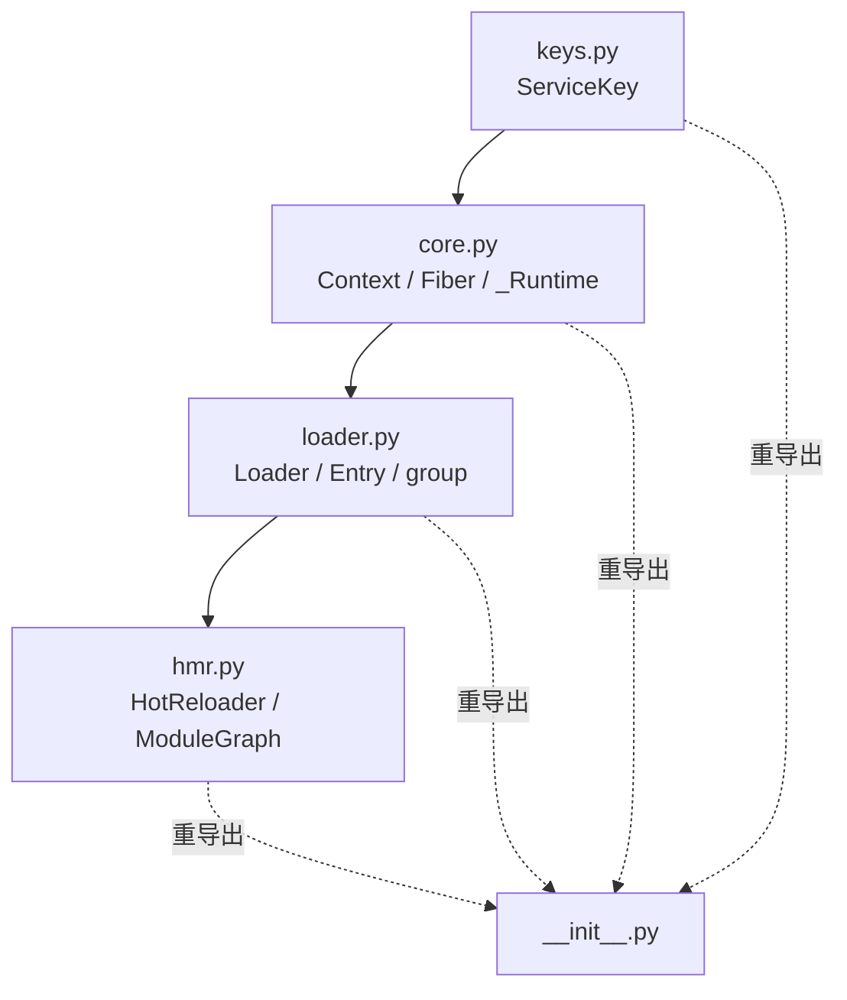
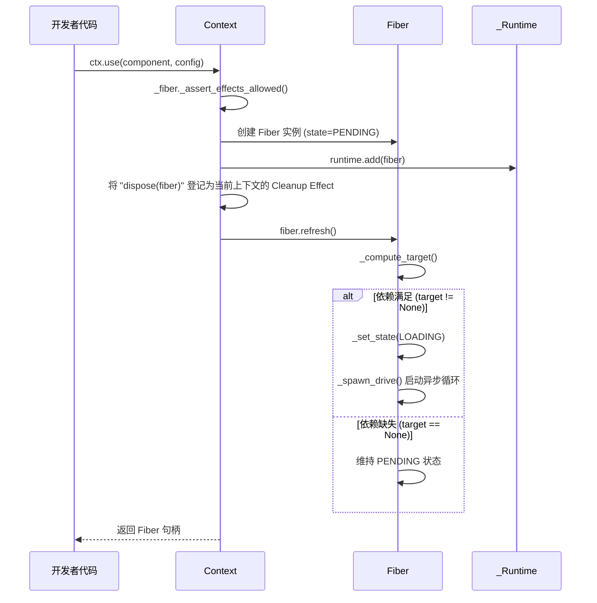
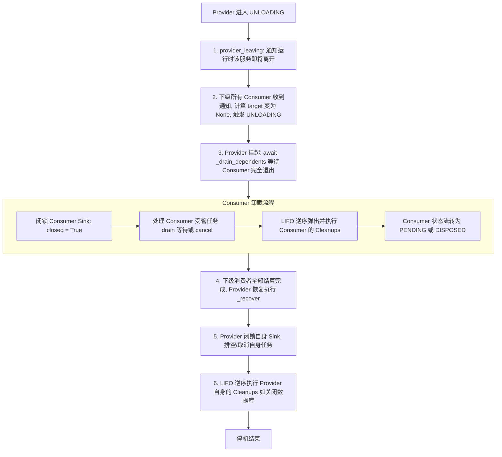
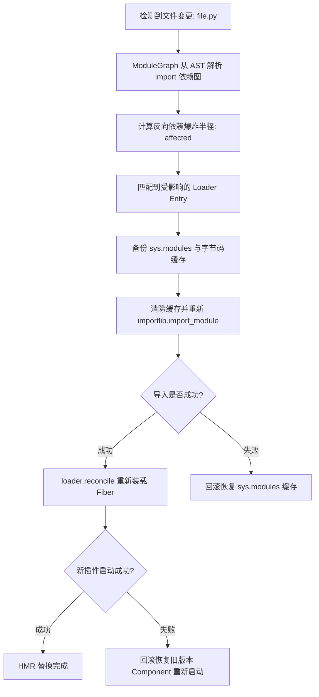
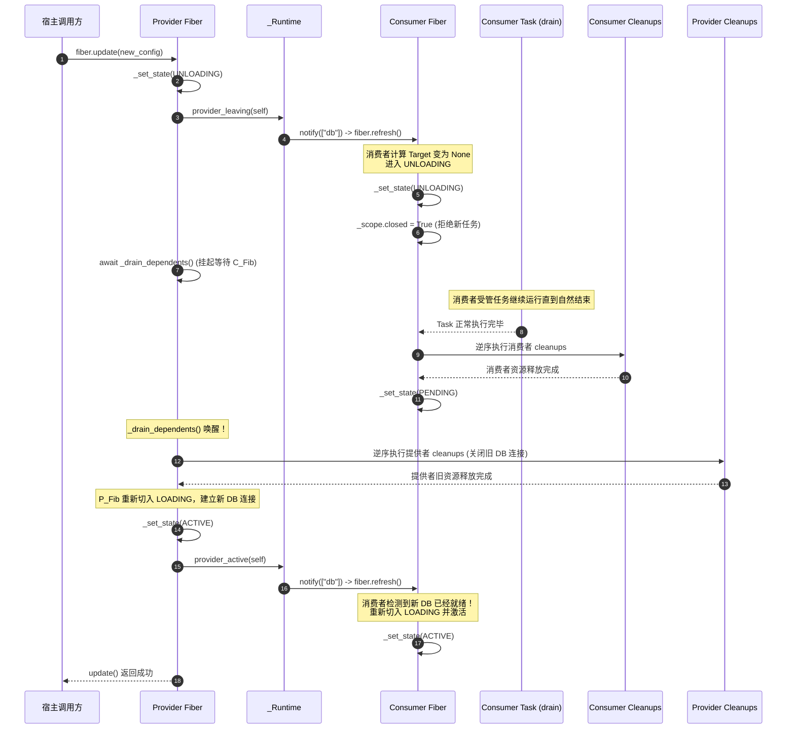
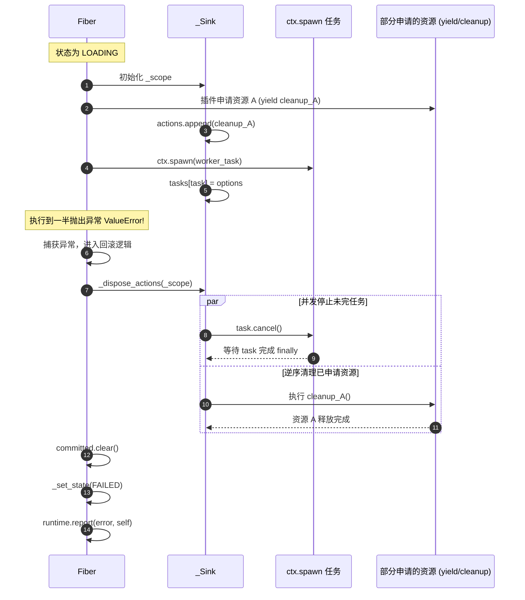

# Cordis (Python) 核心原理代码走读与维护者手册

> 本文档面向 Cordis Python 运行时的**核心开发者与维护者**。涵盖 [`src/cordis`](../src/cordis) 的逐模块代码走读、关键数据结构在内存中的拓扑关系、驱动循环与状态机扭转细节、以及维护系统时必须坚守的不变式规则（Invariants）。

---

## 目录

- [1. 架构总览与模块依赖拓扑](#1-架构总览与模块依赖拓扑)
  - [1.1 源码文件职责划分](#11-源码文件职责划分)
  - [1.2 运行时内核分层结构](#12-运行时内核分层结构)
- [2. 关键数据结构与内存布局解读](#2-关键数据结构与内存布局解读)
  - [2.1 `_Runtime`：全局中枢与注册表](#21-_runtime全局中枢与注册表)
  - [2.2 `Context`：基于原型链的环境切片](#22-context基于原型链的环境切片)
  - [2.3 `Fiber`：纤程控制块 (PCB)](#23-fiber纤程控制块-pcb)
  - [2.4 `Component`：无状态组件规格](#24-component无状态组件规格)
  - [2.5 `_Sink` 与 `_Effect`：副作用作用域树与上下文隔离](#25-_sink-与-_effect副作用作用域树与上下文隔离)
  - [2.6 `_Service`、`_Listener` 与 `_TaskOptions`：运行时元数据](#26-_service_listener-与-_taskoptions运行时元数据)
- [3. 核心机制逐行走读与执行流程](#3-核心机制逐行走读与执行流程)
  - [3.1 挂载与依赖目标计算 (`use` -> `_compute_target`)](#31-挂载与依赖目标计算-use---_compute_target)
  - [3.2 纤程驱动循环深度剖析 (`Fiber._drive`)](#32-纤程驱动循环深度剖析-fiber_drive)
  - [3.3 效应归一化执行器 (`_execute` 与 `_collector`)](#33-效应归一化执行器-_execute-与-_collector)
  - [3.4 反向拓扑停机与 LIFO 清理 (`_drain_dependents` -> `_dispose_actions`)](#34-反向拓扑停机与-lifo-清理-_drain_dependents---_dispose_actions)
  - [3.5 服务解析、Realm 隔离与 Intercept 适配](#35-服务解析realm-隔离与-intercept-适配)
  - [3.6 声明式调和状态机 (`Loader.reconcile`)](#36-声明式调和状态机-loaderreconcile)
  - [3.7 模块图 AST 静态分析与 HMR 事务回滚](#37-模块图-ast-静态分析与-hmr-事务回滚)
- [4. 状态流转与关键时序图解](#4-状态流转与关键时序图解)
  - [4.1 Fiber 状态流转完整矩阵](#41-fiber-状态流转完整矩阵)
  - [4.2 级联排空与依赖隔离时序 (Sequence Diagram)](#42-级联排空与依赖隔离时序-sequence-diagram)
  - [4.3 初始化失败与原子回滚时序](#43-初始化失败与原子回滚时序)
- [5. 核心维护铁律与不变式 (Maintainer Invariants)](#5-核心维护铁律与不变式-maintainer-invariants)
  - [规则 1：依赖视图不可漂移 (Committed View Invariant)](#规则-1依赖视图不可漂移-committed-view-invariant)
  - [规则 2：防自等待死锁 (Anti-Deadlock Invariant)](#规则-2防自等待死锁-anti-deadlock-invariant)
  - [规则 3：逆操作完全执行 (Total Teardown Invariant)](#规则-3逆操作完全执行-total-teardown-invariant)
  - [规则 4：加载惯性与状态单调性 (Inertial Guard Invariant)](#规则-4加载惯性与状态单调性-inertial-guard-invariant)
- [6. 已知缺陷、竞态边缘与调试指南](#6-已知缺陷竞态边缘与调试指南)
  - [6.1 审计缺陷 (B01-B08) 代码机理深度剖析](#61-审计缺陷-b01-b08-代码机理深度剖析)
  - [6.2 开发者维护与排错技巧](#62-开发者维护与排错技巧)

---

## 1. 架构总览与模块依赖拓扑

### 1.1 源码文件职责划分

Cordis Python 核心位于 `python/src/cordis`，代码量极其精炼（约 2000 行），无外部强制依赖（仅可选 `PyYAML`）。

```text
src/cordis/
├── __init__.py    # 公共符号统一重导出与 __all__ 控制
├── keys.py        # ServiceKey[T] 泛型类与 Context 描述符协议
├── core.py        # 运行时微内核：Context, Fiber, Effect, Sink, _Runtime
├── loader.py      # 声明式加载器：Entry, Loader, group, dynamic import
└── hmr.py         # 源码级模块热替换引擎：ModuleGraph, HotReloader
```



### 1.2 运行时内核分层结构

```mermaid
flowchart TB
    subgraph DeclarativeLayer [声明与热更新层 (Declarative & HMR)]
        HMRModule[HotReloader & ModuleGraph] --> LoaderModule[Loader.reconcile]
        LoaderModule --> EntryDef[Entry 树状配置]
    end

    subgraph InterfaceLayer [接口与契约层 (Contracts & Interfaces)]
        EntryDef --> ComponentSpec[Component / @plugin 规格]
        KeySpec[ServiceKey / AppContext] --> ContextAPI[Context 面向用户 API]
    end

    subgraph RuntimeKernel [运行时微内核 (Microkernel Core)]
        ContextAPI --> FiberMgr[Fiber 状态机 & 驱动循环 _drive]
        FiberMgr --> RuntimeState[_Runtime: 服务表 / 监听器表 / 纤程集]
        FiberMgr --> ScopeEngine[_Sink & _Effect: contextvars 上下文追踪]
        ScopeEngine --> TaskSupervisor[TaskPolicy: drain / cancel 协程管理]
    end
```

---

## 2. 关键数据结构与内存布局解读

### 2.1 `_Runtime`：全局中枢与注册表

位于 [`core.py:855`](../src/cordis/core.py#L855)。每一个根 Context (`Context()`) 创建时，会分配一个私有的 `_Runtime` 实例。该实例被其衍生出的所有子 Context 与 Fiber 共享。

```python
class _Runtime:
    uid: int                                       # 全局单调递增 UID 发生器
    fibers: list[Fiber[Any, Any]]                  # 当前运行时接管的所有 Fiber 列表
    services: dict[object, _Service]               # 核心服务路由表：{realm: _Service}
    listeners: dict[str, list[_Listener]]          # 事件监听表：{event_name: [_Listener, ...]}
    errors: list[tuple[Exception, Fiber | None]]   # 未处理异常历史环形/追加记录
    root: Context                                  # 根上下文引用
```

- **`services` 映射键不是字符串，而是 `realm`（域对象）**：这是 Cordis 实现多租户与服务隔离的物理基石。在没有显式隔离时，所有服务使用根上下文的默认 Realm。
- **`listeners` 包含所有静态与动态绑定的监听器**：每个监听器绑定有所属的 `_Sink`，卸载时通过 Sink 的生命周期直接失效。

---

### 2.2 `Context`：基于原型链的环境切片

位于 [`core.py:1094`](../src/cordis/core.py#L1094)。Context 采用类似 JavaScript 原型继承的链式模型。

```python
class Context:
    _runtime: _Runtime               # 共享的全局运行时内核
    _parent: Context | None          # 指向父级 Context，形成向上溯源链
    _fiber: Fiber[Any, Any]          # 当前上下文所属的 Fiber
    _realms_local: dict[str, object] # 本地隔离域重载表: {service_name: realm_object}
    _intercepts_local: dict[str, object] # 本地拦截元数据: {service_name: metadata}
    _closed: bool                    # 根 Context 是否已关闭
    _close_task: asyncio.Task | None # 正在进行的 close 协程任务缓存（防重入）
```

#### 链式向上回溯寻址（Prototype Chain Lookup）
- **寻找 Realm**：`_realm(name)` 从当前 `ctx` 递归回溯 `_parent`，一旦在 `_realms_local` 找到即返回；若一直到达根节点仍无局部重载，则返回根节点的全局 Realm。
- **寻找 Metadata**：`metadata(name)` 向上收集各层 `_intercepts_local[name]`，并自顶向下合并（若是字典则进行字典合并，否则以最底层为准）。

---

### 2.3 `Fiber`：纤程控制块 (PCB)

位于 [`core.py:550`](../src/cordis/core.py#L550)。代表一个组件在运行时中的一次激活执行。

```python
class Fiber(Generic[ConfigT, ContextT]):
    runtime: _Runtime                      # 内核引用
    parent: ContextT                       # 挂载此 Fiber 的父上下文
    component: Component | None            # 静态组件定义（Root Fiber 为 None）
    config: ConfigT                        # 当前生效的配置数据
    uid: int | None                        # 实例全局唯一 ID（被 dispose 后置为 None）
    name: str                              # 标识名称（排错日志用）
    state: FiberState                      # 状态机：PENDING / LOADING / ACTIVE / ...
    desired: bool                          # 期望存在标志：False 表示外部要求销毁
    revision: int                          # 配置修订版本计数器
    target: tuple[int, tuple[int, ...]] | None | object # 目标状态元组
    committed: dict[str, _Service]         # 激活瞬间锁定的依赖服务快照！
    committed_realms: dict[str, object]    # 激活瞬间锁定的依赖服务所属 Realm 快照！
    inertia: asyncio.Task[None] | None     # 正在运行的 _drive 驱动协程任务
    error: Exception | None                # 启动失败时捕获的异常
    cleanup_error: ExceptionGroup | None   # 清理阶段捕获的异常组
    _actions: list[Cleanup | _Effect]      # 当前作用域登记的清理动作栈（LIFO）
    _load_token: object                    # 每次启动分配的唯一代币，防过期待闭包
    _scope: _Sink                          # 根效应收集桶
    _tasks: set[asyncio.Task[Any]]         # 当前 Fiber 拥有的未结束受管后台任务集
    ctx: Context                           # 为该 Fiber 专有派生的子上下文
```

---

### 2.4 `Component`：无状态组件规格

位于 [`core.py:128`](../src/cordis/core.py#L128)。由 `@plugin` 或 `Component` 构造函数创建的不可变对象。

```python
@dataclass(frozen=True, init=False)
class Component(Generic[ConfigT, ContextT]):
    apply: PluginCallback[ContextT, ConfigT]                 # 入口回调（函数或类）
    inject: Mapping[str, object]                             # 依赖清单：{service_name: metadata}
    provide: frozenset[str]                                  # 对外宣告提供的服务名集合
    name: str | None                                         # 组件命名
    validate: Callable[[ConfigT], ConfigT | Awaitable] | None # 配置校验器
    update: Callable[[ContextT, ConfigT, ConfigT], object] | None # 原地更新钩子
```

---

### 2.5 `_Sink` 与 `_Effect`：副作用作用域树与上下文隔离

位于 [`core.py:262`](../src/cordis/core.py#L262) 与 [`core.py:452`](../src/cordis/core.py#L452)。用于精确控制组件内创建的所有副作用。

```python
@dataclass(slots=True)
class _Sink:
    fiber: Fiber[Any, Any]                          # 所属 Fiber
    token: object                                   # 校验代币（必须与 fiber._load_token 一致）
    actions: MutableSequence[Cleanup | _Effect]     # 清理动作栈
    parent: _Sink | None = None                     # 父 Sink（嵌套 Effect 形成树状结构）
    closed: bool = False                            # 是否已关闭新动作准入
    tasks: dict[asyncio.Task[Any], _TaskOptions]    # 归属此 Sink 的后台任务及其策略
```

- **`_collector`（全局 ContextVar）**：
  ```python
  _collector: contextvars.ContextVar[_Sink | None] = contextvars.ContextVar(
      "cordis_effect_collector", default=None
  )
  ```
  通过 `_collector`，任何执行流（包括异步任务和事件回调）均能隐式获取当前的 `_Sink`。如果试图在 `sink.closed == True` 或者 `token != fiber._load_token`（说明当前生命周期已过期）的作用域内创建新 Effect，运行时会立即抛出 `InactiveContextError`。

---

### 2.6 `_Service`、`_Listener` 与 `_TaskOptions`：运行时元数据

```python
@dataclass(slots=True)
class _Service:
    name: str                                          # 服务名
    value: object                                      # 真正的业务实例
    fiber: Fiber[Any, Any]                             # 提供该服务的 Fiber
    realm: object                                      # 所属 Realm
    check: Callable[[Context], bool] | None = None     # 可用性谓词（用于动态按条件暴露）
    adapt: Callable[[Any, Any, Context], Any] | None = None # 服务适配/拦截包装器

@dataclass(slots=True)
class _Listener:
    ctx: Context                                       # 注册监听器的上下文
    callback: Callable[..., object]                    # 回调函数
    sink: _Sink                                        # 绑定的 Sink 作用域
    global_: bool = False                              # 是否忽略 scope 过滤全局生效
    task_policy: TaskPolicy = "drain"                  # 异步回调时的并发停机策略
    timeout: float | None = None                       # 异步回调排空超时

@dataclass(slots=True)
class _TaskOptions:
    policy: TaskPolicy                                 # "drain" 或 "cancel"
    timeout: float | None                              # 排空时限
    stopping: asyncio.Task[None] | None = None         # 正在执行停机的任务（防重入）
```

---

## 3. 核心机制逐行走读与执行流程

### 3.1 挂载与依赖目标计算 (`use` -> `_compute_target`)

当用户调用 `fiber = ctx.use(my_plugin, config)` 时：



#### 关键代码片段：[`core.py:618`](../src/cordis/core.py#L618) `_compute_target`
```python
def _compute_target(self) -> tuple[int, tuple[int, ...]] | None:
    # 1. 如果组件被显式销毁，或当前处于 FAILED 状态，目标为 None
    if not self.desired or self.state is FiberState.FAILED:
        return None
    # 2. 如果父级 Fiber 存在且尚未 ACTIVE，目标为 None（父子生命周期层级绑定）
    if self.parent._fiber is not self.runtime.root._fiber:
        if self.parent._fiber.state is not FiberState.ACTIVE:
            return None
    # 3. 解析依赖服务
    providers: list[int] = []
    for name in self.inject:
        service = self.runtime.resolve(self.ctx, name)
        # 依赖服务缺失，或者该服务的提供者 Fiber UID 为空（已离开），目标判定为 None
        if service is None or service.fiber.uid is None:
            return None
        providers.append(service.fiber.uid)
    # 4. 返回目标：(自身配置版本号, (所有依赖提供者的 UID 元组))
    return self.revision, tuple(providers)
```

> **核心逻辑**：只要声明依赖的任何一个提供者 UID 改变（比如服务重启了），或者自身 `revision` 改变（配置热更），计算出的 `target` 就会与旧值不等，从而立即触发刷新。

---

### 3.2 纤程驱动循环深度剖析 (`Fiber._drive`)

位于 [`core.py:720`](../src/cordis/core.py#L720)。这是整个运行时状态机的发动机。每个 Fiber 同一时刻最多只有一个 `_drive` 协程在跑（记录在 `fiber.inertia` 中）。

```python
async def _drive(self) -> None:
    try:
        while True:
            # -------------------------------------------------------------
            # 阶段 1: 卸载流转 (UNLOADING)
            # -------------------------------------------------------------
            if self.state is FiberState.UNLOADING:
                # 1.1 级联停机：必须先等待所有下级消费者全部停机！
                await self._drain_dependents()
                # 1.2 资源清理：停止本作用域的任务，执行所有 cleanups
                await self._recover()
                # 1.3 关键：清理完成后，才清除已提交依赖快照
                self.committed.clear()
                self.committed_realms.clear()
                self._load_token = object() # 代币失效，旧闭包彻底失效
                
                # 如果是外部要求销毁 (desired == False)
                if not self.desired:
                    self._set_state(FiberState.DISPOSED)
                    self.runtime.remove(self)
                    return
                
                # 重新评估目标
                self.target = self._compute_target()
                if self.target is None:
                    self._set_state(FiberState.PENDING)
                    return
                # 目标仍存在，说明是重启或热更，切入 LOADING
                self._set_state(FiberState.LOADING)

            if self.state is not FiberState.LOADING:
                return

            # -------------------------------------------------------------
            # 阶段 2: 加载流转 (LOADING)
            # -------------------------------------------------------------
            target = self.target
            self._load_token = object()
            self._scope = _Sink(self, self._load_token, self._actions)
            self.cleanup_error = None
            try:
                # 2.1 校验配置
                self.config = await self._validate_config(self.config)
                # 2.2 依赖提交锁定 (Committed View 固化)
                self._commit()
                # 2.3 执行插件 apply 函数并收集副作用
                await _execute(
                    self._component_callback(),
                    lambda: self.target == target and self.desired,
                    self._scope,
                )
                # 2.4 校验是否兑现了 provide 承诺
                self._check_provides()
            except (Exception, asyncio.CancelledError) as exception:
                # 加载失败，执行回滚
                load_error = _effect_error(exception, f"component {self.name!r}")
                try:
                    await _dispose_actions(self._scope, f"component:{self.name}")
                except ExceptionGroup as cleanup_error:
                    load_error = ExceptionGroup(
                        f"component {self.name!r} failed and rollback also failed",
                        [load_error, cleanup_error],
                    )
                self.committed.clear()
                self.committed_realms.clear()
                self.error = load_error
                self.target = None
                self._set_state(FiberState.FAILED)
                self.runtime.report(load_error, self)
                return

            # -------------------------------------------------------------
            # 阶段 3: 惯性目标比对 (Inertia Check)
            # -------------------------------------------------------------
            if self.target == target and self.desired:
                # 目标未变且仍期望存在 -> 成功进入 ACTIVE
                self.error = None
                self._set_state(FiberState.ACTIVE)
                self.runtime.provider_active(self) # 通知等待此服务的下级组件
                return

            # 如果在执行加载期间，目标又变了（例如并发收到新配置）
            # 惯性使然：不抛弃错误，而是立即切入 UNLOADING 回滚后重试
            self._set_state(FiberState.UNLOADING)
            self.runtime.provider_leaving(self)
    finally:
        self.inertia = None
        # 如果最终落入 PENDING 或 FAILED，再次调用 refresh 确保无遗漏事件
        if self.state in (FiberState.PENDING, FiberState.FAILED):
            self.refresh()
```

---

### 3.3 效应归一化执行器 (`_execute` 与 `_collector`)

位于 [`core.py:376`](../src/cordis/core.py#L376)。Cordis 使用 `_execute` 函数实现了代数效应（Algebraic Effects）的归一化处理。

```python
async def _execute(
    callback: Callable[[], object], guard: Callable[[], bool], sink: _Sink
) -> None:
    token = _collector.set(sink) # 1. 注入当前 Sink 到 contextvars
    iterator: Any = None
    try:
        value = callback()
        if inspect.isawaitable(value) and not isinstance(value, AsyncIterable):
            value = await value

        # 2. 模式匹配：Async Context Manager
        if hasattr(value, "__aenter__") and hasattr(value, "__aexit__"):
            await value.__aenter__()
            sink.actions.append(lambda: value.__aexit__(None, None, None))
            return

        # 3. 模式匹配：Sync Context Manager
        if hasattr(value, "__enter__") and hasattr(value, "__exit__"):
            value.__enter__()
            sink.actions.append(lambda: value.__exit__(None, None, None))
            return

        # 4. 模式匹配：Generator / Async Generator
        if isinstance(value, AsyncIterable):
            iterator = value.__aiter__()
            while guard(): # 每次 yield 步进前检查 guard 守卫
                try:
                    item = await anext(iterator)
                except StopAsyncIteration:
                    break
                _collect_value(item, sink)
            return

        # 5. 模式匹配：Lifecycle Protocol (start / stop / close)
        if not callable(value):
            start = getattr(value, "start", None)
            stop = getattr(value, "stop", None) or getattr(value, "close", None)
            if callable(stop):
                sink.actions.append(stop)
            if callable(start):
                await _execute(start, guard, sink)
            return

        # 6. 普通清理回调 (Callable / EffectHandle)
        _collect_value(value, sink)
    finally:
        # 如果生成器中途因 guard 失败退出，强制触发 close
        if iterator is not None and not guard():
            close = getattr(iterator, "aclose", None) or getattr(iterator, "close", None)
            if close:
                await _await(close())
        _collector.reset(token) # 还原 ContextVar
```

---

### 3.4 反向拓扑停机与 LIFO 清理 (`_drain_dependents` -> `_dispose_actions`)

当 Provider 需要卸载或重启时，停机流程严格按照拓扑依赖反向推进：



#### 关键清理函数：[`core.py:345`](../src/cordis/core.py#L345) `_dispose_actions`
```python
async def _dispose_actions(sink: _Sink, label: str) -> None:
    # 第一步：先停掉所有协程任务，确保没有任何代码在并发访问即将被释放的资源
    await _stop_tasks(sink)
    actions = sink.actions
    errors: list[Exception] = []
    # 第二步：严格 LIFO 逆序弹出执行
    while actions:
        action = actions.pop()
        try:
            if isinstance(action, _Effect):
                await action.dispose()
            else:
                await _await(action())
        except (Exception, asyncio.CancelledError) as error:
            # 异常不阻断循环！记录后继续清理其余资源
            errors.append(_effect_error(error, f"cleanup in {label}"))
    if errors:
        # 汇聚所有清理异常，统一抛出 ExceptionGroup
        raise ExceptionGroup(f"errors while disposing {label}", errors)
```

---

### 3.5 服务解析、Realm 隔离与 Intercept 适配

#### 服务解析核心：[`core.py:904`](../src/cordis/core.py#L904) `_Runtime.resolve`
```python
def resolve(self, ctx: Context, name: str, *, active: bool = True) -> _Service | None:
    # 1. 计算上下文在当前服务名下的 Realm 键
    realm = ctx._realm(name)
    # 2. 从服务字典查找对应 Realm 下登记的服务
    service = self.services.get(realm)
    if service is None:
        return None
    # 3. 检查提供者是否 ACTIVE
    if active and service.fiber.state is not FiberState.ACTIVE:
        return None
    # 4. 检查动态谓词 check(ctx) 是否放行
    if service.check:
        try:
            if not service.check(ctx):
                return None
        except Exception as error:
            self.report(error, service.fiber)
            return None
    return service
```

#### 服务消费防越权：[`core.py:1464`](../src/cordis/core.py#L1464) `Context.service`
```python
def service(self, name: ServiceName) -> Any:
    name = _service_name(name)
    realm = self._realm(name)
    fiber: Fiber | None = self._fiber
    
    # 沿 Fiber 继承链向上检查：
    while fiber is not None:
        # 1. 是否存在已提交的依赖？
        service = fiber.committed.get(name)
        if service is not None and fiber.committed_realms.get(name) is realm:
            return self._adapt(service) # 通过适配器/拦截器包装后返回
        
        # 2. 如果插件声明了依赖该服务，但 committed 为空 -> 说明服务不可用！
        if name in fiber.inject:
            raise InactiveServiceError(
                f"required service {name!r} is inactive in component {fiber.name!r}"
            )
        ...
    # 3. 未在 inject 声明而强行访问 -> 拦截并抛出未声明异常！
    raise UndeclaredServiceError(
        f"component {self._fiber.name!r} accessed service {name!r} without declaring it"
    )
```

---

### 3.6 声明式调和状态机 (`Loader.reconcile`)

位于 [`loader.py:157`](../src/cordis/loader.py#L157)。负责将一批声明式的 `Entry` 清单，调和（Reconcile）到运行中的 Fiber 集群：

```python
async def reconcile(self, entries: Iterable[Entry | Mapping[str, Any]]) -> None:
    values = [_coerce_entry(raw) for raw in entries]
    desired = {entry.id: entry for entry in values}

    # 1. 删除阶段：移除不再存在的 Entry
    for entry_id in set(self._loaded) - set(desired):
        await self._dispose(self._loaded.pop(entry_id))

    # 2. 预解析阶段：并发导入新增/变更的 Python 模块
    imports = {
        entry.id: asyncio.to_thread(self._component, entry)
        for entry in values
        if entry.enabled and (...)
    }
    resolved = dict(zip(imports, await asyncio.gather(*imports.values()))) if imports else {}

    # 3. 调和阶段：逐项对比状态
    for entry in values:
        loaded = self._loaded.get(entry.id)
        if loaded is None:
            # 新增插件：挂载并根据 enabled 决定是否启动
            ...
            continue

        previous = loaded.entry
        self._patch_context(loaded, entry) # 更新 Realm 与 Intercept
        loaded.entry = entry

        if not entry.enabled:
            await self._dispose(loaded)
            continue
        if loaded.fiber is None:
            await self._start(loaded, resolved.get(entry.id))
            continue
        if previous.plugin != entry.plugin:
            # 插件实现变更：完全替换重启
            await self._dispose(loaded)
            await self._start(loaded, resolved.get(entry.id))
            continue
        
        # 配置对比与增量更新
        config = self._config(entry)
        if self._config(previous) != config:
            await loaded.fiber.update(config)

    # 4. 驱动等待：刷新并等待所有受影响 Fiber 稳定
    if self.ctx.fiber.state is FiberState.ACTIVE:
        await self.ctx.flush()
```

---

### 3.7 模块图 AST 静态分析与 HMR 事务回滚

位于 [`hmr.py`](../src/cordis/hmr.py)。



#### AST 解析细节：[`hmr.py:54`](../src/cordis/hmr.py#L54)
`ModuleGraph` 不执行模块代码（避免导入副作用），而是使用 `ast.parse` 扫描 `ast.Import` 与 `ast.ImportFrom`，计算相对导入的层级（`node.level`），精确还原依赖树。

---

## 4. 状态流转与关键时序图解

### 4.1 Fiber 状态流转完整矩阵

| 当前状态 | 触发事件 / 条件 | 下一状态 | 触发的副作用动作 |
| :--- | :--- | :--- | :--- |
| **`PENDING`** | 依赖满足 (`target != None`) | `LOADING` | 启动 `_drive` 协程循环 |
| **`LOADING`** | 验证通过且 apply 成功执行 | `ACTIVE` | 标记 `provider_active`，触发依赖它的消费者 refresh |
| **`LOADING`** | apply 抛出异常或依赖突变 | `FAILED` | 执行 `_dispose_actions` 回滚，记录 `error`，上报事件 |
| **`ACTIVE`** | 依赖服务离开 / `restart()` / `update()` | `UNLOADING` | 标记 `provider_leaving`，触发依赖它的消费者 refresh |
| **`UNLOADING`**| 下游排空完毕，且 `target != None` | `LOADING` | 清理旧动作栈，更新代币，重新进入加载阶段 |
| **`UNLOADING`**| 下游排空完毕，且 `target == None` | `PENDING` | 清理旧动作栈，挂起等待新依赖 |
| **`UNLOADING`**| 下游排空完毕，且 `desired == False` | `DISPOSED` | 彻底移出 `runtime.fibers`，释放所有引用 |
| **`FAILED`** | 收到 `restart()` 或依赖变动 refresh | `PENDING` | 重置错误，重新计算 target |

---

### 4.2 级联排空与依赖隔离时序 (Sequence Diagram)

展示当 Provider 配置更新时，整个系统内部的执行时序：



---

### 4.3 初始化失败与原子回滚时序

如果在插件 `apply` 期间发生异常（例如连接超时或缺少表），运行时如何保证系统干净：



---

## 5. 核心维护铁律与不变式 (Maintainer Invariants)

维护 Cordis 核心代码时，**绝对不能违背以下四条不变式**。任何对 `core.py` 的重构或 PR 都必须对照此清单做形式验证：

### 规则 1：依赖视图不可漂移 (Committed View Invariant)

$$\forall t \in [\text{LOADING}, \text{UNLOADING\_END}], \quad \text{Fiber.committed} = \text{Constant Snapshot}$$

- **解释**：组件从进入 `ACTIVE` 到完全退出 `UNLOADING`（所有 cleanup 执行完毕）的整个期间，其 `committed` 字典必须保持锁定。
- **禁止修改**：严禁在 `_drain_dependents` 之前或 `_recover` 期间清空 `committed`。否则消费者在执行清理代码保存最终状态时，会读取到不可用的服务或新版本的错误服务。

---

### 规则 2：防自等待死锁 (Anti-Deadlock Invariant)

$$\text{CurrentTask} \in \text{Fiber.tasks} \implies \text{CurrentTask CANNOT wait for Fiber teardown}$$

- **代码实现**：[`core.py:868`](../src/cordis/core.py#L868) `assert_can_wait_for`。
- **解释**：受管任务不能调用 `await fiber.dispose()` 或 `await fiber.restart()`，也不能等待自身所依赖的父级/提供者 Fiber 的停机。
- **原因**：停机操作会 `await` 该受管任务结束；若任务自身又在 `await` 停机完成，形成自反死锁（Self-Deadlock）。
- **维护要求**：新增等待方法（如新的 join/flush API）时，必须显式调用 `assert_can_wait_for` 校验当前任务归属。

---

### 规则 3：逆操作完全执行 (Total Teardown Invariant)

$$\text{Errors in Cleanup } i \centernot\implies \text{Abort Cleanup } i+1$$

- **解释**：在执行 `_dispose_actions` 清理栈时，某一个 cleanup 抛出异常绝不能截断循环。必须将所有已注册动作全部逆序弹出并执行。
- **异常汇总**：所有抛出的异常必须聚合成 Python 3.11 的原生 `ExceptionGroup` 统一上报。

---

### 规则 4：加载惯性与状态单调性 (Inertial Guard Invariant)

$$\text{Target mutated during LOADING} \implies \text{Complete step with inertia, then UNLOAD}$$

- **解释**：禁止在协程运行中途强行终止一个正在初始化的 `apply` 函数并立即原地重新执行。
- **实现方式**：必须让当前的 `apply` 执行完成，通过 `self.target == target` 守卫比对发现版本已过期，然后平滑流转进入 `UNLOADING` 回滚，再根据新 Target 发起下一次加载。这保证了部分初始化的资源一定会被登记并被正常回滚。

---

## 6. 已知缺陷、竞态边缘与调试指南

### 6.1 审计缺陷 (B01-B08) 代码机理深度剖析

2026-09-10 审计确认了 8 个深层边界缺陷（参见 [`docs/bug-audit-2026-09-10.md`](bug-audit-2026-09-10.md)），维护者在修改相关模块时需特别注意：

#### B01：换 Realm 破坏卸载依赖视图 (P1)
- **位置**：[`core.py:997`](../src/cordis/core.py#L997)、[`core.py:1464`](../src/cordis/core.py#L1464)
- **机理**：`reassign_context_realms` 立即修改了上下文的 Realm，但消费者的 `committed_realms` 记录的是旧 Realm。随后执行 cleanup 读取服务时，`service()` 方法要求上下文当前 Realm 与 `committed_realms` 严格一致，导致抛出 `InactiveServiceError`。
- **修复方向**：允许卸载/清理阶段读取快照中记录的历史 Realm。

#### B02：dispose 与初始化失败并发竞态 (P2)
- **位置**：[`core.py:755`](../src/cordis/core.py#L755)、[`core.py:785`](../src/cordis/core.py#L785)
- **机理**：当 `dispose()` 在组件处于 `LOADING` 且正在等待外部事件时被调用，`desired` 被置为 `False`；随后初始化继续执行并抛出异常，进入 `except` 分支并将状态设为 `FAILED`，跳过了 `DISPOSED` 的迁移，导致 Fiber 残留在 `runtime.fibers` 中。

#### B03：生成器初始化中断被误判为 MissingProvisionError (P1)
- **位置**：[`core.py:702`](../src/cordis/core.py#L702)、[`core.py:754`](../src/cordis/core.py#L754)
- **机理**：生成器插件在 `yield` 之前如果因为超时取消或外部中断退出，`_execute` 提前结束，随后 `_check_provides()` 盲目断言服务是否存在。因插件中途退出尚未执行 `ctx.provide()`，误报为“声明了但未提供服务”，掩盖了真实的取消异常。

#### B04 / B05：HMR 回滚与取消缺陷 (P1)
- **位置**：[`hmr.py:228`](../src/cordis/hmr.py#L228)
- **机理**：B04 回滚只恢复了 `sys.modules`，没有恢复父包模块对象上的属性（如 `parent_pkg.child_mod` 仍指向旧引用）；B05 在等待重载时如果外部 Task 被 cancel，`except BaseException` 没有完整执行恢复逻辑。

---

### 6.2 开发者维护与排错技巧

#### 技巧 1：开启状态转换与错误全景监听
在编写新功能或调试单元测试时，在根 Context 上注册以下两个总线事件，可以获得 100% 完整的纤程轨迹：

```python
root.on("internal/status", lambda fiber, old: print(f"🚦 [状态流转] {fiber.name}: {old.value} -> {fiber.state.value}"))
root.on("internal/error", lambda err, fiber: print(f"💥 [内部异常] {fiber.name if fiber else 'Root'}: {type(err).__name__}: {err}"))
```

#### 技巧 2：运行严格缺陷复现测试套件
审计缺陷包含独立的复现脚本，可直接运行验证：

```bash
cd python
# 验证已知缺陷模式（10 expected failures）
uv run python docs/repros/bug_audit_20260910.py -v

# 严格模式（直接暴露错误堆栈，用于编写修复代码）
uv run python docs/repros/bug_audit_20260910.py --strict -v
```

#### 技巧 3：类型与格式化全面把关
在提交任何针对 `src/cordis` 的改动前，确保通过以下全量命令：

```bash
cd python
uv run mypy                                   # 严格模式类型检查
uv run ruff check src tests examples          # 代码风格与语法检查
uv run python -m unittest discover -v         # 73 项全量单元测试
```
