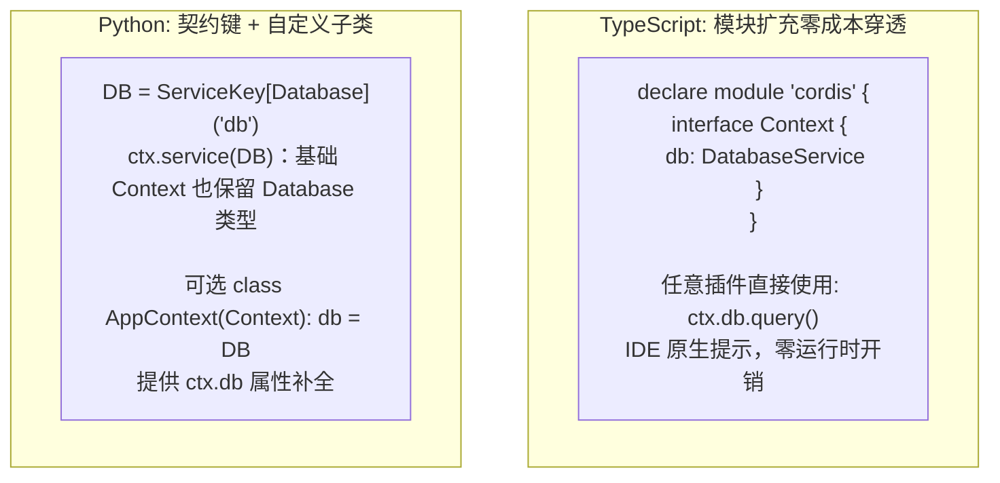

# Cordis 全方位对比：TypeScript 版 vs Python 版架构解析与演进指南

> 本文档系统对比 Cordis 的 TypeScript 官方实现（[`packages/core`](../../packages/core)）与 Python 原生实现（[`python/src/cordis`](../src/cordis)）。从设计哲学、类型系统、元编程、并发治理、Loader、HMR 到生态周边进行全维度透视，深入剖析 Python 版目前的局限与演进方向。

Python 接口已同步当前仓库：除 FiberView、类型键和类型化挂载外，现已提供可选 Service 基类、调用方 Context 传播、Accessor/mixin、EntryTree/ConfigStore、多文件 include、混合静态/运行时 HMR 依赖追踪，以及 logger/timer/registry/schema 辅助层。已有项目的改法见[迁移指南](migration-typed-interfaces.md)。

---

## 目录

- [1. 全景对比速查表](#1-全景对比速查表)
- [2. 元编程与代理模型对比 (Metaprogramming & Proxy)](#2-元编程与代理模型对比-metaprogramming--proxy)
  - [2.1 属性透明拦截与依赖越权防线](#21-属性透明拦截与依赖越权防线)
  - [2.2 可调用服务（Callable Service）与原型缝合](#22-可调用服务callable-service与原型缝合)
- [3. 类型系统与开发体验 (Type System & DX)](#3-类型系统与开发体验-type-system--dx)
  - [3.1 模块扩充（Module Augmentation） vs 描述符子类化](#31-模块扩充module-augmentation-vs-描述符子类化)
  - [3.2 工业级 Schema 规范 vs 基础校验回调](#32-工业级-schema-规范-vs-基础校验回调)
- [4. 服务抽象与生命周期规范 (Service Abstraction)](#4-服务抽象与生命周期规范-service-abstraction)
  - [4.1 `Service` 抽象基类 vs 函数式 `provide`](#41-service-抽象基类-vs-函数式-provide)
  - [4.2 上下文反向追踪（Caller Traceability）](#42-上下文反向追踪caller-traceability)
- [5. 异步与并发任务治理模型 (Concurrency & Task Supervision)](#5-异步与并发任务治理模型-concurrency--task-supervision)
  - [5.1 Python 的突出优势：`ctx.spawn` 与结构化受管任务](#51-python-的突出优势ctxspawn-与结构化受管任务)
  - [5.2 Python 版的任务治理短板与风险](#52-python-版的任务治理短板与风险)
- [6. 声明式配置 Loader 与拓扑树 (Declarative Loader)](#6-声明式配置-loader-与拓扑树-declarative-loader)
  - [6.1 TS 的 `EntryTree` 树形配置与多文件 include 动态回写](#61-ts-的-entrytree-树形配置与多文件-include-动态回写)
  - [6.2 Python 版 Loader 的恢复与并发边界](#62-python-版-loader-的恢复与并发边界)
- [7. 源码级模块热重载 (HMR Engine)](#7-源码级模块热重载-hmr-engine)
  - [7.1 TS 的 Node.js 原生 ESM Loader 劫持](#71-ts-的-nodejs-原生-esm-loader-劫持)
  - [7.2 Python 版基于 AST 分析的局限与恢复范围](#72-python-版基于-ast-分析的局限与恢复范围)
- [8. 官方生态与周边插件矩阵差距 (Ecosystem Gap)](#8-官方生态与周边插件矩阵差距-ecosystem-gap)
- [9. 已修复的核心边界缺陷 (B01~B08)](#9-已修复的核心边界缺陷-b01b08)
- [10. Python 版本的演进路线图 (Roadmap)](#10-python-版本的演进路线图-roadmap)

---

## 1. 全景对比速查表

| 评估维度 | TypeScript 官方实现 (`packages/core`) | Python 原生实现 (`python/src/cordis`) | Python 版现阶段评价 |
| :--- | :--- | :--- | :---: |
| **底层代理模型** | 原生 `Proxy` 深度拦截，强行防守 `inject` 越权 | 基于 `__getattr__` / `__getitem__` 拦截 | 🟡 **能力中等**（对象级无法代理） |
| **类型体验 (DX)** | 模块扩充（Module Augmentation）零成本静态穿透 | ServiceKey、EventKey/QueryKey、泛型配置绑定与 FiberView；可选 AppContext 描述符 | 🟡 需要显式共享契约；键调用无需自定义 Context |
| **服务抽象规范** | 标准 `Service` 基类、`[Service.init]`、Callable 机制 | 函数式 `provide` 与可选自注册 `Service` 并存 | 🟢 Pythonic 的显式双入口 |
| **调用方反向溯源** | `getTraceable` + `symbols.caller` 全自动透传调用者 | `BoundService` + `contextvars` 覆盖同步、异步和迭代调用 | 🟢 已覆盖受管 Service |
| **并发任务管理** | 纯 Promise/Disposable，缺少在途任务排空策略 | 原生 `ctx.spawn` + `TaskPolicy` (`drain`/`cancel`) | 🟢 **优于 TS**（结构化并发设计更强） |
| **配置校验规范** | 原生集成 `@standard-schema/spec`（Zod/ArkType） | decode/validate + callable、Pydantic 风格 Schema adapter | 🟢 通过协议适配 Python 生态 |
| **声明式 Loader** | `EntryTree` 树形配置、`group`、多文件拆分与回写 | 不可变 EntryTree、事务 ConfigStore、ConfigIncludes | 🟢 已覆盖树操作与独立文件回写 |
| **模块热重载 (HMR)**| 深度集成 Node.js ESM Loader | AST 静态图 + 导入期动态追踪，事务替换 `sys.modules` | 🟡 语义接近，仍受 Python 全局导入机制约束 |
| **周边生态** | timer, logger-console, group, include 等独立包 | 内置 timer/logger/group/include/registry 辅助层 | 🟡 能力齐备，插件生态规模仍较小 |
| **边界健壮性** | 经历数万常驻节点长期生产检验（如 Koishi 生态） | 审计 B01–B08 与 K01–K02 已于 2026-09-13 修复 | 🟡 已有回归覆盖，仍需长期运行验证 |

---

## 2. 元编程与代理模型对比 (Metaprogramming & Proxy)

### 2.1 属性透明拦截与依赖越权防线

- **TypeScript 版**：
  整个 `Context` 是一个原生 Proxy 对象（[`packages/core/src/reflect.ts:62`](../../packages/core/src/reflect.ts#L62)）。开发者在代码中执行 `ctx.database` 时，触发 Proxy 的 `get` trap：
  ```typescript
  // TS 内核拦截逻辑片段
  const error = new Error(`cannot get property "${prop}" without inject`)
  // 强行阻断未声明依赖的访问：
  if (prop in fiber.inject) {
    error.message = `cannot get required service "${prop}" in inactive context`
    throw error
  }
  ```
  **优势**：由于是语言级原生 Proxy，即使方法被解构、赋值给临时变量，其属性存取依然被运行时 100% 监管。

- **Python 版**：
  Python 版通过在 Context 类上重写 `__getattr__` 与 `__getitem__`（[Context 属性和下标读取](../src/cordis/core.py#L1707)）模拟该行为。
- **Python 版的边界**：
  Python 没有语言原生的透明 Proxy。当前实现用生命周期绑定的 `ctx.accessor()` / `ctx.mixin()` 扩展 Context，并对 `Service` 子类返回 `BoundService` 使用点视图，从而传播调用者与拦截元数据。任意第三方对象若直接通过 `ctx.provide()` 发布，仍不会自动获得方法级代理，这是刻意保留的显式边界。

### 2.2 可调用服务（Callable Service）与原型缝合

- **TypeScript 版**：
  支持通过 [`createCallable`](../../packages/core/src/utils.ts#L100) 将任意 Service 类转化为函数与对象的复合体：
  ```typescript
  class HttpService extends Service {
    [Service.invoke](url: string) { return fetch(url) }
    post(url: string, data: any) { ... }
  }
  // 既可以直接调用，也可以访问方法：
  app.http('https://api.com')
  app.http.post('https://api.com', {})
  ```
- **Python 版**：
  `Service` 构造时自注册，`BoundService` 同时代理普通方法和 `__call__`；调用期间 `service.ctx` 指向消费者 Context，调用结束后恢复提供方 Context。它不修改类原型，也不使用 Metaclass，符合 Python 对显式对象组合的习惯。

---

## 3. 类型系统与开发体验 (Type System & DX)



### 3.1 模块扩充（Module Augmentation） vs 描述符子类化

TypeScript 可通过模块扩充声明 Context 服务成员；Python 需要显式共享类型契约。基础 Context 的 `ctx.service(KEY)` 和 `ctx[KEY]` 已保留 ServiceKey[T] 的 T，并不要求自定义子类。需要 `ctx.db` 属性补全时再定义 AppContext 描述符；未声明的动态属性及字符串服务读取仍返回 Any。

### 3.2 工业级 Schema 规范 vs 基础校验回调

TS 版适配 [`@standard-schema/spec`](https://github.com/standard-schema/standard-schema)。Python 的 `decode_schema()` / `schema_decoder()` 接受 callable、`validate()`、Pydantic v2 的 `validate_python()`、模型的 `model_validate()` 以及同步/异步结果；`Component.decode_schema()` 解码后返回类型化 BoundComponent。运行时不强依赖任何校验库。

### 当前已具备的类型链

| 业务入口 | 保留的信息 | 动态边界 |
| --- | --- | --- |
| ctx.use / configure → Loader.mount | 配置与 Context 类型，返回可 update 的 Fiber | Entry/reconcile 的插件与配置仍独立存储 |
| Context.fiber / Loader.get、reload | FiberView 保留 Context，配置只供检查 | 未知配置不提供 update；视图不是运行时沙箱 |
| EventKey + on/emit/parallel | 通过 TypeVarTuple 关联零到多个参数 | 字符串事件不关联参数类型 |
| QueryKey + handle/query | 请求、结果和可选 None | 单处理器语义，不替代多监听器短路链 |

EventKey/QueryKey 按对象身份匹配，必须共享同一个键；ServiceKey 继续按字符串名字路由。类型化 mount 目前不参与源码 HMR，动态 Entry 的字符串定位符仍是代码替换入口。

---

## 4. 服务抽象与生命周期规范 (Service Abstraction)

### 4.1 `Service` 抽象基类 vs 函数式 `provide`

- **TypeScript 版**：
  拥有高度内聚的 `Service` 基类（[`packages/core/src/service.ts`](../../packages/core/src/service.ts)），一个类就完整封装了：
  - 构造时自动注册（`super(ctx, 'name')`）；
  - 异步生命周期初始化（`[Service.init]()`）；
  - 生命周期撤销与清理（返回 Dispose 回调）；
  - 隔离域过滤策略（`[symbols.filter]`）；
  - 上下文派生扩展（`[symbols.extend]`）；
  - 配置合并算法（`[symbols.resolveConfig]`）。
- **Python 版**：
  `Service(ctx, key)` 是可选的自注册基类，适合需要调用方 Context 的对象服务；轻量值和第三方对象仍可继续使用 `ctx.provide()`。两条路径共享 Realm、依赖声明和 Effect 回滚，不强迫所有服务继承框架类型。

### 4.2 上下文反向追踪（Caller Traceability）

- **TypeScript 版**：
  拥有强大的 `getTraceable` 机制。当消费者通过 `ctx.db.query()` 访问数据库时，运行时自动给数据库服务挂载 `symbols.caller = ctx`。数据库内部读取 `this.ctx[symbols.caller]` 即可**精确获知是哪一个插件的哪次调用触发了自己**，为权限鉴定、插件调用量配额与链路追踪提供了底层支持。
- **Python 版**：
  `BoundService` 在同步方法、awaitable、同步迭代器和异步迭代器的实际执行期间设置 `contextvars`。服务通过 `self.ctx` 或 `current_context()` 获得调用方；服务内部创建的监听器、任务和子插件因此归消费者生命周期所有。传播只针对 `Service`，不会隐式包装任意对象。

---

## 5. 异步与并发任务治理模型 (Concurrency & Task Supervision)

在此维度，Python 版凭借其现代异步设计展现出了显著的架构优势，但也暴露出关键的停机隐患：

```mermaid
flowchart TD
    subgraph Python_Concurrency [Python: 结构化受管任务 (优势)]
        Spawn["ctx.spawn(coro, policy='drain', timeout=5.0)"]
        Unload["插件触发卸载"] --> Decision{"检查 TaskPolicy"}
        Decision -->|drain| Drain["等待任务自然完成 (带超时缓冲)"]
        Decision -->|cancel| Cancel["立即触发 Task 取消并等待 finally"]
        Drain --> Cleanup["按拓扑反向执行 Cleanups"]
        Cancel --> Cleanup
    end

    subgraph TS_Concurrency [TypeScript: 纯 Promise 模型]
        TS_Effect["ctx.effect(() => { return () => dispose() })"]
        TS_Unload["插件触发卸载"] --> TS_Disposables["并发调用全部 dispose() 闭包"]
        Note["缺少在途协程任务排空与超时机制"]
    end
```

### 5.1 Python 的突出优势：`ctx.spawn` 与结构化受管任务
- 引入了工业级的结构化并发工具 [`ctx.spawn()`](../src/cordis/core.py#L1463)，支持 `policy="drain"`（优雅排空）与 `policy="cancel"`（即时取消），能够保证“在提供者服务关闭前，消费者的在途事务被安全排空或协作退出”。

### 5.2 Python 版的任务治理短板与风险
1. **Cleanup 清理阶段缺少全局超时保护（P0 级风险）**：
   在 [`_dispose_actions`](../src/cordis/core.py#L449) 中，`_dispose_actions` 清理动作栈时是无限期等待的。若某个插件的清理函数发生永久死锁（例如等待未关闭的连接池），整个进程的卸载与重载流程将被永久冻结。
2. **协作取消的天然脆弱性**：
   Python 协程的取消依赖协作让出，若插件内存在同步 CPU 密集死循环或阻塞式系统调用（如未经线程化的文件读写），`cancel()` 信号无法强制打断执行。

---

## 6. 声明式配置 Loader 与拓扑树 (Declarative Loader)

### 6.1 TS 的 `EntryTree` 树形配置与多文件 include 动态回写

- **TypeScript 版 (`@cordisjs/plugin-loader`)**：
  - 拥有 `EntryTree` 分层配置模型；
  - 原生支持分组插件 `@cordisjs/plugin-group`，支持对子系统进行整体验证与批量启停；
  - 支持 `@cordisjs/plugin-include`，能够将单体大配置文件拆分为模块化的独立 YAML 子文件，并支持运行期将配置变更动态回写保存至磁盘。
### 6.2 Python 版 Loader 的恢复与并发边界

Python 已增加不可变 `EntryTree` 的 create/update/remove/move 路径操作。`ConfigStore` 把 Loader reconcile、乐观版本检查和 JSON/YAML 原子回写放在一个取消安全的串行事务中；任一步失败都会恢复旧运行态。`ConfigIncludes` 将每个文件挂成独立 group/nested Loader，允许相同局部 id 并分别监听和回写。见 [Loader API](api/loader.md)。

这些恢复不提供进程外数据库式隔离，也不能撤销任意外部副作用。children/group 支持嵌套 Loader；类型化 mount 独立管理，不被 reconcile([]) 删除。不同根 Loader 的更新仍需宿主协调。


---

## 7. 源码级模块热重载 (HMR Engine)

### 7.1 TS 的 Node.js 原生 ESM Loader 劫持

- **TypeScript 版 (`packages/hmr`)**：
  - 深度绑定 Node.js 18+ 原生 ESM Loader 内部机制（`--expose-internals`）；
  - 事务级内存模块置换，在替换失败时不仅能够还原模块缓存，还能完整修复父包属性引用。
### 7.2 Python 版基于 AST 分析的局限与恢复范围

Python 的 B04/B05 已修复：模块缓存和父包属性一起恢复，操作取消会等提交或回滚收尾。接受的包会扩展到缓存子模块，并在 reload_changed 中检查 external 边界。

当前依赖图合并 AST 静态边和插件导入期间捕获的 `__import__` / `importlib.import_module()` 动态边；动态模块名因此能参与反向影响分析。剩余边界是插件加载窗口之外才发生的条件导入、全进程源码扫描成本、导入时外部副作用，以及外层 Loader 不自动遍历 group 子 Loader。见 [HMR API](api/hmr.md)。


---

## 8. 官方生态与周边插件矩阵差距 (Ecosystem Gap)

TypeScript 版本拥有经过多年积累的完整官方生态，而 Python 版目前仅是单体微内核：

```
TypeScript 官方生态矩阵:
├── @cordisjs/core                   (内核)
├── @cordisjs/plugin-loader          (多格式配置加载器)
├── @cordisjs/plugin-hmr             (源码级热重载)
├── @cordisjs/plugin-timer           (受管定时器与心跳服务)
├── @cordisjs/plugin-logger-console  (分级彩色控制台日志)
├── @cordisjs/plugin-group           (插件分组与条件流控)
├── @cordisjs/plugin-include         (配置拆分与动态文件回写)
└── @cordisjs/plugin-utils           (对象追踪与工具集)

Python 当前状态:
├── cordis-python (core, loader/config, hmr, services；统一从 cordis 导出)
├── 内置 group/include、logger、timer、registry、schema adapter
├── 配置文件监听、原子回写、受管任务、类型化通知与查询
└── examples/ (CSV 导入、Agent、安全卸载、类型化接口等示例)
```

Python 的这些能力采用标准库习惯：`ctx.timer.timeout()/interval()/debounce()/throttle()` 返回受管 Task；`ctx.logger` 基于 `logging` 并自动附加 Fiber 元数据；`ContextLogger.add_handler()` 随作用域移除 handler。与 TS 的主要差距从“缺少能力”变成了“生态包数量和长期生产验证规模不同”。

---

## 9. 已修复的核心边界缺陷 (B01~B08)

下表保留 [2026-09-10 审计](bug-audit-2026-09-10.md)的历史缺陷描述；**现已全部修复**，不代表当前行为，也不能据此推断 TS 在未经同等测试的场景下没有缺陷。当前修复与验证见[修复记录](bug-fixes-2026-09-13.md)。

| 缺陷编号 | 严重度 | 缺陷名称与机理 | 实际影响 |
| :---: | :---: | :--- | :--- |
| **B01** | **P1** | 消费者切换 Realm 破坏卸载依赖视图 | 违反了“Committed View 不可漂移”铁律，清理代码无法访问旧依赖，导致数据持久化失败 |
| **B02** | **P2** | `dispose()` 与初始化失败并发竞态 | 状态被误切入 `FAILED` 而非 `DISPOSED`，导致残留在 `runtime.fibers` 无法被垃圾回收 |
| **B03** | **P1** | 生成器初始化被中断误判为 `MissingProvisionError` | 插件中途被取消退出，被误报为“未提供服务”，掩盖了真实的异常原因并阻断自愈 |
| **B04** | **P1** | HMR 回滚遗漏父模块属性更新 | 仅恢复了 `sys.modules`，其他模块通过父级属性访问时获取到错误引用 |
| **B05** | **P1** | 取消等待 HMR 任务导致回滚被跳过 | 新插件加载失败且旧插件已被卸载，直接丢失业务服务 |
| **B06** | **P2** | 已销毁的 Fiber 被父级闭包持续强引用 | 引发隐性内存泄漏 |
| **B07** | **P2** | 非法 `yield` 引发执行器异常时未关闭生成器 | 挂起的生成器未执行 `finally` 块，导致文件句柄等资源悬挂 |
| **B08** | **P2** | 受管任务通过服务清理句柄卸载依赖绕过防自锁检查 | 破坏了 `assert_can_wait_for` 防线，存在引发静默死锁的风险 |

---

## 10. Python 版本的演进路线图 (Roadmap)

审计的 10 项缺陷、Loader 串行协调与失败恢复已经完成。后续工作集中在：

1. cleanup 期限、容量和长期运行诊断。
2. 动态依赖声明、嵌套 Loader 的 HMR 范围与 watcher 恢复策略。
3. 依赖环、整组就绪和 Realm 冲突预检。
4. 长期运行观测、插件生态规模与更多第三方 Schema/日志 handler 集成。

完整状态见[实现与维护参考](implementation.md#维护清单)。
