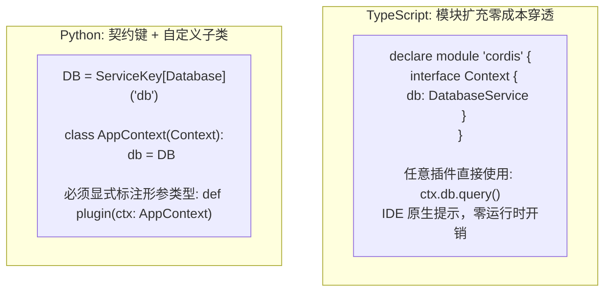
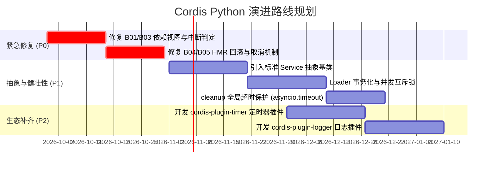

# Cordis 全方位对比：TypeScript 版 vs Python 版架构解析与演进指南

> 本文档系统对比 Cordis 的 TypeScript 官方实现（[`packages/core`](../../packages/core)）与 Python 原生实现（[`python/src/cordis`](../src/cordis)）。从设计哲学、类型系统、元编程、并发治理、Loader、HMR 到生态周边进行全维度透视，深入剖析 Python 版目前的局限与演进方向。

---

## 目录

- [1. 全景对比速查表](#1-全景对比速查表)
- [2. 元编程与代理模型对比 (Metaprogramming & Proxy)](#2-元编程与代理模型对比-metaprogramming--proxy)
  - [2.1 属性透明拦截与依赖越权防线](#21-属性透明拦截与依赖越权防线)
  - [2.2 可调用服务（Callable Service）与原型缝合](#22-可调用服务callable-service与原型缝合)
- [3. 类型系统与开发体验 (Type System & DX)](#3-类型系统与开发体验-type-system--dx)
  - [3.1 模块扩充（Module Augmentation） vs 描述符子类化](#31-模块扩充module-augmentation-vs-描述符子类化)
  - [3.2 工业级 Schema 规范 vs 基础校验回调](#32-工业级-schema-规范-vs-基础校验回调)
- [4. 服务抽象与生命周期规范 (Service Abstraction)](#4-服务抽象与生命周期规范-service-abstraction)
  - [4.1 `Service` 抽象基类 vs 函数式 `provide`](#41-service-抽象基类-vs-函数式-provide)
  - [4.2 上下文反向追踪（Caller Traceability）](#42-上下文反向追踪caller-traceability)
- [5. 异步与并发任务治理模型 (Concurrency & Task Supervision)](#5-异步与并发任务治理模型-concurrency--task-supervision)
  - [5.1 Python 的突出优势：`ctx.spawn` 与结构化受管任务](#51-python-的突出优势ctxspawn-与结构化受管任务)
  - [5.2 Python 版的任务治理短板与风险](#52-python-版的任务治理短板与风险)
- [6. 声明式配置 Loader 与拓扑树 (Declarative Loader)](#6-声明式配置-loader-与拓扑树-declarative-loader)
  - [6.1 TS 的 `EntryTree` 树形配置与多文件 include 动态回写](#61-ts-的-entrytree-树形配置与多文件-include-动态回写)
  - [6.2 Python 版 Loader 的缺陷：非全局事务与并发竞争](#62-python-版-loader-的缺陷非全局事务与并发竞争)
- [7. 源码级模块热重载 (HMR Engine)](#7-源码级模块热重载-hmr-engine)
  - [7.1 TS 的 Node.js 原生 ESM Loader 劫持](#71-ts-的-nodejs-原生-esm-loader-劫持)
  - [7.2 Python 版基于 AST 分析的局限与回滚残留](#72-python-版基于-ast-分析的局限与回滚残留)
- [8. 官方生态与周边插件矩阵差距 (Ecosystem Gap)](#8-官方生态与周边插件矩阵差距-ecosystem-gap)
- [9. Python 版已确认的 8 个核心边界缺陷 (Audited Bugs B01~B08)](#9-python-版已确认的-8-个核心边界缺陷-audited-bugs-b01b08)
- [10. Python 版本的演进路线图 (Roadmap)](#10-python-版本的演进路线图-roadmap)

---

## 1. 全景对比速查表

| 评估维度 | TypeScript 官方实现 (`packages/core`) | Python 原生实现 (`python/src/cordis`) | Python 版现阶段评价 |
| :--- | :--- | :--- | :---: |
| **底层代理模型** | 原生 `Proxy` 深度拦截，强行防守 `inject` 越权 | 基于 `__getattr__` / `__getitem__` 拦截 | 🟡 **能力中等**（对象级无法代理） |
| **类型体验 (DX)** | 模块扩充（Module Augmentation）零成本静态穿透 | `ServiceKey[T]` + 手写 `AppContext` 描述符 | 🟡 **偏繁琐**（需显式子类化） |
| **服务抽象规范** | 标准 `Service` 基类、`[Service.init]`、Callable 机制 | 仅支持无基类函数式 `ctx.provide` | 🔴 **明显不足**（缺少标准抽象） |
| **调用方反向溯源** | `getTraceable` + `symbols.caller` 全自动透传调用者 | 仅支持 Fiber 级 `contextvars`，无方法级 Caller | 🔴 **明显不足**（无自动调用方标记） |
| **并发任务管理** | 纯 Promise/Disposable，缺少在途任务排空策略 | 原生 `ctx.spawn` + `TaskPolicy` (`drain`/`cancel`) | 🟢 **优于 TS**（结构化并发设计更强） |
| **配置校验规范** | 原生集成 `@standard-schema/spec`（Zod/ArkType） | 仅支持简单无规范的 `Callable` 回调 | 🟡 **能力中等**（缺生态集成） |
| **声明式 Loader** | `EntryTree` 树形配置、`group`、多文件拆分与回写 | 基础扁平 `reconcile`，无组管理 | 🔴 **明显不足**（非全局事务） |
| **模块热重载 (HMR)**| 深度集成 Node.js ESM 加载器，全事务性置换与回滚 | 纯 Python 源码 AST 解析，替换 `sys.modules` | 🔴 **明显不足**（无法感知动态 import） |
| **周边生态** | 官方包含 timer, logger-console, group, include 等 | 纯微内核裸核，周边插件生态为 0 | 🔴 **明显不足**（生态完全空白） |
| **边界健壮性** | 经历数万常驻节点长期生产检验（如 Koishi 生态） | 2026-09-10 审计确认 8 个底层边界 Bug 待修复 | 🔴 **明显不足**（回滚存在漏洞） |

---

## 2. 元编程与代理模型对比 (Metaprogramming & Proxy)

### 2.1 属性透明拦截与依赖越权防线

- **TypeScript 版**：
  整个 `Context` 是一个原生 Proxy 对象（[`packages/core/src/reflect.ts:62`](../../packages/core/src/reflect.ts#L62)）。开发者在代码中执行 `ctx.database` 时，触发 Proxy 的 `get` trap：
  ```typescript
  // TS 内核拦截逻辑片段
  const error = new Error(`cannot get property "${prop}" without inject`)
  // 强行阻断未声明依赖的访问：
  if (prop in fiber.inject) {
    error.message = `cannot get required service "${prop}" in inactive context`
    throw error
  }
  ```
  **优势**：由于是语言级原生 Proxy，即使方法被解构、赋值给临时变量，其属性存取依然被运行时 100% 监管。

- **Python 版**：
  Python 版通过在 Context 类上重写 `__getattr__` 与 `__getitem__`（[`core.py:1464`](../src/cordis/core.py#L1464)）模拟该行为。
- **Python 版的不足**：
  Python 缺乏语言原生的透明对象级 Proxy（`__getattr__` 只能拦截不存在的属性，对已有属性无法拦截）。一旦服务实例被返回给上层，服务对象自身的方法调用链**无法被运行时自动挂载拦截钩子**，导致配置拦截（Intercepts）和动态访问器（Accessors）的灵活性大幅缩水。

### 2.2 可调用服务（Callable Service）与原型缝合

- **TypeScript 版**：
  支持通过 [`createCallable`](../../packages/core/src/utils.ts#L100) 将任意 Service 类转化为函数与对象的复合体：
  ```typescript
  class HttpService extends Service {
    [Service.invoke](url: string) { return fetch(url) }
    post(url: string, data: any) { ... }
  }
  // 既可以直接调用，也可以访问方法：
  app.http('https://api.com')
  app.http.post('https://api.com', {})
  ```
- **Python 版的不足**：
  虽然 Python 类支持定义 `__call__`，但由于没有统一的 Service 基类与自动原型缝合机制，无法实现将调用者 Context、拦截配置与追踪器自动融合在可调用服务中的能力。

---

## 3. 类型系统与开发体验 (Type System & DX)



### Python 版在此维度的不足：
1. **开发者心智负担较重**：
   TypeScript 借助语言级 `declare module 'cordis'`，任意第三方插件只要引入，全局的 `ctx.<service>` 就自动获得强类型提示与补全；而在 Python 中，由于不支持类接口动态合并，必须在每个项目中手动定义 `AppContext` 子类并声明描述符，一旦开发者随手写了 `def plugin(ctx: Context)`，类型提示立刻退化为 `Any`。
2. **缺乏标准 Schema 校验框架集成**：
   TS 版直接适配 [`@standard-schema/spec`](https://github.com/standard-schema/standard-schema)，能够无缝接入 Zod、Valibot、ArkType 等强大的校验库；Python 版目前仅提供裸 `validate: Callable[[ConfigT], ConfigT]`，未深度集成 Pydantic 等生态事实标准。

---

## 4. 服务抽象与生命周期规范 (Service Abstraction)

### 4.1 `Service` 抽象基类 vs 函数式 `provide`

- **TypeScript 版**：
  拥有高度内聚的 `Service` 基类（[`packages/core/src/service.ts`](../../packages/core/src/service.ts)），一个类就完整封装了：
  - 构造时自动注册（`super(ctx, 'name')`）；
  - 异步生命周期初始化（`[Service.init]()`）；
  - 生命周期撤销与清理（返回 Dispose 回调）；
  - 隔离域过滤策略（`[symbols.filter]`）；
  - 上下文派生扩展（`[symbols.extend]`）；
  - 配置合并算法（`[symbols.resolveConfig]`）。
- **Python 版的不足**：
  **完全没有 `Service` 基类！** 
  Python 版把服务降级为了普通对象，发布服务必须在普通插件函数中调用 `ctx.provide(KEY, instance)`。这种设计导致服务的定义与生命周期管理割裂在类与函数两个不同层级，缺乏标准化的服务工程实践。

### 4.2 上下文反向追踪（Caller Traceability）

- **TypeScript 版**：
  拥有强大的 `getTraceable` 机制。当消费者通过 `ctx.db.query()` 访问数据库时，运行时自动给数据库服务挂载 `symbols.caller = ctx`。数据库内部读取 `this.ctx[symbols.caller]` 即可**精确获知是哪一个插件的哪次调用触发了自己**，为权限鉴定、插件调用量配额与链路追踪提供了底层支持。
- **Python 版的不足**：
  完全不具备方法级调用者自动追踪能力，跨插件调用时无法得知调用发起方身份。

---

## 5. 异步与并发任务治理模型 (Concurrency & Task Supervision)

在此维度，Python 版凭借其现代异步设计展现出了显著的架构优势，但也暴露出关键的停机隐患：

```mermaid
flowchart TD
    subgraph Python_Concurrency [Python: 结构化受管任务 (优势)]
        Spawn["ctx.spawn(coro, policy='drain', timeout=5.0)"]
        Unload["插件触发卸载"] --> Decision{"检查 TaskPolicy"}
        Decision -->|drain| Drain["等待任务自然完成 (带超时缓冲)"]
        Decision -->|cancel| Cancel["立即触发 Task 取消并等待 finally"]
        Drain --> Cleanup["按拓扑反向执行 Cleanups"]
        Cancel --> Cleanup
    end

    subgraph TS_Concurrency [TypeScript: 纯 Promise 模型]
        TS_Effect["ctx.effect(() => { return () => dispose() })"]
        TS_Unload["插件触发卸载"] --> TS_Disposables["并发调用全部 dispose() 闭包"]
        Note["缺少在途协程任务排空与超时机制"]
    end
```

### Python 版的优势：
- 引入了工业级的结构化并发工具 [`ctx.spawn()`](../src/cordis/core.py#L1279)，支持 `policy="drain"`（优雅排空）与 `policy="cancel"`（即时取消），能够保证“在提供者服务关闭前，消费者的在途事务被安全排空或协作退出”。

### Python 版的不足与风险：
1. **Cleanup 清理阶段缺少全局超时保护（P0 级风险）**：
   在 [`core.py:345`](../src/cordis/core.py#L345) 中，`_dispose_actions` 清理动作栈时是无限期等待的。若某个插件的清理函数发生永久死锁（例如等待未关闭的连接池），整个进程的卸载与重载流程将被永久冻结。
2. **协作取消的天然脆弱性**：
   Python 协程的取消依赖协作让出，若插件内存在同步 CPU 密集死循环或阻塞式系统调用（如未经线程化的文件读写），`cancel()` 信号无法强制打断执行。

---

## 6. 声明式配置 Loader 与拓扑树 (Declarative Loader)

- **TypeScript 版 (`@cordisjs/plugin-loader`)**：
  - 拥有 `EntryTree` 分层配置模型；
  - 原生支持分组插件 `@cordisjs/plugin-group`，支持对子系统进行整体验证与批量启停；
  - 支持 `@cordisjs/plugin-include`，能够将单体大配置文件拆分为模块化的独立 YAML 子文件，并支持运行期将配置变更动态回写保存至磁盘。
- **Python 版 (`loader.py`) 的不足**：
  1. **缺少全局事务性（P1 缺陷）**：`reconcile()` 过程中若第 2 个插件导入报错，已删除的第 1 个插件无法回滚恢复，导致系统损坏；
  2. **配置记录与 Fiber 状态不同步**：配置校验失败时，Fiber 会自动回滚到旧版本，但 Loader 内存中的 Entry 字典依然记录为新版本，导致下一次提交同一配置被判定为“无变化”而被跳过；
  3. **并发更新缺少互斥锁**：两个并发协程同时调用 `reconcile` 会破坏内部 `_loaded` 映射表。

---

## 7. 源码级模块热重载 (HMR Engine)

- **TypeScript 版 (`packages/hmr`)**：
  - 深度绑定 Node.js 18+ 原生 ESM Loader 内部机制（`--expose-internals`）；
  - 事务级内存模块置换，在替换失败时不仅能够还原模块缓存，还能完整修复父包属性引用。
- **Python 版 (`hmr.py`) 的不足**：
  1. **仅支持 AST 静态 import 识别**：无法识别代码中通过 `importlib.import_module()` 动态导入的依赖关系；
  2. **回滚存在“幽灵引用”（Bug B04）**：HMR 替换失败回滚时，只恢复了 `sys.modules`，父模块对象（如 `package.module`）依然指向失败的新模块；
  3. **任务取消导致回滚遗漏（Bug B05）**：在等待 HMR 重载完成时若外部任务被取消，异常处理会跳过回滚逻辑，导致旧插件已被卸载而新插件未能启动，系统陷入服务真空；
  4. **全量源码扫描开销大**：大型工程中每次文件变更都需要对所有已加载模块的源码执行 AST 解析，存在较高的 I/O 与 CPU 延迟。

---

## 8. 官方生态与周边插件矩阵差距 (Ecosystem Gap)

TypeScript 版本拥有经过多年积累的完整官方生态，而 Python 版目前仅是单体微内核：

```
TypeScript 官方生态矩阵:
├── @cordisjs/core                   (内核)
├── @cordisjs/plugin-loader          (多格式配置加载器)
├── @cordisjs/plugin-hmr             (源码级热重载)
├── @cordisjs/plugin-timer           (受管定时器与心跳服务)
├── @cordisjs/plugin-logger-console  (分级彩色控制台日志)
├── @cordisjs/plugin-group           (插件分组与条件流控)
├── @cordisjs/plugin-include         (配置拆分与动态文件回写)
└── @cordisjs/plugin-utils           (对象追踪与工具集)

Python 当前状态:
└── cordis-python (仅包含 core, loader, hmr, keys 四个源码文件，生态周边为 0)
```

**对开发者的直接影响**：
- 在 Python 中，开发者无法使用 `ctx.timer.setTimeout()`，必须手动使用 `asyncio.sleep` 与 `ctx.spawn` 组合；
- 没有开箱即用的分级日志插件，无法实现按上下文作用域自动过滤日志。

---

## 9. Python 版已确认的 8 个核心边界缺陷 (Audited Bugs B01~B08)

根据 2026-09-10 官方审计报告 [`python/docs/bug-audit-2026-09-10.md`](bug-audit-2026-09-10.md)，Python 版现存 8 个已通过独立脚本复现的底层 Bug（TS 版在对应场景均具备更健壮的防御机制）：

| 缺陷编号 | 严重度 | 缺陷名称与机理 | 实际影响 |
| :---: | :---: | :--- | :--- |
| **B01** | **P1** | 消费者切换 Realm 破坏卸载依赖视图 | 违反了“Committed View 不可漂移”铁律，清理代码无法访问旧依赖，导致数据持久化失败 |
| **B02** | **P2** | `dispose()` 与初始化失败并发竞态 | 状态被误切入 `FAILED` 而非 `DISPOSED`，导致残留在 `runtime.fibers` 无法被垃圾回收 |
| **B03** | **P1** | 生成器初始化被中断误判为 `MissingProvisionError` | 插件中途被取消退出，被误报为“未提供服务”，掩盖了真实的异常原因并阻断自愈 |
| **B04** | **P1** | HMR 回滚遗漏父模块属性更新 | 仅恢复了 `sys.modules`，其他模块通过父级属性访问时获取到错误引用 |
| **B05** | **P1** | 取消等待 HMR 任务导致回滚被跳过 | 新插件加载失败且旧插件已被卸载，直接丢失业务服务 |
| **B06** | **P2** | 已销毁的 Fiber 被父级闭包持续强引用 | 引发隐性内存泄漏 |
| **B07** | **P2** | 非法 `yield` 引发执行器异常时未关闭生成器 | 挂起的生成器未执行 `finally` 块，导致文件句柄等资源悬挂 |
| **B08** | **P2** | 受管任务通过服务清理句柄卸载依赖绕过防自锁检查 | 破坏了 `assert_can_wait_for` 防线，存在引发静默死锁的风险 |

---

## 10. Python 版本的演进路线图 (Roadmap)

基于上述对比，建议 Python 版后续按以下优先级演进升级：



### 具体行动建议：
1. **优先修复审计缺陷**：集中精力解决 B01、B03、B04、B05，消除停机时依赖访问失败与热更回滚破损；
2. **抽象标准化**：设计 Python 版的 `class Service` 规范，让服务的声明、生命周期与可用性检查统一内聚；
3. **事务型 Loader**：为 `Loader.reconcile` 加入 `asyncio.Lock`，并在应用变更前进行配置预校验，确保失败能够完整原子回滚；
4. **周边生态建设**：将定时器与日志服务从业务代码中剥离，形成标准的 Python 周边包。
