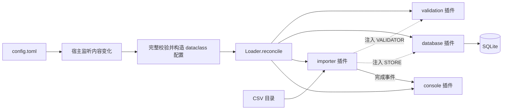

# 实战场景：配置驱动的 CSV 订单导入

适合 Cordis 的场景通常具备两个特点：功能由多个插件组合，运行期间还需要更新配置、替换服务或停用功能。下面几种都能在日常开发中用到：

| 场景 | 插件如何拆分 | 配置修改后的行为 |
| --- | --- | --- |
| **CSV 导入与数据处理** | 文件扫描、业务校验、存储、日志 | 更新校验规则后重新检查文件；切换数据库时先完成在途导入 |
| 开发工具服务 | 命令注册、代码检查、文档预览、文件监听 | 启停命令或监听器，更新检查路径与规则 |
| 多租户机器人 | 消息渠道、命令、定时任务、租户服务 | 为某个租户启停功能、调整任务频率，服务通过 Realm 隔离 |
| 通知服务 | 业务订阅、模板、邮件或消息发送适配器 | 更新模板或发送配置时，让正在发送的任务先退出 |
| AI Agent | 模型客户端、工具、会话、记忆存储 | 切换客户端配置、启停工具，并管理旧调用的生命周期 |

本例实现第一种：真实读取 CSV，校验订单金额，把合法记录写入 SQLite。TOML 配置和 CSV 都会被持续监听，不需要第三方库、数据库服务器或 API Key。

## 先看自动演示

从仓库根目录执行：

```bash
cd python
uv sync
uv run python -m examples.order_importer --demo
```

演示在临时目录中创建配置、CSV 和 SQLite 数据库，然后**实际修改配置文件**，由运行中的监听器完成更新。结束后清理临时目录，不修改示例自带的配置和数据。

关键输出如下：

```text
[导入] orders.csv: 成功 1 行，拒绝 2 行
  第 3 行: 金额超过上限 50.00
  第 4 行: 金额必须是最多两位小数的正数

[演示] 将配置文件中的金额上限改为 100.00
[配置已更新] 金额上限 100.00，扫描间隔 0.1s，日志 True
[导入] orders.csv: 成功 2 行，拒绝 1 行

[数据库] 重复导入按订单号更新，当前共 2 条：
  ORD-001 Alice 25.00
  ORD-002 Bob 80.00
```

示例中的金额用整数分保存，订单号是主键。重复处理 `ORD-001` 会更新同一条记录，不会插入第二条同名订单。

## 手动修改配置，观察自动更新

在 `python/` 目录启动常驻进程：

```bash
uv run python -m examples.order_importer
```

默认读取 [`examples/order_importer/config.toml`](../examples/order_importer/config.toml)：

```toml
[database]
path = "var/orders.sqlite3"

[validation]
max_amount = "50.00"

[importer]
directory = "incoming"
interval = 0.5

[logging]
enabled = true
```

路径相对于配置文件所在目录解析。默认数据库生成在 `examples/order_importer/var/orders.sqlite3`，该生成目录已加入 `.gitignore`。也可以传入自己的配置：

```bash
uv run python -m examples.order_importer --config /path/to/config.toml
```

保持进程运行，在编辑器中依次尝试以下修改并保存：

| 修改 | 可以观察到什么 |
| --- | --- |
| `max_amount = "100.00"` | 校验服务更新，导入插件重新启动，已有 CSV 被重新检查，80 元订单通过 |
| `interval = 2.0` | 导入插件重启，目录扫描周期变为 2 秒 |
| `logging.enabled = false` | 控制台日志插件卸载，停止打印导入报告；扫描和入库继续工作 |
| `logging.enabled = true` | 重新挂载日志插件，后续导入报告再次显示 |
| `database.path = "var/other.sqlite3"` | 在途导入先结束，再关闭原连接、打开新库并重新扫描 CSV |

配置文件每 0.2 秒检查一次内容。更新还会等待受影响插件退出，所以耗时也取决于正在处理的任务。`importer.interval` 只控制 CSV 扫描频率，不改变配置检查频率。仅修改注释、配置值保持相同，不会重启插件。

金额要写成带引号的十进制文本，避免浮点数转换；必须大于零、最多两位小数。扫描间隔必须是至少 0.05 秒的有限数字。配置状态和错误由宿主打印，不受业务日志开关影响。

故意把金额改成 `"NaN"`，或暂时写入不完整的 TOML，会看到配置错误。修正并保存后，监听器会继续应用配置，无需重启进程。

## 修改 CSV 也会自动处理

输入格式是固定三列：

```csv
order_id,customer,amount
ORD-001,Alice,25.00
ORD-002,Bob,80.00
ORD-003,Carol,-5.00
```

在默认的 `examples/order_importer/incoming/` 下新增 `more.csv`：

```csv
order_id,customer,amount
ORD-004,Dora,39.90
ORD-001,Alice,30.00
```

扫描器发现新文件后，创建 `ORD-004`，并把已有 `ORD-001` 更新为 30 元。修改已存在 CSV 并保存，也会再次处理该文件。

导入报告中的“成功 N 行”是本轮通过校验并写入的行数，包含对已有订单的更新。拒绝行会带上 CSV 行号和原因；文件表头错误则报告整个文件失败，等待文件再次变化。

如果要查看数据库，在 `python/` 目录执行：

```bash
uv run python -c 'import sqlite3; db = sqlite3.connect("examples/order_importer/var/orders.sqlite3"); print(db.execute("SELECT order_id, customer, amount_cents FROM orders ORDER BY order_id").fetchall()); db.close()'
```

按 `Ctrl+C` 退出：配置监听和扫描任务请求取消，已提交的导入任务先排空，随后释放服务和数据库连接。

## 插件如何协作



对应代码分为五部分：

| 文件 | 职责 |
| --- | --- |
| [`contracts.py`](../examples/order_importer/contracts.py) | `Order`、导入报告、服务 Protocol、`ServiceKey[T]` 和 `AppContext` 描述符 |
| [`config.py`](../examples/order_importer/config.py) | 把外部 TOML 数据校验并转换为不可变 dataclass，金额转换为整数分 |
| [`plugins.py`](../examples/order_importer/plugins.py) | SQLite 存储、金额校验、目录扫描和日志四个插件 |
| [`application.py`](../examples/order_importer/application.py) | 配置内容监听、稳定 id 装配、更新后的状态检查，以及出错后继续监听 |
| [`__main__.py`](../examples/order_importer/__main__.py) | 常驻入口、退出管理和自动演示 |

业务插件接收具体配置类型：

```python
@plugin(provide=[VALIDATOR])
def validation(ctx: AppContext, config: ValidationConfig) -> None:
    ctx.provide(VALIDATOR, AmountValidator(config))


@plugin(inject=[STORE, VALIDATOR], provide=[IMPORTER])
def importer(ctx: AppContext, config: ImporterConfig) -> None:
    config.directory.mkdir(parents=True, exist_ok=True)
    service = DirectoryImporter(ctx, config)
    ctx.provide(IMPORTER, service)
    ctx.spawn(service.watch(), policy="cancel", name="orders:scan")
```

这段代码摘自 `plugins.py`。消费者通过 `ctx.validator.validate(...)` 和 `ctx.store.save(...)` 使用接口；这些属性保留服务类型和运行时依赖检查。也可以通过 `task = root.importer.submit(path)` 手动提交文件，返回值是 `asyncio.Task[ImportReport]`。

宿主把四份配置交给固定的条目 id：

```python
await loader.reconcile([
    Entry("console", console, enabled=config.logging),
    Entry("database", database, config.database),
    Entry("validation", validation, config.validation),
    Entry("importer", importer, config.importer),
])
```

配置未变的条目保持实例。修改金额规则时，`validation` 更新；依赖它的 `importer` 自动退出并重新激活，数据库实例保持不变。切换日志开关只影响 `console`。配置源本身只在宿主监听，插件无需各自打开同一份 TOML。

这里使用业务配置格式，所以宿主先解析成 dataclass，再调用 `reconcile()`。Cordis 原生的 `Loader.load_file()` / `watch_file()` 接受的是插件条目清单，不会自动把这份业务配置转换成 dataclass；两种格式不能直接混用。

## 正在导入时，更新如何处理

目录扫描是长期循环，使用 `policy="cancel"`；每个文件的导入任务使用 `policy="drain", timeout=5`。

1. 规则或数据库开始更新后，导入插件停止接单和扫描。
2. 已经开始的文件继续使用当次激活的依赖视图，旧规则保持到该任务结束。
3. 在途任务完成或响应取消后，旧服务才会清理。
4. 新实例启动，重新扫描目录，并用新规则处理文件。

扫描器使用 `asyncio.shield()` 等待导入任务，因此取消扫描器不会连带取消应该排空的文件导入。5 秒是从卸载开始计算的宽限期，不是每个文件的执行时限。

输入目录的处理记录保存在扫描器实例内。插件重启后会重新扫描已有文件；数据库的主键与 upsert 让重复写入具有明确结果。这是示例选择的业务策略，可以按实际需求替换成持久化任务表。

## 行为范围

TOML 语法或字段校验失败发生在 `reconcile()` 之前，已有插件不变。数据库打开失败等运行时错误可能发生在逐项更新期间；Loader 不是整个配置清单的原子事务，宿主会报告错误并继续监听。

每条合法订单独立提交。后面的行失败、任务被取消、CSV 被删除，或者规则变得更严格，都不会自动删除已经入库的订单。更换数据库路径也不迁移旧库数据，新库会从当前输入文件重新导入。

这个示例面向小型本地文件：CSV 读取和 SQLite 操作使用同步标准库调用，适合看清插件关系。大批量处理可进一步加入异步存储适配器、批次事务、任务队列、重试和持久化导入记录。文件检测使用修改时间和大小；上游完整写好文件后再原子重命名到输入目录，可避免读到写入中的文件。

本例演示的是**配置自动更新**。修改 Python 源码需要另接 HMR 或重启进程，概念区别见[核心概念](core-concepts.md)。

## 验证

```bash
uv run mypy
uv run python -m unittest tests.test_order_importer -v
uv run python -m examples.order_importer --demo
```

测试覆盖真实配置文件更新、无效配置后的恢复、CSV 内容变化、订单去重与更新、日志启停，以及在途导入跨越规则更新和数据库重启的行为。示例的所有 Python 模块都加入了 mypy strict 检查。
