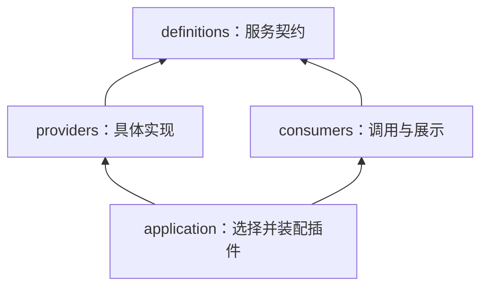
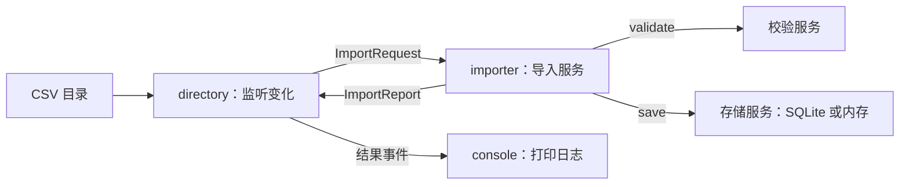

# 实战场景：配置驱动的 CSV 订单导入

适合 Cordis 的场景通常具备两个特点：功能由多个插件组合，运行期间还需要更新配置、替换服务或停用功能。下面几种都能在日常开发中用到：

| 场景 | 插件如何拆分 | 配置修改后的行为 |
| --- | --- | --- |
| **CSV 导入与数据处理** | 文件扫描、业务校验、存储、日志 | 更新校验规则后重新检查文件；切换数据库时先完成在途导入 |
| 开发工具服务 | 命令注册、代码检查、文档预览、文件监听 | 启停命令或监听器，更新检查路径与规则 |
| 多租户机器人 | 消息渠道、命令、定时任务、租户服务 | 为某个租户启停功能、调整任务频率，服务通过 Realm 隔离 |
| 通知服务 | 业务订阅、模板、邮件或消息发送适配器 | 更新模板或发送配置时，让正在发送的任务先退出 |
| AI Agent | 模型客户端、工具、会话、记忆存储 | 切换客户端配置、启停工具，并管理旧调用的生命周期 |

本例实现第一种：读取 CSV，校验订单金额，把合法记录写入存储。它把**服务契约、具体实现、调用入口**分开，你可以在程序运行时，通过 TOML 把 SQLite 换成内存存储。调用方无需修改代码，也不需要第三方库、数据库服务器或 API Key。

先运行演示，再看[三角色如何分工](#三角色如何分工)，最后尝试[增加自己的提供方](#增加自己的提供方)。

## 先看自动演示

从仓库根目录执行：

```bash
cd python
uv sync
uv run python -m examples.order_importer --demo
```

演示在临时目录中创建配置、CSV 和 SQLite 数据库，然后**实际修改配置文件**，由运行中的监听器完成更新。结束后清理临时目录，不修改示例自带的配置和数据。

关键输出如下：

```text
[导入] orders.csv: 成功 1 行，拒绝 2 行
  第 3 行: 金额超过上限 50.00
  第 4 行: 金额必须是最多两位小数的正数

[演示] 将配置文件中的金额上限改为 100.00
[配置已更新] 金额上限 100.00，扫描间隔 0.1s，日志 True，存储 sqlite
[导入] orders.csv: 成功 2 行，拒绝 1 行

[数据库] 重复导入按订单号更新，当前共 2 条：
  ORD-001 Alice 25.00
  ORD-002 Bob 80.00

[演示] 将 database.provider 从 sqlite 改成 memory
[配置已更新] 金额上限 100.00，扫描间隔 0.1s，日志 True，存储 memory
[导入] orders.csv: 成功 2 行，拒绝 1 行
[替换成功] 内存提供方使用相同契约，导入与日志消费者保持原代码。
```

示例中的金额用整数分保存，订单号是主键。重复处理 `ORD-001` 会更新同一条记录，不会插入第二条同名订单。

## 手动修改配置，观察自动更新

在 `python/` 目录启动常驻进程：

```bash
uv run python -m examples.order_importer
```

默认读取 [`examples/order_importer/config.toml`](../examples/order_importer/config.toml)。下面是一份用于复现演示的配置；如果你已经改过文件，先按此设置金额上限：

```toml
[database]
provider = "sqlite"
path = "var/orders.sqlite3"

[validation]
max_amount = "50.00"

[importer]
directory = "incoming"
interval = 0.5

[logging]
enabled = true
```

路径相对于配置文件所在目录解析。默认数据库生成在 `examples/order_importer/var/orders.sqlite3`，该生成目录已加入 `.gitignore`。也可以传入自己的配置：

```bash
uv run python -m examples.order_importer --config /path/to/config.toml
```

保持进程运行，在编辑器中依次尝试以下修改并保存：

| 修改 | 可以观察到什么 |
| --- | --- |
| `max_amount = "100.00"` | 校验服务更新，导入服务与目录监听重新启动，已有 CSV 被重新检查，80 元订单通过 |
| `interval = 2.0` | 仅目录监听重启，扫描周期变为 2 秒；导入服务和存储实例保留 |
| `logging.enabled = false` | 控制台日志插件卸载，停止打印导入报告；扫描和入库继续工作 |
| `logging.enabled = true` | 重新挂载日志插件，后续导入报告再次显示 |
| `database.provider = "memory"` | 关闭旧存储，启用内存提供方，重新导入当前目录中的 CSV |
| `database.provider = "sqlite"` | 换回 SQLite，重新打开 `path` 指向的数据库 |
| `database.path = "var/other.sqlite3"` | 使用 SQLite 时，在途导入先按退出策略结束，再打开新库并重新扫描 CSV |

切换到内存模式时可以保留 `path`，它只在 SQLite 模式生效。内存实例卸载或进程退出后，数据就会丢失；两种提供方之间**不会自动迁移数据**。重新扫描 CSV 是本例补充数据的方式。

配置文件每 0.2 秒检查一次内容。更新还会等待受影响插件退出，所以耗时也取决于正在处理的任务。`importer.interval` 只控制 CSV 扫描频率，不改变配置检查频率。仅修改注释、配置值保持相同，不会重启插件。

金额要写成带引号的十进制文本，避免浮点数转换；必须大于零、最多两位小数。扫描间隔必须是至少 0.05 秒的有限数字。配置状态和错误由宿主打印，不受业务日志开关影响。

故意把金额改成 `"NaN"`，或暂时写入不完整的 TOML，会看到配置错误。修正并保存后，监听器会继续应用配置，无需重启进程。

## 修改 CSV 也会自动处理

输入格式是固定三列：

```csv
order_id,customer,amount
ORD-001,Alice,25.00
ORD-002,Bob,80.00
ORD-003,Carol,-5.00
```

在默认的 `examples/order_importer/incoming/` 下新增 `more.csv`：

```csv
order_id,customer,amount
ORD-004,Dora,39.90
ORD-001,Alice,30.00
```

扫描器发现新文件后，创建 `ORD-004`，并把已有 `ORD-001` 更新为 30 元。修改已存在 CSV 并保存，也会再次处理该文件。

导入报告中的“成功 N 行”是本轮通过校验并写入的行数，包含对已有订单的更新。拒绝行会带上 CSV 行号和原因；文件表头错误则报告整个文件失败，等待文件再次变化。

使用 SQLite 提供方时，要查看数据库，可以在 `python/` 目录执行：

```bash
uv run python -c 'import sqlite3; db = sqlite3.connect("examples/order_importer/var/orders.sqlite3"); print(db.execute("SELECT order_id, customer, amount_cents FROM orders ORDER BY order_id").fetchall()); db.close()'
```

按 `Ctrl+C` 退出：配置监听和扫描任务请求取消，已提交的导入任务先排空，随后释放服务和数据库连接。

## 三角色如何分工

设计参考了 [DeepSeek Harness 的能力三角色实践](https://deepseek-harness.github.io/deepseek-harness/develop/practice/)。在这个例子里，Consumer 是目录监听与控制台展示；也可以换成 HTTP 接口、CLI 命令或 LLM 工具。

| 角色 | 本例中的代码 | 负责什么 |
| --- | --- | --- |
| **Service Definition：服务契约** | [`definitions.py`](../examples/order_importer/definitions.py) | 定义请求、结果、Protocol、服务键和共同的行为约定 |
| **Service Provider：服务提供方** | [`providers/`](../examples/order_importer/providers/) | 实现金额校验、CSV 导入，以及 SQLite / 内存存储；管理自己的资源 |
| **Consumer：服务调用方** | [`consumers/`](../examples/order_importer/consumers/) | 决定什么时候提交文件、如何展示导入结果；不导入具体提供方 |

依赖方向如下，箭头表示 Python 模块的导入关系：



`providers/` 和 `consumers/` 互不导入。`config.py` 与 `application.py` 是装配入口，负责认识具体实现、解析配置并作出选择。这里先按模块拆分，保持在同一个示例包内；需要独立发布时再拆成多个包。

### 1. 契约拥有输入、输出和行为约定

[`definitions.py`](../examples/order_importer/definitions.py) 不读取 CSV、不连接数据库，也不打印日志。例如，存储契约的接口是：

```python
class OrderStore(Protocol):
    def save(self, order: Order) -> None: ...

    def all(self) -> tuple[Order, ...]: ...
```

`Order` 也由这个模块定义。它还声明了两条调用链使用的输入与输出：

| 服务 | 输入 | 输出 |
| --- | --- | --- |
| `OrderValidator.validate()` | `ValidateOrderRequest`：订单号、客户、金额文本 | `Order`：规范化后的订单，金额为整数分；非法值抛出 `ValueError` |
| `OrderImporter.submit()` | `ImportRequest`：待导入文件的路径 | `asyncio.Task[ImportReport]`：等待任务得到成功行数和拒绝原因 |

这些类型都属于契约模块，调用方无需为获取 `ImportReport` 去导入 CSV 实现。`ServiceKey[OrderStore]` 等带类型的键把接口与运行时服务对应起来，`AppContext` 则提供 `ctx.store`、`ctx.validator`、`ctx.importer` 这些有类型提示的访问方式。

这里使用 Python `Protocol`：实现满足接口即可，不要求继承统一基类。**类型一致还不够，还要遵守同一套行为约定。** 本例要求存储按订单号覆盖写入，`all()` 返回按订单号排序的不可变快照，实例关闭后抛出 `StoreClosedError`。同一组测试会验证 SQLite 和内存实现。

跨实例的数据持久性不属于这个共同契约。如果你的调用方必须依赖持久化，就需要把它写进契约，并选择满足要求的提供方；当前内存实现不满足这种要求。

### 2. 提供方实现能力，管理自己的资源

| 文件 | 实现与资源 |
| --- | --- |
| [`providers/validation.py`](../examples/order_importer/providers/validation.py) | 实现 `OrderValidator`，按金额上限校验；配置类型 `ValidationConfig` 由它拥有 |
| [`providers/sqlite.py`](../examples/order_importer/providers/sqlite.py) | 实现 `OrderStore`，管理数据库连接；使用 `ctx.defer(store.close)` 绑定连接关闭生命周期 |
| [`providers/memory.py`](../examples/order_importer/providers/memory.py) | 实现同一个 `OrderStore`，把订单保存在当前实例的字典中 |
| [`providers/csv.py`](../examples/order_importer/providers/csv.py) | 实现 `OrderImporter`，读取单个文件，调用校验与存储接口，返回导入报告 |

SQLite 提供方使用 `ctx.defer` 注册连接关闭，免去了写生成器插件的繁琐：

```python
@plugin(provide=[STORE])
def database(ctx: AppContext, config: DatabaseConfig) -> None:
    config.path.parent.mkdir(parents=True, exist_ok=True)
    connection = sqlite3.connect(config.path)
    store = SQLiteStore(connection)
    ctx.defer(store.close, label="sqlite:close")
    with connection:
        connection.execute(...)
    ctx.provide(STORE, store)
```

CSV 提供方的插件定义很短：

```python
@plugin(inject=[STORE, VALIDATOR], provide=[IMPORTER])
def importer(ctx: AppContext, _config: None) -> None:
    ctx.provide(IMPORTER, CsvImporter(ctx))
```

它通过 `ctx.validator.validate(...)` 和 `ctx.store.save(...)` 调用共享契约，不认识 `SQLiteStore` 或 `MemoryStore`。对于存储能力，它是调用方；对于文件导入能力，它是提供方。三种角色是相对于一项能力而言的。

每次 `submit()` 都由 CSV 提供方创建受管任务，完成后只返回 `ImportReport`。它不扫描目录，也不打印日志或发送展示事件。

### 3. 调用方决定何时调用、怎样呈现

[`consumers/directory.py`](../examples/order_importer/consumers/directory.py) 扫描目录，发现文件变化后，通过契约提交任务。它使用 Cordis 的 `ctx.timer.interval` 调度扫描任务，天然受控于插件生命周期：

```python
@plugin(inject=[IMPORTER])
def directory(ctx: AppContext, config: ImporterConfig) -> None:
    config.directory.mkdir(parents=True, exist_ok=True)
    watcher = DirectoryWatcher(ctx, config)
    ctx.timer.interval(
        config.interval, watcher.scan_step, immediate=True, policy="cancel"
    )
```

当扫描到变化时通过契约发起处理：

```python
report = await asyncio.shield(
    self.ctx.importer.submit(ImportRequest(path))
)
self.ctx.emit(EVENT_ORDERS_IMPORTED, report)
```

这是成功路径的节选。完整代码也会处理导入失败。`ImportRequest` 从 `definitions.py` 导入；整个目录监听模块没有导入任何 `providers` 模块。

[`consumers/console.py`](../examples/order_importer/consumers/console.py) 监听导入完成和失败事件，把报告渲染成终端日志。它同样只需要共享数据类型。运行时调用关系是：



手动导入时也可以直接调用 `await root.importer.submit(ImportRequest(path))`，无需挂载目录或日志插件。这样 CLI、HTTP 或 LLM 工具都能复用导入服务，各自处理参数和呈现结果。

## 配置如何选择提供方

宿主中的两个模块把业务配置连接到运行时：

| 文件 | 职责 |
| --- | --- |
| [`config.py`](../examples/order_importer/config.py) | 校验整份 TOML，根据 `provider` 创建 `DatabaseConfig` 或 `MemoryConfig`，并解析其他插件配置 |
| [`application.py`](../examples/order_importer/application.py) | 配置内容监听、稳定 id 装配、更新后的状态检查，以及出错后继续监听 |
| [`__main__.py`](../examples/order_importer/__main__.py) | 常驻入口、退出管理和自动演示 |

`application.py` 选择存储实现，两个分支使用相同的条目 id：

```python
if isinstance(config.database, DatabaseConfig):
    store_entry = Entry("database", database, config.database)
else:
    store_entry = Entry("database", memory, config.database)
```

再将目标插件清单交给 Loader：

```python
await self.loader.reconcile([
    Entry("console", console, enabled=config.logging),
    store_entry,
    Entry("validation", validation, config.validation),
    Entry("importer", importer),
    Entry("directory", directory, config.importer),
])
```

配置表 `[importer]` 里的 `directory` 和 `interval` 实际交给 **directory 调用方**；CSV 提供方接收的是每次提交的 `ImportRequest`，自身没有目录配置。这样修改扫描频率只会重启监听器，导入服务实例保持不变。

修改金额规则或替换存储时，依赖它们的 `importer` 会退出并重新激活，随后目录监听也重新启动。切换日志开关只影响 `console`。配置源只在宿主监听，插件无需各自打开同一份 TOML。

这里使用业务配置格式，所以宿主先解析成 dataclass，再调用 `reconcile()`。Cordis 原生的 `Loader.load_file()` / `watch_file()` 接受的是插件条目清单，不会自动把这份业务配置转换成 dataclass；两种格式不能直接混用。

示例源码目前继续使用 Entry/reconcile 和字符串通知，不能据此认为 Entry 会检查配置配对或字符串事件会检查参数。新代码可用 configure/decode → mount 保留配置类型，用 EventKey 关联通知参数，用 QueryKey 关联单处理器请求与结果；参考[类型化接口示例](../examples/typed_interfaces.py)。若迁移本例，应同步替换通知注册方与发送方，并明确 mount 条目由 unmount/close 管理、不参与 reconcile 的目标清单；不要只替换某一处调用。具体步骤见[迁移指南](migration-typed-interfaces.md)。

## 增加自己的提供方

例如，希望加入远程存储：

1. 在 `providers/` 增加模块，实现 `OrderStore` 的接口和行为约定，使用 `@plugin(provide=[STORE])` 注册服务。
2. 在提供方内部定义连接配置，登记客户端的清理操作；不要把连接细节放进 `definitions.py`。
3. 在装配入口 `config.py` / `application.py` 中注册新选项，负责解析配置和选择插件。
4. 让新实现通过同一组存储契约测试，再通过配置切换验证生命周期。

新增提供方需要注册装配规则；已经注册的 SQLite / 内存提供方仅需改 TOML 就能切换。两种操作都无需修改目录监听、日志展示或导入服务的代码。这体现了面向契约的依赖倒置，也让扩展集中在实现与装配处。

`contracts.py` 和 `plugins.py` 保留为旧导入路径的转发入口，新代码请使用上述角色模块。调用接口已改为请求对象：`validate(ValidateOrderRequest(...))`、`submit(ImportRequest(path))`。

## 正在导入时，更新如何处理

目录扫描是长期循环，使用 `policy="cancel"`；每个文件的导入任务使用 `policy="drain", timeout=5`。

1. 规则或存储开始更新后，目录监听先停止，导入提供方停止接单。
2. 已经开始的文件继续使用当次激活的依赖视图，旧规则保持到该任务结束。
3. 在途任务完成或响应取消后，旧服务才会清理。
4. 新实例启动，重新扫描目录，并用新规则处理文件。

扫描器使用 `asyncio.shield()` 等待导入任务，因此取消扫描器不会连带取消应该排空的文件导入。5 秒是从卸载开始计算的宽限期，不是每个文件的执行时限。扫描器退出后，不再为它此前等待的任务发布完成报告；任务仍按提供方的退出策略处理。

输入目录的处理记录保存在扫描器实例内。插件重启后会重新扫描已有文件；数据库的主键与 upsert 让重复写入具有明确结果。这是示例选择的业务策略，可以按实际需求替换成持久化任务表。

## 行为范围

TOML 语法或字段校验失败发生在 `reconcile()` 之前，已有插件不变。数据库打开失败等运行时错误可能发生在逐项更新期间；Loader 会尝试恢复受影响旧条目，宿主会报告错误并继续监听；恢复自身失败时聚合报告，应用外部副作用仍需补偿。

每条合法订单独立写入。后面的行失败、任务被取消、CSV 被删除，或者规则变得更严格，都不会自动删除已有订单。更换数据库路径或切换提供方不迁移数据，新实例会从当前输入文件重新导入；内存提供方的数据只存在于该实例存活期间。

这个示例面向小型本地文件：CSV 读取和 SQLite 操作使用同步标准库调用，适合看清插件关系。大批量处理可进一步加入异步存储适配器、批次事务、任务队列、重试和持久化导入记录。文件检测使用修改时间和大小；上游完整写好文件后再原子重命名到输入目录，可避免读到写入中的文件。

本例演示的是**配置自动更新**。修改 Python 源码需要另接 HMR 或重启进程，概念区别见[核心概念](core-concepts.md)。

## 验证

```bash
uv run mypy
uv run python -m unittest tests.test_order_importer -v
uv run python -m examples.order_importer --demo
```

测试覆盖真实配置文件更新、无效配置后的恢复、CSV 内容变化、日志启停，以及在途导入跨越规则更新和数据库重启的行为。三角色相关检查包括两种存储的共同契约、配置切换提供方、修改扫描间隔时保留导入服务、直接调用导入服务，以及模块之间没有违规的直接或间接依赖。示例的所有 Python 模块都加入了 mypy strict 检查。
