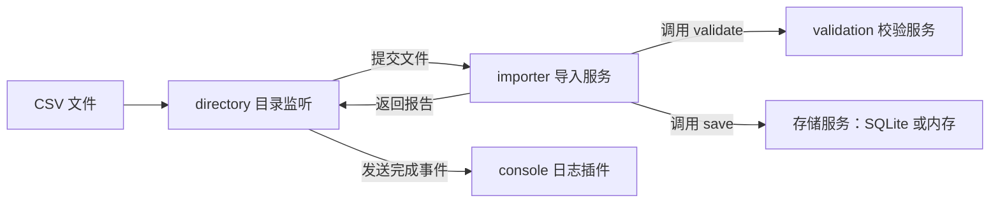

# Python Cordis：从一个可运行的例子开始

Cordis 是一个 Python 插件运行时。你把功能写成插件，声明它需要哪些服务，运行时负责安排启动、更新和退出，并清理插件登记的资源。

这份指南用一个订单导入程序说明它的用法：读取 CSV、校验金额、写入 SQLite；程序运行时修改配置，新规则会自动生效。只需要了解 Python 函数、类和基本的 `async` / `await`，就可以跟着操作。

阅读顺序：

1. [运行示例，看看它解决什么问题](#先运行起来)。
2. [修改一行配置，观察更新](#让配置修改自动生效)。
3. [读懂插件、服务和依赖](#读懂插件之间的关系)。
4. [自己挂载一个插件](#自己挂载一个插件)。

## 什么时候会用到 Cordis

假设你正在开发一个后台导入程序：

- 扫描目录，找到新增或修改过的 CSV。
- 按业务规则检查每一行订单。
- 把合法订单写入数据库，打印拒绝原因。

第一次实现这三个功能通常不难。程序长期运行后，会遇到更多问题：金额上限改了，谁来刷新规则？数据库连接要更换，正在导入的文件怎么办？关掉日志功能后，之前注册的监听器如何移除？

Cordis 用插件之间的依赖关系来管理这些变化。例如，导入插件依赖校验服务和数据库服务；其中一个服务更新时，运行时会让导入插件先退出，等新服务可用后再启动它。

应用需要动态启停功能、更新配置或管理多组资源时，这套机制会更有价值。一次性、执行完就退出的小脚本，通常用普通函数和上下文管理器就足够了。

## 先运行起来

要求 Python 3.11 或更新版本。使用 uv 时，从**仓库根目录**执行：

```bash
cd python
uv sync
uv run python -m examples.order_importer --demo
```

没有 uv，也可以安装当前源码后运行：

```bash
cd python
python3 -m venv .venv
.venv/bin/python -m pip install -e .
.venv/bin/python -m examples.order_importer --demo
```

这两组命令任选一组。下面的操作均在 `python/` 目录执行；使用虚拟环境安装的读者，可以把 `uv run python` 替换为 `.venv/bin/python`。

演示使用临时目录，不需要数据库服务器或 API Key。它会创建三条订单：

| 订单 | 金额 | 初始规则：金额不能超过 50 元 |
| --- | --- | --- |
| ORD-001 | 25 元 | 通过 |
| ORD-002 | 80 元 | 拒绝，超过上限 |
| ORD-003 | −5 元 | 拒绝，金额必须为正数 |

随后，演示程序把配置文件里的上限改成 100 元。下面是输出中的关键几行，其他日志已省略：

```text
[导入] orders.csv: 成功 1 行，拒绝 2 行
[演示] 将配置文件中的金额上限改为 100.00
[配置已更新] 金额上限 100.00，扫描间隔 0.1s，日志 True，存储 sqlite
[导入] orders.csv: 成功 2 行，拒绝 1 行
```

80 元的订单通过了新规则，负数订单仍被拒绝。数据库最终有两条订单；重复处理同一订单号会更新已有记录。接着，演示把存储提供方切换成内存，验证同一套导入逻辑可以继续使用。演示结束后会退出，并清理临时目录。

## 让配置修改自动生效

接下来启动常驻程序，让它等待你的修改：

```bash
uv run python -m examples.order_importer
```

打开 [`examples/order_importer/config.toml`](../examples/order_importer/config.toml)，找到 `[validation]`，把金额上限设置成：

```toml
[validation]
max_amount = "100.00"
```

保持终端中的程序运行，修改后保存，就会看到配置更新和再次导入的日志。金额写成带引号的十进制文本，由配置解析器转换为整数分。

这个示例每 0.2 秒检查一次配置内容。它完成了下面几步：

1. 读取并校验整份配置。
2. 把新的规则配置交给运行时，开始更新校验插件。
3. 导入插件因依赖变化而退出；正在处理的任务先按退出策略结束。
4. 新的校验服务就绪后，导入服务与目录监听重新启动，扫描已有 CSV，并使用新规则处理。

**自动检查配置文件是这个示例宿主实现的功能。** “宿主”就是读取配置、装配插件并保持程序运行的入口程序。Cordis 提供插件更新机制；宿主负责监听自己的配置、解析字段，再把变更交给运行时。

还可以尝试以下修改：

| 配置位置 | 修改 | 结果 |
| --- | --- | --- |
| `[importer]` | `interval = 2.0` | 目录扫描改为每 2 秒一次 |
| `[logging]` | `enabled = false` | 停用打印导入报告的插件，导入继续运行 |
| `[logging]` | `enabled = true` | 恢复后续导入报告的打印 |
| `[database]` | `provider = "memory"` | 换成内存存储，重新导入当前 CSV；内存数据在实例卸载后丢失 |
| `[database]` | `provider = "sqlite"` | 换回 SQLite，重新打开 `path` 指向的数据库 |

默认 CSV 在 [`examples/order_importer/incoming/`](../examples/order_importer/incoming/)，数据库在 `examples/order_importer/var/orders.sqlite3`。配置中的相对路径以配置文件所在目录为起点。新增或修改 CSV 也会触发处理；按 `Ctrl+C` 退出程序。

完整操作和数据处理规则见[订单导入实战](scenarios.md)。

## 读懂插件之间的关系

先分清**插件**和**服务**：插件是一组一起启动、一起退出的功能；服务是插件提供给其他插件使用的对象。

在这个程序里，它们的对应关系是：

| 插件 | 做什么 | 提供什么 / 依赖什么 |
| --- | --- | --- |
| `validation` | 根据配置创建校验规则 | 提供可以调用 `validate()` 的校验对象 |
| `database` / `memory` | 管理 SQLite 连接或内存数据 | 提供同一个存储接口，可以调用 `save()` |
| `importer` | 导入单个文件，返回报告 | 依赖校验和存储对象，提供导入服务 |
| `directory` | 扫描目录，提交新增或修改的文件 | 依赖导入服务，发布结果事件 |
| `console` | 监听导入完成事件，打印结果 | 接收事件，无需直接操作数据库 |



这是一张调用关系图。Cordis 会额外记录这些对象由哪个插件创建、哪些插件依赖它们，从而安排更新和清理顺序。

源代码也按职责分开：`definitions.py` 定义接口和请求、结果类型，`providers/` 实现具体能力，`consumers/` 负责目录监听与日志展示。提供方和调用方都依赖契约，互不导入对方的实现。完整的三角色设计与扩展步骤见[实战文档](scenarios.md#三角色如何分工)。

### 提供服务

下面摘自 [`providers/validation.py`](../examples/order_importer/providers/validation.py)，是完整的校验插件定义；其中的类型和校验类由该模块导入或定义：

```python
@plugin(provide=[VALIDATOR])
def validation(ctx: AppContext, config: ValidationConfig) -> None:
    ctx.provide(VALIDATOR, AmountValidator(config))
```

从上到下理解：

- `@plugin` 把这个函数声明为插件，装配时才会执行它。
- `provide=[VALIDATOR]` 声明它会提供校验服务。
- `config` 是这一次启动收到的配置。
- `ctx.provide(...)` 把实际的校验对象注册给运行时。

这里的 `ctx` 是 **Context（上下文）**：运行时传给插件的操作入口。插件通过它注册服务、读取依赖、监听事件和创建受管任务。

`VALIDATOR` 是带类型的服务键，定义在 [`definitions.py`](../examples/order_importer/definitions.py)：

```python
VALIDATOR = ServiceKey[OrderValidator]("orders.validator")
```

`OrderValidator` 描述校验对象应当支持的接口，`ServiceKey` 将这个接口与服务名关联起来。提供者和消费者共同导入同一个键；写错参数或传错服务类型时，mypy 可以帮助发现问题。

### 声明依赖

导入服务的声明和初始化如下，摘自 [`providers/csv.py`](../examples/order_importer/providers/csv.py)：

```python
@plugin(inject=[STORE, VALIDATOR], provide=[IMPORTER])
def importer(ctx: AppContext, _config: None) -> None:
    ctx.provide(IMPORTER, CsvImporter(ctx))
```

`inject=[STORE, VALIDATOR]` 表示存储和校验服务都可用后，这个函数才会运行。依赖还没准备好时，插件会等待；依赖更新时，它会退出并重新启动。

导入逻辑读取服务时使用 `ctx.validator` 和 `ctx.store`。这两个属性在 `AppContext` 上用服务键声明，既支持类型提示，也会执行运行时依赖检查。

目录监听是另一个插件，只声明 `inject=[IMPORTER]`。它通过 `ctx.importer.submit(ImportRequest(path))` 提交文件，等待得到 `ImportReport` 后再发布事件。它不需要知道文件如何解析、订单保存在哪里。

## 自己挂载一个插件

除了通过配置文件装配，也可以在 Python 入口中直接启动插件。将下面这份**完整程序**保存为 `python/try_validation.py`：

```python
import asyncio

from examples.order_importer.definitions import AppContext, ValidateOrderRequest
from examples.order_importer.providers.validation import ValidationConfig, validation


async def main() -> None:
    async with AppContext() as root:
        validator = root.use(
            validation, ValidationConfig(max_amount_cents=5000),
        )
        await validator
        print(root.validator.validate(
            ValidateOrderRequest("ORD-001", "Alice", "25.00"),
        ))

        await validator.update(ValidationConfig(max_amount_cents=10000))
        print(root.validator.validate(
            ValidateOrderRequest("ORD-002", "Bob", "80.00"),
        ))


asyncio.run(main())
```

在 `python/` 目录运行：

```bash
uv run python try_validation.py
```

输出：

```text
Order(order_id='ORD-001', customer='Alice', amount_cents=2500)
Order(order_id='ORD-002', customer='Bob', amount_cents=8000)
```

这份程序只装配校验插件，用来观察加载与配置更新。`5000` 和 `10000` 的单位是分，对应 50 元和 100 元。`ValidateOrderRequest` 是共享契约中的请求类型，把输入字段交给校验服务。

留意这三个名字，它们指向不同的对象：

| 名字 | 是什么 | 你用它做什么 |
| --- | --- | --- |
| `validation` | 插件定义，类型为 **Component** | 传给 `root.use()`，可以挂载多次 |
| `validator` | 本次挂载的运行句柄，类型为 **Fiber** | 等待启动、更新配置、重启或卸载 |
| `root.validator` | 插件注册的业务服务 | 调用 `validate()` 校验订单 |

**更新插件使用 Fiber，调用业务功能使用服务对象。** 默认的 `update()` 会在配置变化时重新运行插件；退出 `async with` 时，根 Context 会关闭它管理的运行时。

如果插件声明了尚未出现的依赖，`await fiber` 也可能在 `pending` 状态返回。它等待的是当前生命周期转换，并不会无限等待未来的服务。需要确认就绪时检查 `fiber.state`；完整写法见[使用教程](tutorial.md#4-装配派发和更新)。

## 配置文件怎样变成插件更新

常驻示例把“直接调用 `root.use()`”这一步交给了 **Loader（加载器）**。宿主先把 TOML 转成带类型的配置对象，再提供一份目标插件清单。

下面是 [`application.py`](../examples/order_importer/application.py) 中的装配语句；`config` 已经过解析和校验，`store_entry` 已按配置选择 SQLite 或内存插件：

```python
await self.loader.reconcile([
    Entry("console", console, enabled=config.logging),
    store_entry,
    Entry("validation", validation, config.validation),
    Entry("importer", importer),
    Entry("directory", directory, config.importer),
])
```

`Entry` 是一个配置条目，第一个参数是稳定的名字。`reconcile()` 会比较这份清单和已经运行的插件：新增条目就挂载，移除条目就卸载，已有条目的配置变化就更新。

因此，金额上限变化时，数据库配置没有变化，它的实例会保留；校验插件更新，依赖它的导入服务与目录监听会重新启动。扫描间隔变化只重启目录监听，日志开关变化只影响日志插件。

本例 TOML 中的 `[validation]`、`[database]` 是应用自己的配置格式。Cordis 原生 `Loader.load_file()` 使用 `[[plugins]]` 条目清单，两者通过不同的解析入口处理。需要直接使用原生格式时，看[使用教程中的 TOML 加载](tutorial.md#从-toml-加载)。

## 资源与退出

写插件时，还需要说明资源如何释放。Cordis 会自动撤销通过 Context 注册的服务和监听器；插件自己打开的文件、连接等资源，需要登记清理函数。

例如，数据库插件创建连接后，立即登记关闭操作。下面是它的初始化片段：

```python
connection = sqlite3.connect(config.path)
store = SQLiteStore(connection)
yield store.close
```

生成器里的 `yield` 把清理操作交给运行时，然后继续初始化。后续步骤失败或插件退出时，已经登记的关闭操作仍会执行。多个资源按登记的相反顺序清理。

文档中把这类有生命周期的操作称为 **Effect**；把插件运行所需的依赖条件称为 **Coeffect**。它们分别对应“我创建了什么，需要怎样清理”和“我要运行，需要什么服务”。

后台任务也需要归属到插件。订单示例区分两种任务：

| 任务 | 策略 | 插件退出时 |
| --- | --- | --- |
| directory 插件持续扫描目录 | `policy="cancel"` | 请求取消，等待扫描循环退出 |
| importer 插件正在导入一个文件 | `policy="drain", timeout=5` | 最多等待 5 秒自然完成，随后请求取消并等待清理 |

运行时会先处理消费者的任务和资源，再关闭它依赖的数据库。这个顺序要求任务通过 `ctx.spawn()` 或异步事件监听器登记；普通 `asyncio.create_task()` 不会自动加入插件管理。

这里的超时是退出阶段的等待时间。取消需要协程响应，已经提交到数据库的订单也不会因为插件卸载而自动撤回。

## 遇到问题时先看哪里

| 现象 | 先检查什么 |
| --- | --- |
| 插件没有启动，状态是 `pending` | 它声明的服务是否已经提供；隔离过服务时，提供者和消费者是否在同一个域 |
| `await loader.reconcile()` 返回了，但功能不可用 | 检查对应 Fiber 的状态和错误；调用返回不等于所有插件已经成功激活 |
| TOML 修改后报错 | 看终端中的配置错误；本例会继续监听，修正内容后保存即可 |
| 收不到导入报告 | 检查日志插件是否启用、CSV 是否发生变化、是否存在导入失败日志 |
| 停止程序时长时间没有退出 | 检查未完成的任务、阻塞操作和没有返回的清理函数 |

当前版本适合学习和受控试点。配置的整体回滚、并发更新和资源容量管理仍有不足，关键生产业务需要额外加固；具体问题见[实现与维护参考](implementation.md#当前限制与风险)。

## 接下来读什么

| 你想继续做什么 | 文档 |
| --- | --- |
| 从头编写自己的插件 | [使用教程](tutorial.md) |
| 查询方法参数、返回值和异常 | [API 参考](api.md) |
| 理解 Context、Fiber、隔离域等概念 | [核心概念](core-concepts.md) |
| 了解 Protocol、服务键和配置类型检查 | [类型化插件开发](typing.md) |
| 扩展 CSV 导入业务或寻找其他场景 | [场景与配置自动更新](scenarios.md) |
| 阅读源码、排查更新失败或参与维护 | [实现与维护参考](implementation.md) |
